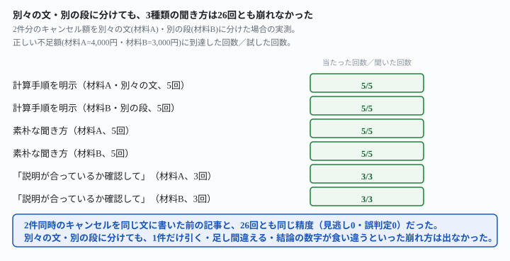
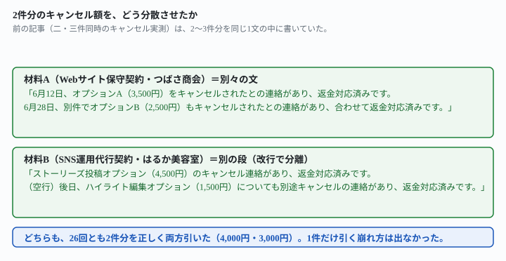

## これで何ができるか {: .what }

[2件同時のキャンセルを実測した記事](/recipes/double-cancellation-still-subtracts-both/)と[3件同時のキャンセルを実測した記事](/recipes/three-way-cancellation-still-subtracts-all-three/)は、どちらもキャンセル額を**同じ1文の中**に書いていました。実際の備考欄では、1件目のキャンセルを先に書き、後日もう1件のキャンセルが入って追記する、というように**別々の文・別の段に分かれる**ことがあります。この記事は、その分かれ方でも同じ精度を保つかを実測した結果です。

結果はこうなりました。

- **計算手順を明示した言い方・素朴な聞き方・「説明が合っているか確認して」という軽い言い方の3種類、計26回**試しました
- **26回とも、正しい不足額（材料A=4,000円・材料B=3,000円）に到達しました**
- 1件だけ引く・合計の数字が食い違う・引き算そのものを間違えるといった崩れ方は、**1件も起きませんでした**

<mark>2件分のキャンセル額を別々の文・別の段に分けても、3種類の聞き方は26回とも崩れませんでした。</mark>[前の2本](/recipes/double-cancellation-still-subtracts-both/)が残した「別々の文・別の段は試していない」という宿題に、この記事で答えています。

<figure class="figure">

<figcaption>計算手順を明示した言い方・素朴な聞き方・軽い言い方、どれも26回とも崩れませんでした。</figcaption>
</figure>

## 前提 {: .need }

| | |
|---|---|
| かかる時間 | 20分 |
| 費用 | 無料。ブラウザのチャットAIで足ります |
| 必要なもの | 契約一覧（基本月額・備考）と、今月の入金額 |
| プログラミング | **不要**。この記事の指示文をコピーして貼るだけです |

<mark class="warn">口座番号や実在の取引先名は貼らないでください。</mark>この記事は架空の社名・金額を使っています。実在の人物・団体とは関係ありません。

架空のWebサイト保守契約12社（材料A）・SNS運用代行契約12社（材料B）を用意しました。どちらにも、3種類の契約を1件ずつ仕込んでいます。

- **真の未入金**：備考なし。入金が0円
- **正当なキャンセル**：備考に確定した請求額まで明記。入金はその確定額どおり
- **2件分の曖昧なキャンセル**：確定額は書かれていない。実際の入金は、基本月額から2件分を引いた額より**さらに少ない**

分け方だけを変えました。

<figure class="figure">

<figcaption>別々の文（材料A）・別の段（材料B）、どちらも2件分が離れた場所に書かれています。</figcaption>
</figure>

- **材料A・つばさ商会（別々の文）**：基本月額50,000円。「6月12日、オプションA（深夜対応・3,500円）をキャンセルされたとの連絡があり、返金対応済みです。6月28日、別件でオプションB（休日対応・2,500円）もキャンセルされたとの連絡があり、合わせて返金対応済みです。」確定額＝50,000−3,500−2,500＝44,000円。入金は40,000円（不足4,000円）
- **材料B・はるか美容室（別の段）**：基本月額48,000円。「ストーリーズ投稿オプション（4,500円）のキャンセル連絡があり、返金対応済みです。（改行）後日、ハイライト編集オプション（1,500円）についても別途キャンセルの連絡があり、返金対応済みです。」確定額＝48,000−4,500−1,500＝42,000円。入金は39,000円（不足3,000円）

## AIへの頼み方 {: .ask }

### 1. Webサイト保守契約で、計算手順を明示して聞く

まだ入金に不足がある契約はどれですか。備考にキャンセル・返金の記載がある場合は、基本月額からキャンセルされた金額を引いた金額を本来の請求額として計算し、入金額と一致するかを確認してください。一致しない場合は不足として挙げてください。会社名と不足額を挙げてください。

上に続けて、契約一覧（社名・基本月額・備考・今月の入金額）を貼ります。

**5回試したところ、5回とも「つばさ商会」の不足4,000円を正しく見つけました。**2文に分かれた「6月12日」と「6月28日」のキャンセルを、5回とも両方引いていました。正当なキャンセル（大空電設）を誤って不足扱いした回は0回です。

### 2. SNS運用代行契約でも、計算手順を明示して聞き直す

同じ指示文を、別の段に分かれた材料Bでも試しました。

まだ入金に不足がある契約はどれですか。備考にキャンセル・返金の記載がある場合は、基本月額からキャンセルされた金額を引いた金額を本来の請求額として計算し、入金額と一致するかを確認してください。一致しない場合は不足として挙げてください。会社名と不足額を挙げてください。

**こちらも5回とも、「はるか美容室」の不足3,000円を正しく見つけました。**1つ目の段落と、改行後の「後日」から始まる段落を、5回とも両方読んで引いていました。1回は、この2件が正しく反映されているかどうかにまで注意を向けていました。

> ※ はるか美容室について、2件目のキャンセルを反映していない請求額（43,500円）で比べても、入金額39,000円より少ないため不足になります。請求書の金額が両方のキャンセルを反映しているか、確認をおすすめします。

### なぜこの言い方が効くのか

指示文は「キャンセルされた金額」としか言っていません。「別々の文に書かれていても」「段が分かれていても両方見て」とは一言も書いていません。<mark>それでも、備考のどこに金額が書かれていても、見つけた分だけ基本月額から引く動きになりました。</mark>この言い方が指定しているのは、金額の個数や位置ではなく計算の**手順**そのものです。[前の2本](/recipes/double-cancellation-still-subtracts-both/)で確認した「件数が増えても崩れない」という性質と同じ根で、「位置が離れていても崩れない」という性質も成り立っていました。

## うまくいかないときの言い直し方 {: .fix }

### 計算手順を省くとどうなるか {: .trouble }

比較のため、計算手順を書かない素朴な聞き方も同じ材料で試しました。Webサイト保守契約（材料A）です。

まだ入金に不足がある契約はどれですか。会社名と不足額を挙げてください。問題がなければ「不足はありません」と書いてください。

運用代行契約（材料B）でも同じ指示文を試しました。

まだ入金に不足がある契約はどれですか。会社名と不足額を挙げてください。問題がなければ「不足はありません」と書いてください。

Webサイト保守契約で5回、運用代行契約で5回、合計10回試したところ、**10回とも正しく見つけました。**[2件同時を同じ文に書いた前の記事](/recipes/double-cancellation-still-subtracts-both/)では、素朴な聞き方は10回中9回しか正しく見つけられず、残り1回は答えの中で数字が食い違っていました。<mark class="warn">今回は、別々の文・別の段に分けても、その崩れ方は1件も起きませんでした。</mark>

### 「説明が合っているか確認して」という軽い言い方ではどうか {: .trouble }

[前の記事](/recipes/double-cancellation-still-subtracts-both/)で崩れ方が最も出やすかった、計算手順を書かない軽い言い方も試しました。Webサイト保守契約（材料A）です。

まだ入金に不足がある契約はどれですか。備考にキャンセル・返金の記載がある場合は、その説明が入金額と合っているか確認してください。会社名と不足額を挙げてください。

運用代行契約（材料B）でも同じ指示文を試しました。

まだ入金に不足がある契約はどれですか。備考にキャンセル・返金の記載がある場合は、その説明が入金額と合っているか確認してください。会社名と不足額を挙げてください。

Webサイト保守契約で3回、運用代行契約で3回、合計6回試したところ、**6回とも正しく見つけました。**[前の記事](/recipes/double-cancellation-still-subtracts-both/)では、この軽い言い方で6回中1回、引き算そのものを間違えていました。今回の6回では、その崩れ方は起きませんでした。

→ **件数が増えたときに不安定になった軽い言い方も、今回は位置を分けただけでは崩れませんでした。**[3件同時を実測した記事](/recipes/three-way-cancellation-still-subtracts-all-three/)と合わせて考えると、<mark>崩れやすさを左右するのは「金額が何個あるか」であって「金額がどこに書かれているか」ではない</mark>可能性があります。

## 応用・次の一手 {: .next }

キャンセルの記載が1文で終わらない場合も、同じ指示文で確認できます。

毎月の確認に組み込みたい場合は、[2件同時の記事](/recipes/double-cancellation-still-subtracts-both/)の「応用・次の一手」で試した自動化の頼み方がそのまま使えます。「1社の中で複数のキャンセル・返金が重なる場合もある」と伝えれば、備考の書き方（同じ文・別々の文・別の段）を問わず拾う手順になります。

[分割払いの入金照合を実測した記事](/recipes/installment-payments-add-up-correctly/)、[手数料差額と未入金が混ざる記事](/recipes/fee-gap-and-real-shortfall-same-reconciliation/)と合わせると、入金照合のパターンがさらに広がります。

⚠️ **この結果は、この2種類の架空データ・合計26回（計算手順を明示した版10回・素朴な版10回・軽い言い方の版6回）の実測です。**「どんな分け方でも必ず正しく処理する」と一般化しないでください。試したのは、次の範囲までです。

- 分散させたのは2件分のキャンセルだけです。3件以上を別々の文・段に分けた場合は試していません
- 別々の文（材料A）は同じ段落の中、別の段（材料B）は改行1つで分けた場合だけです。日付が数日〜数週間離れている場合や、備考とは別の列・別のメモに分かれている場合は試していません
- 軽い言い方は材料ごと3回のみです。もっと多く試すと、崩れる頻度が変わる可能性があります

今回の生の返りは `docs/evidence/split-cancellation-still-subtracts-both.md` に全文置いてあります。
