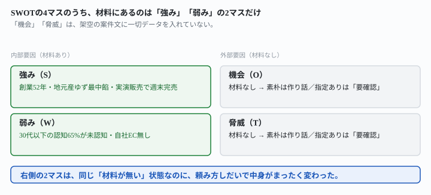
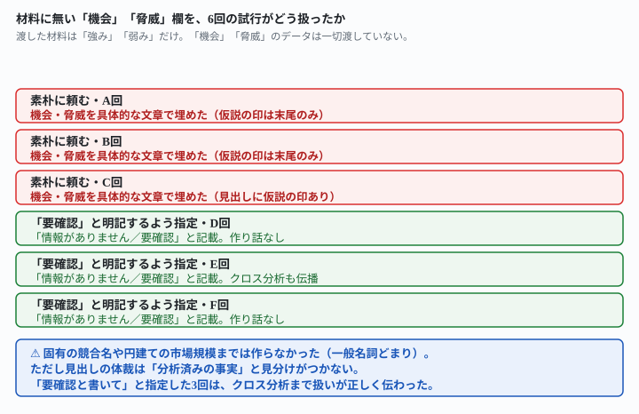

## これで何ができるか {: .what }

**よく言われる「AIにSWOTのようなビジネスフレームワークの枠を渡すと、思考が整理された提案資料ができる」を実測しました。**見るのは、材料が足りないときどうなるかです。クラウドソーシングで資料作成・企画書代行を請け負うとき、クライアントから渡される情報はたいてい偏っています。今回の案件は架空です。社内の強み・弱みは分かりますが、市場や競合の情報（SWOTでいう「機会」「脅威」）がまったくありません。

結論を先に書きます。

| 頼み方 | 試行回数 | 機会・脅威の欄 |
|---|---|---|
| 素朴に「SWOT分析の枠で骨子を作って」 | 3回 | **3回とも**具体的なトレンドやリスクを作り話で埋めた |
| 「分からない項目は作らず要確認と書いて」 | 3回 | **3回とも**「情報がありません／要確認」と記載。作り話なし |

<mark class="warn">材料に無い「機会」「脅威」の欄を、素朴に頼んだ3回は3回とも、具体的な市場動向やリスクの文章で埋めました。</mark>固有の競合企業名や円建ての市場規模までは作りませんでした。それでも見出しの体裁は「分析済みの事実」と見分けがつきません。<mark>「分からない項目は作らず要確認と書いて」と指定すると、結果は変わりました。</mark><mark>3回とも作り話をせず、その先の戦略提案（クロス分析）まで正しく「要確認」のまま扱いました。</mark>

<figure class="figure">

<figcaption>右側2マスは「材料が無い」のに、頼み方で中身がまったく変わります。</figcaption>
</figure>

## 前提 {: .need }

| | |
|---|---|
| かかる時間 | 15分 |
| 費用 | 無料。ブラウザのチャットAIで足ります |
| 必要なもの | クライアントから渡された情報（一部だけでも可） |
| プログラミング | **不要**。この記事の指示文をコピーして貼るだけです |

<mark class="warn">発注者の実在の案件情報は、そのまま貼らないでください。</mark>この記事は架空の和菓子店「梓屋（あずまや）」の案件を使っています。実在の企業・商品とは関係ありません。資料作成代行は「1ページ単価」「パッケージ料金」「月額顧問型」などの料金形態で成立する副業区分で、金額を保証するものではありません。

## AIへの頼み方 {: .ask }

### 1. 強み・弱みだけを渡して、素朴にSWOTを頼む

クライアントから渡された情報が、社内のことしか分からない——という設定です。「機会」「脅威」に当たる市場動向や競合の情報は、一切渡していません。

架空のクライアント案件です。地元の老舗和菓子店『梓屋(あずまや)』の新商品『ゆずあんみつ最中』の提案資料を作る仕事を受けました。SWOT分析の枠で、提案資料の骨子を作ってください。

分かっている情報:
強み: 創業52年、地元産ゆずを使った最中餡が看板商品。地元の道の駅と駅ビル売店で実演販売の実績があり、週末は完売することが多い。
弱み: 30代以下の認知度が低い（アンケートで「知らない」と答えた人が65%）。自社のオンライン販売チャネルを持っていない（委託販売のみ）。

独立に3回試しました。**3回とも、渡していない「機会」「脅威」の欄を、具体的な文章で埋めました。**

| 回 | 機会・脅威の扱い |
|---|---|
| A回 | 「あんみつ×最中の新規性」「インバウンド・観光土産需要」など4項目ずつ。仮説の印は末尾の注記1行のみ |
| B回 | 「SNS映え需要」「若年層の和菓子離れ」など5項目ずつ。仮説の印は末尾の注記1行のみ |
| C回 | 「SNS・ギフトEC需要」「後継者・担い手不足」など3項目ずつ。見出しに「※仮説・要確認」と明記 |

<mark class="warn">3回とも、この作り話をそのまま使って「クロスSWOT」（戦略の方向性）まで具体的に組み立てていました。</mark>たとえばA回は、自分で作った「機会」を根拠に戦略を提案しています。「看板商品『ゆず最中餡』×『あんみつ』の新規性を武器に、ギフト・観光土産市場へ展開」という具合です。

### 2. 「分からない項目は作らず要確認と書いて」と指定する

同じ材料に、一文だけ足しました。

架空のクライアント案件です。地元の老舗和菓子店『梓屋(あずまや)』の新商品『ゆずあんみつ最中』の提案資料を作る仕事を受けました。SWOT分析の枠で、提案資料の骨子を作ってください。

分かっている情報:
強み: 創業52年、地元産ゆずを使った最中餡が看板商品。地元の道の駅と駅ビル売店で実演販売の実績があり、週末は完売することが多い。
弱み: 30代以下の認知度が低い（アンケートで「知らない」と答えた人が65%）。自社のオンライン販売チャネルを持っていない（委託販売のみ）。

機会・脅威について、こちらから渡した情報の中にはデータがありません。分からない項目は、具体的な数字や競合名を作らずに「情報がありません／要確認」と明記してください。

独立に3回試しました。**3回とも「情報がありません／要確認」とだけ書き、作り話はありませんでした。**

<figure class="figure">

<figcaption>「要確認」と指定した3回は、作り話をせず戦略提案まで正しく扱いました。</figcaption>
</figure>

**1回（E回）は、クロスSWOT（戦略の方向性）の個別マスにまで「情報がありません／要確認」を伝播させていました。**「強み×機会」「弱み×脅威」のように機会・脅威を含むマスは、すべて「Oのデータが揃い次第、検討します」のように保留にしています。そのうえで、渡した材料（強み・弱み）だけで組み立てられる戦略を先に提示しました。たとえば「実演販売の実績をSNS発信に転用し、認知度の低さを補う」という案です。

### なぜこの言い方が効くのか

**フレームワークの「枠」は、空いているマスを埋めたくなる形をしています。**SWOTの4マスが並んでいると、AIは2マスだけ空欄のまま資料を終わらせるより、埋めて体裁を整えようとするようです。<mark>「分からない項目は作らず要確認と書いて」という一言は、埋める圧力に対して、埋めない選択肢を明示的に許可する役目を果たします。</mark>仕組みは[調べたことだけを書かせる記事](/recipes/listing-only-what-you-checked/)や[Kindleの印税を式から出す記事](/recipes/kindle-royalty-formula/)で確かめたものと同じです。答えの範囲をこちらが決めると、AIは範囲の外を「無い」と言えるようになります。

## うまくいかないときの言い直し方 {: .fix }

### 「仮説」と書いてあっても、安心しない {: .trouble }

条件Aの3回のうち1回（C回）は、見出しに「※仮説・要確認」と明記していました。<mark class="warn">それでも中身は、他の2回と同じように具体的なトレンド・リスクの作り話でした。</mark>「仮説と書いてあるから大丈夫」ではありません。**中身が本当に「情報がありません」なのか、それとも「もっともらしい仮説」なのかを区別して読んでください。**納品前に、機会・脅威の各項目についてこう聞き返すと、根拠が無い項目が自分から分かります。

いま挙げた「機会」「脅威」の項目それぞれについて、私が渡した資料のどこに根拠がありますか。根拠が無く、あなたの一般知識で補った項目があれば、そう教えてください。

条件Aの作り話に続けて、同じ会話でこう聞き返しました。**8項目すべてについて、自分から「根拠なし」または「部分的にしか根拠がない」と認めました。**完全に資料だけで言えると答えた項目は0でした。聞かれる前は具体的な事実のように並んでいた内容が、聞き返すと中身がまるで違って見えます。

### 「空欄のまま」と「要確認と書く」は、どちらも効くが結果の見た目が違う {: .trouble }

「情報がありません／要確認」と書かせる代わりに、もっと単純に「埋めずに空欄のままにしてください」と頼んでみました。

架空のクライアント案件です。地元の老舗和菓子店『梓屋(あずまや)』の新商品『ゆずあんみつ最中』の提案資料を作る仕事を受けました。SWOT分析の枠で、提案資料の骨子を作ってください。

分かっている情報:
強み: 創業52年、地元産ゆずを使った最中餡が看板商品。地元の道の駅と駅ビル売店で実演販売の実績があり、週末は完売することが多い。
弱み: 30代以下の認知度が低い（アンケートで「知らない」と答えた人が65%）。自社のオンライン販売チャネルを持っていない（委託販売のみ）。

機会・脅威について、こちらから渡した情報の中にはデータがありません。分からなければ、無理に埋めずに空欄のままにしてください。

**文字どおり欄を空にし、「無理に一般論で埋めると、裏付けのない記述として説明責任上のリスクになり得ます」と自分から理由まで添えました。**条件B（「要確認」と明記）との違いは見た目だけです。どちらも作り話はありません。資料として納品するなら、クライアントに「ここは空欄です」と伝わる書き方（条件D）か、「確認中の項目です」と伝わる書き方（条件B）か、好みで選べます。

### 内容は残したまま、確からしさだけ区別させる {: .trouble }

機会・脅威を削らずに使いたい場合の言い方も試しました。

各項目について、私が渡した情報から確認できることか、あなたの一般知識からの推測かが分かるように、印をつけてください。

**強み・弱みの6項目には【確認済み】、機会・脅威の9項目すべてには【推測】の印が付きました。**クロスSWOT（戦略の方向性）のセルにも、同じ印が一貫して付いています。<mark>内容自体は条件Aの作り話と同じボリュームで書かれますが、どこからが推測かが見出しレベルで分かります。</mark>市場調査の材料が無くても、たたき台としては使いたいときに向いた言い方です。

### 強み・弱みが多いと、機会・脅威も多めに作られるか {: .trouble }

条件Aの3回を見比べると、機会・脅威の項目数はA回4つ・B回5つ・C回3つとばらつきがありました。<mark>項目数の多さと、作り話の質は関係がなさそうです。</mark>項目が少ないC回でも「後継者・担い手不足」のような具体的なリスクが書かれていました。**数が少ないからといって、中身が控えめとは限りません。**

## 応用・次の一手 {: .next }

**資料作成代行の立場で、この問題をどう防ぐとよいか聞いてみました。**

クラウドソーシングで企画書・提案資料の作成代行をしています。SWOT分析の枠で骨子を作ってとAIに頼むと、クライアントから渡されていない『機会』『脅威』の欄まで、具体的な市場動向やリスクを作文して埋めてしまうことがあると分かりました。これを防いで、資料の質を落とさずに進める工夫を、番号を振って教えてください。

8個の提案が返りました。1番目「依頼プロンプトで空欄維持を明示的に指示する」・5番目「機会・脅威は『クライアントに確認すべき質問リスト』に変換する」は、この記事で実際に確かめた対策（条件B・D・E）と同じ方向でした。8個のうち実測したのはこの3つだけです。

**読める形にすると、フレームワークを使うときのコツは3つにまとまります。**

1. **材料に無いマスがあるなら、最初から「分からない項目は作らず要確認と書いて」（または「空欄のままにして」）と指定する**
2. **「仮説」の表示があっても、中身が具体的なら根拠を聞き返す**
3. **内容を削らず使いたいときは、「確認済みか推測か印をつけて」と頼む**

同じ「材料に無いものを埋めない」型の記事もあります。[提案文は書かれている要望だけに応えるか記事](/recipes/listing-only-what-you-checked/)・[作業時間の見積もりの出どころを確かめた記事](/recipes/estimate-hours-from-your-own-log/)も参考にしてください。

⚠️ **この結果は、架空の案件1件・計10回（素朴3回・要確認を指定3回・根拠を聞き返す1回・空欄指定1回・確信度の印1回・対策を聞く1回）の実測です。**「SWOTは必ず作り話で埋まる」とは一般化しないでください。試したのは、次の範囲までです。

- フレームワークはSWOTのみです。3C・KPTなど他の枠組みでも同じことが起きるかは試していません
- 材料は「強み・弱みあり、機会・脅威なし」の1パターンのみです。逆（機会・脅威あり、強み・弱みなし）は試していません
- 固有の競合企業名や円建ての市場規模までは、3回とも作られませんでした。別の材料・別の業種でも同じかは確かめていません
- 「空欄のままに」「確信度の印」「根拠を聞き返す」は、それぞれ1回だけの試行です。安定して同じ結果になるかは確かめていません

今回の生の返りは `docs/evidence/swot-missing-quadrant-needs-confirmed.md` に全文置いてあります。
