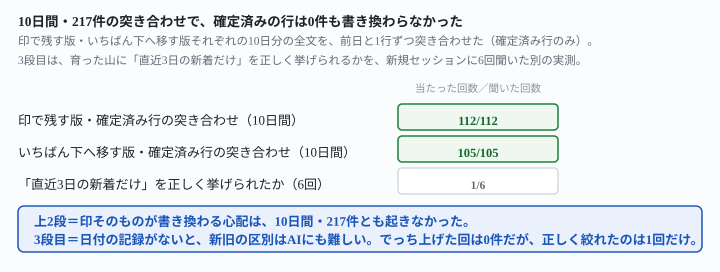
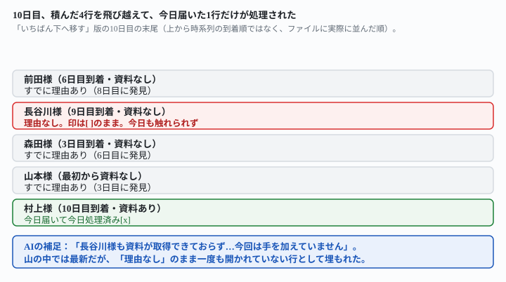

## これで何ができるか {: .what }

[やることリストをAIに毎日1件ずつ進めさせる](/recipes/queue-done-marks-that-survive/)は、処理できない行の行き先を試した記事です。ただし測ったのは**2回転**まででした。[待ち行列の止まった行を週1回で数える](/recipes/fresh-easy-row-throws-off-the-stuck-count/)がその続きを10日間の連鎖で測っています。ただし見ていたのは「止まった行は何件か」という**件数**だけです。

この記事は、同じ10日間の連鎖データを使って、まだ誰も見ていない2点を確かめます。

1. 確定済みの行は、後から静かに書き換わらないか
2. 行き先に積んだ行が増えたとき、新しく届いた行は古い行と混同されずに識別できるか

結論は3つです。

<figure class="figure">

<figcaption>確定済みの行は217件とも無事。新旧の見分けだけは別問題でした。</figcaption>
</figure>

**① 心配していた事故は起きませんでした。**<mark>確定済みの行（済・できない印）を10日間・217件突き合わせて、後から書き換わったものは0件です</mark>。印で残す版・いちばん下へ移す版のどちらも崩れていません。これで[前作](/recipes/queue-done-marks-that-survive/)が残した「下に溜まった行が10日後にどうなっているかは分かりません」という宿題に答えが出ました。

**② かわりに、「1件だけ」という約束が崩れました。**止まった行に当たった日、AIは印を付けるだけで止まらず、<mark>続けて次の1件まで処理した回があります</mark>。6回の「止まった行に初めて当たった日」のうち、いちばん下へ移す版は3回とも、印で残す版は1回だけ、2件ぶん進みました。

**③ 積んだ行の山は、丸ごと飛び越えられることがあります。**いちばん下へ移す版の10日目、<mark class="warn">今日届いたのに誰にも見られていない止まった行が、印も理由もつかないまま山の中に取り残されました</mark>。AIはその行を飛び越えて、もっと新しく届いた簡単な行だけを先に処理しています。

## 前提 {: .need }

| | |
|---|---|
| かかる時間 | 30分。[前作](/recipes/queue-done-marks-that-survive/)を先に読むと早いです |
| 費用 | 無料。無料のチャットAIで足ります |
| 必要なもの | ブラウザで使えるAI（ChatGPT・Claude・Geminiなど）と、テキストファイル1つ |
| プログラミング | **不要**。ファイルは箇条書きのメモで構いません |

⚠️ **待ち行列を毎日1件ずつ処理させる形そのものは[やることリストをAIに毎日1件ずつ進めさせる](/recipes/queue-done-marks-that-survive/)にあります。**週1回の件数の数え方は[待ち行列の止まった行を週1回で数える](/recipes/fresh-easy-row-throws-off-the-stuck-count/)・[待ち行列90日分も件数は狂わない](/recipes/stuck-rows-hold-the-count-at-scale/)にあります。この記事は、それを**10日間の実際の連鎖**で動かしたとき、確定済みの行の内容そのものと、新旧の見分けだけを扱います。

📌 **この記事の実測は、[待ち行列の止まった行を週1回で数える](/recipes/fresh-easy-row-throws-off-the-stuck-count/)が生成した10日分の全文ログを使っています。**生成は独立プロセスによる既存の実測データで、ここでは新しい観点で機械照合し直しました。材料と10日間の連鎖そのものは前作と同じです。新しく行ったのは「確定済み行の突き合わせ」と「新旧を問う6回の追加実測」です。

## AIへの頼み方 {: .ask }

### 1. 10日間の連鎖で、確定済みの行を突き合わせる

毎日使う指示文は、前作とまったく同じです。**材料は1本（問い合わせ対応の待ち行列、最初は10行）です。**1日1行の新着を10日間足しながら、前日の「更新後の待ち行列の全文」をそのまま次の日の入力にしました。

下は、毎朝1件ずつ処理している待ち行列です。未処理のものを1件だけ処理して、済の印を付けてください。処理した中身と、更新後の待ち行列の全文を書いてください。

印は「- [x] 」で始まる形に固定してください。ほかの行は1文字も変えないでください。

処理できなかった行は「- [!] 」にして、できなかった理由を次の行に書いてください。処理できなかった行を「- [x] 」にはしないでください。

10日分の全文を、前日と1行ずつ機械で突き合わせました。条件は「前の日に済・できない印がついた行は、名前・印・資料欄・理由欄まで1文字も変わらず残っているか」です。

| | 突き合わせた確定済み行 | 不一致 |
|---|---|---|
| 印で残す版 | 112件 | **0件** |
| いちばん下へ移す版 | 105件 | **0件** |

10日間・217件の突き合わせで、確定済みの行が後から書き換わった事故は1件もありませんでした。前作の32回（2回転×16系列）に続き、10回転でも崩れていません。

### 2. 止まった行に当たると、1件では止まらないことがある

🔑 **ここが見立てと違っていました。**「1件だけ処理してください」という指示文は、**止まった行をどう扱うかまでは決めていません**。3日目、両方の版で同じことが起きました。AIの返りには、こう書いてあります——「山本様を処理できなかったため、次の未処理の松本様を1件処理しました」。山本様を止まった行として処理した**あと**、松本様まで進めています。<mark class="warn">「1件だけ」のつもりが、止まった行に当たった日は2件ぶん進みました</mark>。

| | 止まった行に初めて当たった日 | 2件ぶん進んだ回 |
|---|---|---|
| 印で残す版 | 3日目・6日目・9日目（3回） | **1回** |
| いちばん下へ移す版 | 3日目・6日目・8日目（3回） | **3回** |

いちばん下へ移す版は3回とも2件ぶん進みました。印で残す版は最初の1回だけで、6日目・9日目は印を付けて素直に止まっています。<mark>n=3・n=3という小さい数字なので、「いちばん下へ移す版のほうが必ず2件進む」とまでは言えません</mark>。ただ**「止まった行＝その日は1件も進まない」という思い込みは外れました**。

🔑 **なぜこうなるか**＝「止まった行を『- [!] 』にする」ことを、AI自身が「1件の処理」として数えていないためです。指示文に「止まった行も1件に数える」という一文はありません。数に入れたいなら、受け皿（[AIに「ついでに整理しておきました」と言わせない頼み方](/recipes/limit-what-ai-touches/)の型）と同じように、ここも明示する必要があります。

未処理のものを1件だけ処理してください。止まった行に「- [!] 」を付けることも1件に数えてください。その日に2件以上は進めないでください。

止まった行にまた当たる場面（5日目の状態＋6日目の新着）を使い、この一文を足して2回試しました。<mark>2回とも、止まった行だけを動かして止まり、次の行には手を付けませんでした</mark>。

### 3. 行き先に積んだ山は、丸ごと飛び越えられる

これがいちばん見過ごしやすい崩れです。いちばん下へ移す版の10日目、待ち行列の末尾はこうなっていました。

<figure class="figure">

<figcaption>長谷川様だけ、理由も印もつかずに山の中に取り残されました。</figcaption>
</figure>

**9日目に届いた長谷川様も、資料が「（取得できませんでした）」の止まった行です。**ところが10日目、AIが実際に処理したのは**その日に届いたばかりの村上様（資料あり）だけ**でした。AIの返りには、こう書いてあります——「長谷川様も資料が取得できておらず、処理できない状態です。ただ、この行には『できなかった理由』がありません。『ほかの行は1文字も変えない』というご指示に従い、今回は手を加えていません」。

<mark class="warn">AIは長谷川様が止まっていることに気づいています。それでも、その行には触れず、もっと新しく届いた簡単な行だけを先に処理しました</mark>。結果、長谷川様は10日間ずっと「`- [ ]`」のまま、理由も印もつかずに残っています。**見た目は「まだ何も試していない行」と「資料が無くてどうしても処理できない行」が、まったく同じです。**

🔑 **なぜこうなるか**＝「いちばん下へ移す」運用は、止まった行が溜まるたびに末尾に積み重なります。新しい到着は、その山のさらに下に付きます。まだ理由を書いていない新着が、その山に紛れることがあります。<mark>すると、AIは「山の中で今できることを探す」側に回り、古い順・到着順には処理しません</mark>。印で残す版では起きませんでした。止まった行がもとの位置に残るので、山の中に紛れ込むことがないためです。

### 4. 育った山に「直近の新着だけ」と聞いても、正しく絞れない

最後に、10日目の状態を**新規セッション**に見せました。「直近3日以内に新しく届いた、止まった行だけ」を6回聞いています（印で残す版・いちばん下へ移す版それぞれ3回）。

下は、問い合わせ対応の待ち行列の現在の状態です。週に1回だけ目を通すとして、直近3日以内に新しく届いた行の中で、資料が取得できておらず、このままでは処理されない行はどれですか。該当するものを名前で教えてください。古くから止まっている行は、今回は聞いていません。

正解は**長谷川様1件だけ**です。6回のうち5回は、何日も前から止まっている山本様・森田様・前田様までまとめて「新着の可能性が高い」として挙げました。正しく長谷川様だけを切り出せたのは1回です。

<mark>6回とも、日付の情報が無いことを自分から指摘し、受信日を**でっち上げた回は0件**でした</mark>。これは誠実な態度です。ただし<mark class="warn">日付を記録していないと、AI自身も新旧を見分けられません</mark>。

📌 **直し方は簡単です。**止まった行を作るとき、理由の行に発見した日付を添えてください。

処理できなかった行は「- [!] 」にして、次の行に「理由: ◯◯（確認日: 2026-11-07）」の形で書いてください。

この形で書かせたところ、3回とも指定どおりの形で確認日が入りました。さらに、10日目の状態に実際の発見日（3日目・6日目・8日目）を確認日として書き足し、「確認日が直近3日以内の行はどれですか。確認日が無い行は別枠で」と3回聞き直しました。<mark>3回とも、直近3日以内の行・それより前の行・確認日が無い長谷川様の3つを、取り違えずに分けました</mark>。日付さえ付けば、新旧の見分けはAIにもできます。

## うまくいかないときの言い直し方 {: .fix }

### 止まった行に当たった日、2件以上処理されてしまう {: .trouble }

2番の症状です。「1件だけ」に止まった行も数えさせます。

未処理のものを1件だけ処理してください。止まった行に「- [!] 」を付けることも1件に数えてください。その日に2件以上は進めないでください。

### 行き先に積んだ行が増えて、週1回の確認が追いつかない {: .trouble }

[待ち行列90日分も件数は狂わない](/recipes/stuck-rows-hold-the-count-at-scale/)の3番の指示文を使ってください（「資料の行が『（取得できませんでした）』になっている行だけを数えてください」）。これなら件数自体は何件に育っても正しく数えられます。ただし<mark class="warn">「直近の新着だけ」という新旧の絞り込みは、この記事のとおり別問題です</mark>。日付を添えていない待ち行列では、週1回の確認でも「3日以内」を正しく聞き出せません。

### 新着の止まった行が、山の中で見逃されていないか心配 {: .trouble }

3番の崩れです。印で残す版（行き先を位置で作らず、もとの場所に`- [!]`を残す版）に変えるか、理由の行に発見日を必ず添えてください。

処理できなかった行は「- [!] 」にして、できなかった理由を次の行に書いてください。処理できなかった行を「- [x] 」にはしないでください。

## 応用・次の一手 {: .next }

**手で1回やって良かったものを、置き場所と時刻を決めて自動にする**——この記事はその運用を**10日間の実際の連鎖**で確かめた形です。

1. [やることリストをAIに毎日1件ずつ進めさせる](/recipes/queue-done-marks-that-survive/)で、待ち行列を毎日1件ずつ進める形を決める
2. [毎日決まった時刻にAIを動かす仕掛けを作らせる](/recipes/github-actions-daily-cron/)で、時刻を決めて置く
3. **止まった行にも「1件に数える」と明記する**（2番の言い直し方）
4. **止まった行の理由に発見日を添える**（4番の言い直し方）。日付が無いと、週1回の確認でも新旧を見分けられない
5. [待ち行列90日分も件数は狂わない](/recipes/stuck-rows-hold-the-count-at-scale/)で、件数そのものの数え方を確認する

⚠️ **4番を飛ばさないでください。**日付を添えないまま運用すると、止まった行の山が育つほど、新しく届いた問題が古い問題に紛れて見えなくなります。<mark>見つけにくいのは古い問題ではなく、山に紛れたばかりの新しい問題のほうです</mark>。

📌 **この記事が実測していないこと**＝11日目以降と、材料を変えた場合です。この記事は[前作](/recipes/fresh-easy-row-throws-off-the-stuck-count/)が生成した1本の材料・10日間の連鎖データを、新しい観点で読み直しました。山の積み方（いちばん下へ移す版）が長く続くほど同じ崩れが起きやすくなるのかは、今後の宿題です。別の材料でも同じ日数で同じ崩れが起きるのかも、まだ確かめていません。
