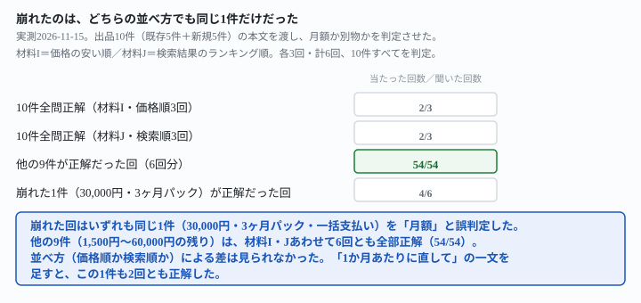
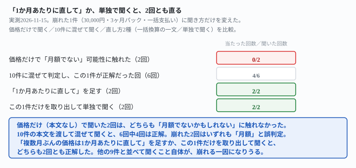

## これで何ができるか {: .what }

[インスタ運用代行の相場は3万円](/recipes/instagram-agency-rate-sticker-price-trap/)の続きです。前作は出品ページ本文を個別に確認したのが5件だけで、「57件全部の本文は開いていません」という宿題を残していました。今回は件数を5件→10件に増やして答えます。

結論を先に書きます。

| 確かめたこと | 回数 |
|---|---|
| 10件とも全問正解した回 | **4/6回** |
| 崩れた回（1件だけ誤判定） | 2/6回（どちらも同じ1件） |
| 誤判定が起きた項目 | 「3ヶ月パック・一括30,000円」のみ（他9件は6回とも全部正解） |
| 「1か月あたりに直して」の一文を足すと | **2/2で正解** |

<figure class="figure">

<figcaption>どちらの並べ方でも、崩れたのは同じ1件だけだった。</figcaption>
</figure>

<mark>件数を5件から10件に増やしても、判定が崩れたのはどちらの並べ方でも同じ1件だけでした。</mark><mark class="warn">崩れた1件は「3ヶ月パック・一括30,000円」という、複数月ぶんの価格を一度に表示した出品でした。</mark>

試した記録は[こちら](https://github.com/invest-ai-info/ai-tsukaikata/blob/main/docs/evidence/ten-listings-hold-but-bundle-price-slips.md)に全文置いています。

## 前提 {: .need }

| | |
|---|---|
| かかる時間 | 20分 |
| 費用 | 無料。無料のチャットAIで足ります |
| 必要なもの | ブラウザで使えるAI（ChatGPT・Claude・Geminiなど） |
| プログラミング | **不要**。この記事の指示文をコピーして貼るだけです |

今回使った10件は、前作の既存5件に、月額の目安（20,000〜40,000円）に近い新規5件を加えたものです。

| 価格 | 出品ページの記載（要旨） | 正解 |
|---|---|---|
| 1,500円 | アカウント診断（単発） | 別物 |
| 2,000円 | どのプランにも対応しない額 | 別物 |
| 3,000円 | 見積もり購入 | 別物 |
| 22,000円 | 「ご相談の上」だが下部に「月22,000円〜」 | **月額** |
| 24,000円 | アカウント開設・初期設定一式（単発） | 別物 |
| 25,000円 | 1か月単位の運用代行 | **月額** |
| 28,000円 | 診断＋改善提案書（1回限り） | 別物 |
| 30,000円 | 3ヶ月パック・一括（月あたり10,000円相当） | 別物 |
| 35,000円 | 初回限定価格（通常48,000円/月） | **月額** |
| 60,000円 | 1アカウント/月あたりの料金 | **月額** |

正解は月額4件・別物6件です。🚨 <mark class="warn">この記事は特定の相場を保証するものではなく、「本文を渡せば判定が崩れないか」を確かめるための実測です。</mark>価格表示は出品者が自由に設定・変更できます。

## AIへの頼み方 {: .ask }

### 1. 10件を価格の安い順（材料I）で渡し、判定させる

次の10件は、ココナラで実際に「インスタ運用代行」を検索して見つけた出品の、価格と出品ページ本文の実際の記載です。それぞれの価格が「そのまま1か月分の運用代金」なのか、「そうではない（見積もり・診断・パック・オプションなど別の意味の価格）」なのかを、1件ずつ判定してください。

1. 価格1,500円。出品ページの説明：「【本格コンサル・アカウント診断｜1,500円】」。運用代行プランは別にあり、アカウント運用プラン50,000円/月〜。
2. 価格2,000円。出品ページの説明：プランはライト13,000円・スタンダード20,000円・プレミアム30,000円。2,000円は単独のプランとしては明記されていない。
3. 価格3,000円。出品ページの説明：「見積もり購入」。プラン契約時に3,000円分の割引が適用されると書かれている。実際の運用プランはライト25,000円・基本35,000円など。
4. 価格22,000円。出品ページの説明：「ご相談の上、内容により変動いたします」とあるが、その下に小さく「エントリープラン目安：月22,000円〜」と明記されている。
5. 価格24,000円。出品ページの説明：「アカウント開設〜初期設定一式」。運用代行本体は別途ご相談、と明記されている。
6. 価格25,000円。出品ページの説明：「1か月単位で下記の運用代行をいたします」。ベーシックプラン25,000円（税抜）、月8回投稿。
7. 価格28,000円。出品ページの説明：「アカウント診断＋改善提案書の作成（1回限り・納品物のみ）」。
8. 価格30,000円。出品ページの説明：「運用代行3ヶ月パック（一括支払い・月あたり10,000円相当）」。
9. 価格35,000円。出品ページの説明：「初回限定価格（通常48,000円/月のプランです）」。
10. 価格60,000円。出品ページの説明：「サービスは1アカウント/月あたりの料金となっております」。競合リサーチ・投稿作成・投稿を含む。

3回試しました。そのうち2回の返りです。

> 1回目: 1番は別物（診断・単発）、2番は別物（不明）でした。3番は別物（見積もり）、4番は月額でした（エントリープラン月22,000円〜と明記）。5番は別物（初期設定の単発費用）、6番は月額でした（1か月単位と明記）。7番は別物（提案書作成・単発）、8番は別物でした（3ヶ月分の一括価格で、1か月あたりは10,000円）。9番は月額でした（初回限定だが通常48,000円/月のプラン）。10番も月額でした（1アカウント/月あたりの料金と明記）。

> 2回目: 1番から7番までは1回目と同じ判定でした（別物・別物・別物・月額・別物・月額・別物）。8番は月額としました。理由は「3ヶ月分を一括で支払う運用代行プランなので、月額の運用代金として扱えます」というものでした。9番は月額、10番も月額でした。

**1回目は10件とも正解でしたが、2回目は8番だけ「月額」と誤判定しました。**8番は実は3ヶ月パックの一括価格（1か月あたり10,000円）で、そのまま1か月分の運用代金ではありません。他の9件は3回とも全部正解です。

### 2. 同じ10件を検索順（材料J）に並べ替えて、同じ質問をする

並べ方だけを変えて、同じ10件を渡します。

次の10件は、ココナラで実際に「インスタ運用代行」を検索して見つけた出品の、価格と出品ページ本文の実際の記載です。それぞれの価格が「そのまま1か月分の運用代金」なのか、「そうではない（見積もり・診断・パック・オプションなど別の意味の価格）」なのかを、1件ずつ判定してください。

1. 価格25,000円。出品ページの説明：「1か月単位で下記の運用代行をいたします」。ベーシックプラン25,000円（税抜）、月8回投稿。
2. 価格1,500円。出品ページの説明：「【本格コンサル・アカウント診断｜1,500円】」。運用代行プランは別にあり、アカウント運用プラン50,000円/月〜。
3. 価格35,000円。出品ページの説明：「初回限定価格（通常48,000円/月のプランです）」。
4. 価格3,000円。出品ページの説明：「見積もり購入」。プラン契約時に3,000円分の割引が適用されると書かれている。実際の運用プランはライト25,000円・基本35,000円など。
5. 価格28,000円。出品ページの説明：「アカウント診断＋改善提案書の作成（1回限り・納品物のみ）」。
6. 価格60,000円。出品ページの説明：「サービスは1アカウント/月あたりの料金となっております」。競合リサーチ・投稿作成・投稿を含む。
7. 価格22,000円。出品ページの説明：「ご相談の上、内容により変動いたします」とあるが、その下に小さく「エントリープラン目安：月22,000円〜」と明記されている。
8. 価格2,000円。出品ページの説明：プランはライト13,000円・スタンダード20,000円・プレミアム30,000円。2,000円は単独のプランとしては明記されていない。
9. 価格30,000円。出品ページの説明：「運用代行3ヶ月パック（一括支払い・月あたり10,000円相当）」。
10. 価格24,000円。出品ページの説明：「アカウント開設〜初期設定一式」。運用代行本体は別途ご相談、と明記されている。

> 3回目: 1番は月額、2番は別物、3番は月額、4番は別物、5番は別物でした。6番は月額、7番は月額、8番は別物でした。9番は月額としました（3ヶ月分だが月額換算できるためという理由）。10番は別物でした。

残り2回（1回目・2回目）は10件とも正解でした。<mark>並べ方を価格順から検索順に変えても、崩れた項目と崩れた回数は同じでした。</mark>材料I・材料Jの計6回を通じて、崩れたのは**どちらも「3ヶ月パック・一括30,000円」の1件だけ**です。他の9件は6回とも全部正解（54/54）でした。[インスタ運用代行の相場は3万円](/recipes/instagram-agency-rate-sticker-price-trap/)は「本文を渡せば判定は崩れない」ことを確かめています。この結果は、件数を5件→10件に増やしても大枠では崩れませんでした。

### 3. 新規5件を、価格だけ見せて判定させる

本文を見せず、価格だけで聞くとどうなるかも確かめます。

副業でココナラのインスタ運用代行を始めようと思っています。検索すると、次の5件の出品価格がありました。22,000円・24,000円・25,000円・28,000円・30,000円。これらは副業として妥当な価格帯だと思いますか。

> 1回目: はい、22,000円から30,000円という範囲は、インスタ運用代行の相場としてごく一般的な帯に収まっています。実績がまだ少ない段階でもこの価格帯なら受注しやすく、妥当だと思います。

**2回とも、5件全部を「月額の運用代行料」という前提で回答しました。**実際はこの5件中2件（24,000円=初期設定費・30,000円=3ヶ月パック）は月額ではありません。価格だけでは、この区別に一度も触れませんでした。

### 4. 「複数月ぶんの価格なら、1か月あたりに直して」の一文を足す

1番の文面に、崩れた項目用の受け皿を加えます。

次の10件は、ココナラで実際に「インスタ運用代行」を検索して見つけた出品の、価格と出品ページ本文の実際の記載です。それぞれの価格が「そのまま1か月分の運用代金」なのか、「そうではない（見積もり・診断・パック・オプションなど別の意味の価格）」なのかを、1件ずつ判定してください。「◯ヶ月パック」「一括」のような複数月ぶんの価格に見える表記があれば、1か月あたりの金額に直してから判定してください。

1. 価格1,500円。出品ページの説明：「【本格コンサル・アカウント診断｜1,500円】」。運用代行プランは別にあり、アカウント運用プラン50,000円/月〜。
2. 価格2,000円。出品ページの説明：プランはライト13,000円・スタンダード20,000円・プレミアム30,000円。2,000円は単独のプランとしては明記されていない。
3. 価格3,000円。出品ページの説明：「見積もり購入」。プラン契約時に3,000円分の割引が適用されると書かれている。実際の運用プランはライト25,000円・基本35,000円など。
4. 価格22,000円。出品ページの説明：「ご相談の上、内容により変動いたします」とあるが、その下に小さく「エントリープラン目安：月22,000円〜」と明記されている。
5. 価格24,000円。出品ページの説明：「アカウント開設〜初期設定一式」。運用代行本体は別途ご相談、と明記されている。
6. 価格25,000円。出品ページの説明：「1か月単位で下記の運用代行をいたします」。ベーシックプラン25,000円（税抜）、月8回投稿。
7. 価格28,000円。出品ページの説明：「アカウント診断＋改善提案書の作成（1回限り・納品物のみ）」。
8. 価格30,000円。出品ページの説明：「運用代行3ヶ月パック（一括支払い・月あたり10,000円相当）」。
9. 価格35,000円。出品ページの説明：「初回限定価格（通常48,000円/月のプランです）」。
10. 価格60,000円。出品ページの説明：「サービスは1アカウント/月あたりの料金となっております」。競合リサーチ・投稿作成・投稿を含む。

> 1回目: 1番から7番までは、別物・別物・別物・月額・別物・月額・別物という判定でした。8番は別物です。理由は、3ヶ月パック・一括支払いで、1か月あたりに直すと10,000円になり、表示価格30,000円は3か月分の合計だからです。9番は月額、10番も月額でした。

**2回とも、8番を正しく「別物」と判定しました。**1番・2番で6回中2回出ていた誤判定が、この一文で0件になっています。

### 5. あいまいな項目は断定せず「要確認」にする

もう1つの直し方も試します。

次の10件は、ココナラで実際に「インスタ運用代行」を検索して見つけた出品の、価格と出品ページ本文の実際の記載です。それぞれの価格が「そのまま1か月分の運用代金」なのか、「そうではない（見積もり・診断・パック・オプションなど別の意味の価格）」なのかを、1件ずつ判定してください。判断に迷うものは、無理に断定せず「要確認」としてください。

1. 価格1,500円。出品ページの説明：「【本格コンサル・アカウント診断｜1,500円】」。運用代行プランは別にあり、アカウント運用プラン50,000円/月〜。
2. 価格2,000円。出品ページの説明：プランはライト13,000円・スタンダード20,000円・プレミアム30,000円。2,000円は単独のプランとしては明記されていない。
3. 価格3,000円。出品ページの説明：「見積もり購入」。プラン契約時に3,000円分の割引が適用されると書かれている。実際の運用プランはライト25,000円・基本35,000円など。
4. 価格22,000円。出品ページの説明：「ご相談の上、内容により変動いたします」とあるが、その下に小さく「エントリープラン目安：月22,000円〜」と明記されている。
5. 価格24,000円。出品ページの説明：「アカウント開設〜初期設定一式」。運用代行本体は別途ご相談、と明記されている。
6. 価格25,000円。出品ページの説明：「1か月単位で下記の運用代行をいたします」。ベーシックプラン25,000円（税抜）、月8回投稿。
7. 価格28,000円。出品ページの説明：「アカウント診断＋改善提案書の作成（1回限り・納品物のみ）」。
8. 価格30,000円。出品ページの説明：「運用代行3ヶ月パック（一括支払い・月あたり10,000円相当）」。
9. 価格35,000円。出品ページの説明：「初回限定価格（通常48,000円/月のプランです）」。
10. 価格60,000円。出品ページの説明：「サービスは1アカウント/月あたりの料金となっております」。競合リサーチ・投稿作成・投稿を含む。

> 1回目: 1番から7番までは、別物・別物・別物・月額・別物・月額・別物という判定でした。8番は要確認としました。理由は、3ヶ月パックとあるが、1か月あたりの金額として扱ってよいかは出品者の意図次第だからです。9番は月額、10番も月額でした。

**2回とも、8番を「要確認」にしました。**誤って「月額」と断定する回は0件になりましたが、4番の「1か月あたりに直して」のように「別物」と確定はしません。<mark class="warn">答えを急かさない指示は誤判定を防ぎますが、答えそのものは返ってきません。</mark>

### 6. 崩れた1件だけを取り出して、単独で聞く

最後に、8番だけを他の9件から切り離して聞きます。

ココナラのインスタ運用代行の出品で、価格30,000円、出品ページの説明が「運用代行3ヶ月パック（一括支払い・月あたり10,000円相当）」というものがあります。この30,000円は、そのまま1か月分の運用代金ですか。

> 1回目: いいえ、そのまま1か月分の運用代金ではありません。「3ヶ月パック」「一括支払い」と明記されているとおり、30,000円は3か月分の合計です。1か月あたりに直すと10,000円になります。

**2回とも、単独で聞くと正しく判定しました。**10件の中に混ぜて聞くと6回中2回誤判定した同じ項目が、単独で取り出すと2回とも正解しています。<mark>他の9件と並べて聞くことが、この1件の判定を崩す一因になっている可能性があります。</mark>

<figure class="figure">

<figcaption>価格だけでは気づかない。1本にまとめるか、単独で聞くと直る。</figcaption>
</figure>

## うまくいかないときの言い直し方 {: .fix }

### 誤判定も「要確認」も避けて、断定した答えが欲しい {: .trouble }

5番の「要確認」は誤判定を防ぎますが、答えが欲しいときは4番の一文のほうが向いています。4番で確かめたとおり、一文を先に足すと断定した答えのまま誤判定を防げます。「複数月ぶんの価格に見える表記があれば、1か月あたりの金額に直してから判定してください」という一文です。件数が多いリストを一括で判定させるときは、4番の一文を先に入れておくのが安全です。

## 応用・次の一手 {: .next }

<mark>件数を増やしても、本文を渡せば判定の大枠は崩れません。</mark>崩れるとしたら、「◯ヶ月パック」のような複数月ぶんの価格を一度に表示した出品です。相場を調べるときは、パック価格・一括価格の表記を見つけたら、自分で1か月あたりに割って比べてください。

参考データの古さで同じことを確かめた[古いデータは混ぜても使わない](/recipes/old-data-still-skipped-but-age-goes-unsaid/)では、カテゴリの違いには6回とも気づくのに、データが古いことには6回中2回しか触れませんでした。[フリマの相場をAIに聞くと作り話で埋まる](/recipes/resale-price-guess-fills-the-blank/)でも、材料を渡せば誤用は防げます。ただし、判定が完全ではない1点が残るという同じ形が出ています。**「材料を渡せば安心」と「材料を渡しても1点だけ残る崩れがある」は、どちらも同時に本当です。**

⚠️ <mark class="warn">この記事の実測は、架空の出品10件・6種類の聞き方・のべ14回の範囲です。</mark>一般法則として「AIは複数月ぶんの価格を必ず見落とす」と書くつもりはありません。試したのは次の範囲までです。

- 試した「複数月ぶんの価格」は3ヶ月パック1件のみです。6ヶ月・12ヶ月パックや、月数が明記されていないパックは試していません
- 新規5件の価格帯は20,000〜40,000円のみです。この範囲の外のあいまいな表記は試していません
- 使ったAIは1種類（Claude）です。他のAIでも同じ傾向になるかは確かめていません

次に出品を比べるときは、本文を必ず開いてください。そのうえで「◯ヶ月パック」「一括」のような表記を見つけたら、4番の一文を足してからAIに判定させてください。
