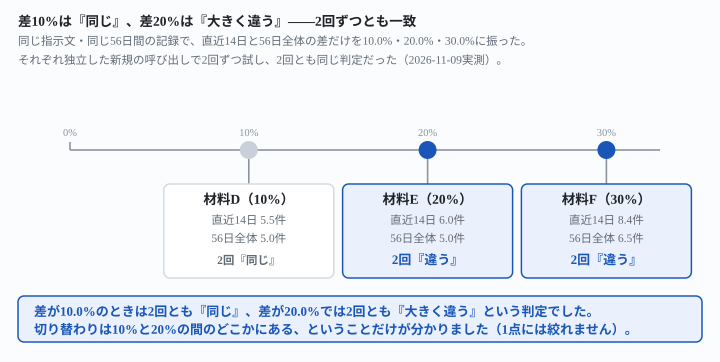
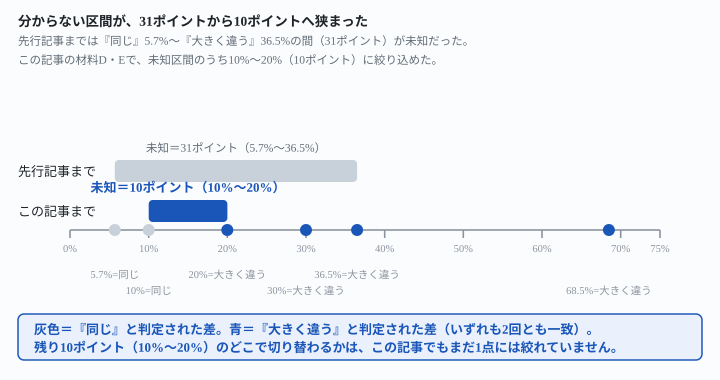

## これで何ができるか {: .what }

監視の自動化では、「直近のふだんの目安」と「もっと長い期間のふだんの目安」をAIに比べさせ、
「実務上同じとみなせるか、それとも大きく違うか」を一言で判定させる場面があります。
結論を先に書きます。

| 2つの目安の差 | AIの判定（2回とも） |
|---|---|
| 10.0% | 「同じ」（実務上同じとみなせる範囲） |
| 20.0% | 「大きく違う」 |
| 約30.0% | 「大きく違う」 |

<mark>差が10.0%のときは2回とも「同じ」、差が20.0%になると2回とも「大きく違う」でした。</mark>
[先行記事](/recipes/increasing-log-judgment-comes-out-right/)は差36.5%・68.5%という
はっきり離れた2条件しか試しておらず、[その前の記事](/recipes/flat-log-keeps-the-benchmark-steady/)の
差5.7%と合わせても、「同じ」と「大きく違う」の間に31ポイント（5.7%〜36.5%）の未知区間が
残っていました。<mark>この記事で、未知区間は10%〜20%の10ポイントまで狭まりました。</mark>

<figure class="figure">

<figcaption>差10.0%は「同じ」、差20.0%・約30.0%は「大きく違う」。2回ずつとも一致しました。</figcaption>
</figure>

⚠️ **1点には絞れていません。**今回確かめたのは10.0%・20.0%・30.0%の3点だけです。
その間の15%や18%がどちらに転ぶかは、試していないので分かりません。

## 前提 {: .need }

| | |
|---|---|
| かかる時間 | 15分 |
| 費用 | 無料。無料のチャットAIで足ります |
| 必要なもの | 毎日の件数が並んだ記録（増加傾向のあるもの） |
| プログラミング | **不要**。記録と指示文をそのまま貼るだけです |

使う指示文は[先行記事](/recipes/increasing-log-judgment-comes-out-right/)・
[前作](/recipes/flat-log-keeps-the-benchmark-steady/)と一字一句同じです。
変えたのは記録の中身だけで、**直近14日の目安と56日全体の目安の差が、ちょうど
10.0%・20.0%・30.0%になるように作り直しました**（真値はPython `statistics`で算出）。

- **材料D**（差10.0%）＝直近14日5.5件/日・56日全体5.0件/日
- **材料E**（差20.0%）＝直近14日6.0件/日・56日全体5.0件/日
- **材料F**（差約30.0%）＝直近14日8.4件/日・56日全体6.5件/日

どの材料も56日間（9/2〜10/27）で、独立した新規の呼び出しで**2回ずつ**試しました
（自動化ものの2回転の決まりに従う）。1回の呼び出しに答えを知らない側として
「ふつうの無料チャットAI」の役を演じさせ、ツールは使わず暗算・筆算で計算させています。
生の返りと機械照合は `docs/evidence/ten-percent-same-twenty-percent-different.md` に
全文置いてあります。

## AIへの頼み方 {: .ask }

### 差10.0%の記録で試す（材料D）

これは問い合わせフォームに届いた件数の記録です。直近14日分の記録と、直近14日分に古い42日分を足した56日分全部の記録、の2つを渡します。それぞれについて、ふだんの1日あたりの件数の目安を計算してください。そのうえで、2つの目安が実務上同じとみなせるほど近いか、それとも大きく違うかを判定し、理由を書いてください。

1回目は「直近14日の目安5.5件/日、56日全体の目安5.0件/日。差は0.5件/日(約10%)」を正しく算出し、
「実務上は『ほぼ同じ』とみなせる範囲内の差です」と判定しました。差が、記録そのものが持つ
日々のブレ（標準偏差相当で±0.9〜1件）の半分程度しかないことを理由に挙げています。

これは問い合わせフォームに届いた件数の記録です。直近14日分の記録と、直近14日分に古い42日分を足した56日分全部の記録、の2つを渡します。それぞれについて、ふだんの1日あたりの件数の目安を計算してください。そのうえで、2つの目安が実務上同じとみなせるほど近いか、それとも大きく違うかを判定し、理由を書いてください。

2回目も同じ5.5件/日・5.0件/日を算出し、「ほぼ近いが、わずかにズレがある程度で
『大きく違う』とは言えない」と判定しました。**2回とも、数値は真値と完全に一致し、
判定も「同じ」側で揃いました。**

### 差20.0%の記録で試す（材料E）

これは問い合わせフォームに届いた件数の記録です。直近14日分の記録と、直近14日分に古い42日分を足した56日分全部の記録、の2つを渡します。それぞれについて、ふだんの1日あたりの件数の目安を計算してください。そのうえで、2つの目安が実務上同じとみなせるほど近いか、それとも大きく違うかを判定し、理由を書いてください。

1回目は「直近14日6.0件/日、56日全体5.0件/日。差は約20%」を正しく算出し、
「実務上『同じとみなせる』範囲の誤差ではなく、大きく違う」と判定しました。
9月分の平均(約4.2件/日)と10月分の平均(約5.8件/日)を自分で割って示し、
「増加トレンドの一部で、単なるブレではない」と理由を書いています。

これは問い合わせフォームに届いた件数の記録です。直近14日分の記録と、直近14日分に古い42日分を足した56日分全部の記録、の2つを渡します。それぞれについて、ふだんの1日あたりの件数の目安を計算してください。そのうえで、2つの目安が実務上同じとみなせるほど近いか、それとも大きく違うかを判定し、理由を書いてください。

2回目も同じ6.0件/日・5.0件/日で、「実務上『同じ』とはみなせない、はっきりした差です」と
判定しました。<mark>差10.0%では「同じ」、差20.0%では「大きく違う」。数値がどちらも真値と
完全に一致したうえで、判定だけが切り替わっています。</mark>

### 差約30.0%の記録で試す（材料F）

これは問い合わせフォームに届いた件数の記録です。直近14日分の記録と、直近14日分に古い42日分を足した56日分全部の記録、の2つを渡します。それぞれについて、ふだんの1日あたりの件数の目安を計算してください。そのうえで、2つの目安が実務上同じとみなせるほど近いか、それとも大きく違うかを判定し、理由を書いてください。

1回目は「直近14日約8.4件/日、56日全体約6.5件/日。約3割(29%)の差」で
「大きく違う」と判定しました。<mark class="warn">ただし56日分の合計を365件と書いており、
真値の363件と2件ズレていました。</mark>週ごとの合計を自分で並べて見せていたので
機械照合できましたが、判定の方向（大きく違う）自体は真値どおりでした。

これは問い合わせフォームに届いた件数の記録です。直近14日分の記録と、直近14日分に古い42日分を足した56日分全部の記録、の2つを渡します。それぞれについて、ふだんの1日あたりの件数の目安を計算してください。そのうえで、2つの目安が実務上同じとみなせるほど近いか、それとも大きく違うかを判定し、理由を書いてください。

2回目は8.43件/日・6.48件/日(56日合計363件)と、今度は数値も真値と完全に一致し、
「大きく違う」と判定しました。

### 先行記事と合わせると、未知区間は10ポイントまで狭まった

<figure class="figure">

<figcaption>未知区間は31ポイント（5.7%〜36.5%）から、10ポイント（10%〜20%）まで狭まりました。</figcaption>
</figure>

| 記録の性質 | 真値の差 | 聞いた回数 | AIの判定 |
|---|---|---|---|
| フラット（[先行記事](/recipes/flat-log-keeps-the-benchmark-steady/)） | 約5.7% | 2回 | 2回とも「同じ」 |
| 材料D（この記事） | 10.0% | 2回 | 2回とも「同じ」 |
| 材料E（この記事） | 20.0% | 2回 | 2回とも「大きく違う」 |
| 材料F（この記事） | 約30.0% | 2回 | 2回とも「大きく違う」 |
| 材料A（[先行記事](/recipes/increasing-log-judgment-comes-out-right/)） | 約36.5% | 2回 | 2回とも「大きく違う」 |
| 材料C（[先行記事](/recipes/increasing-log-judgment-comes-out-right/)） | 約68.5% | 2回 | 2回とも「大きく違う」 |

## うまくいかないときの言い直し方 {: .fix }

### 自分の差が10%〜20%に近いなら、「同じ/大きく違う」の一言だけを見ない {: .trouble }

今回の3点はどれも、2回とも同じ側に揃いました。崩れた箇所があるとしたら、
**この記事がまだ試していない「境界に近すぎる差」のほうです**（15%や18%など）。

自分の監視対象の差が10%〜20%に近いときは、次の2つを足してください。

1. **判定の言葉だけでなく、使った数値（差の件数・パーセント）も書かせる。**
   「大きく違う」という一言だけだと、境界付近での判定のブレに気づけません
2. **1回だけで決めず、2回試す。**この記事の3点はどれも2回とも同じ側でしたが、
   境界に近い差では2回の答えが割れる可能性が、まだ試していないぶんだけ残っています

## 応用・次の一手 {: .next }

- **自動化の監視スクリプトに組み込むなら、判定の言葉だけでなくパーセントの数値もログに残す。**
  境界付近で判定が変わったときに、「何%から切り替わったか」を後から追えます
- **閾値そのものを固定値で決めると誤検知が起きる話は[固定日数の閾値が誤検知した記事](/recipes/flat-threshold-misfires/)
  が実測しています。**「同じ/大きく違う」の判定も、今回の実測どおり境界付近では
  言葉だけで割り切れません
- 次に測るなら、15%・18%のような**この記事の2点のさらに内側**を試すと、
  未知区間をもう一段狭められます
