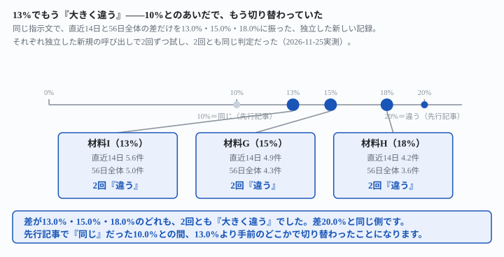
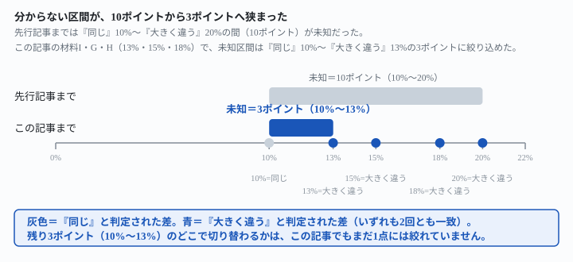

## これで何ができるか {: .what }

監視の自動化では、「直近のふだんの目安」と「もっと長い期間のふだんの目安」をAIに比べさせ、
「実務上同じとみなせるか、それとも大きく違うか」を一言で判定させる場面があります。
結論を先に書きます。

| 2つの目安の差 | AIの判定（2回とも） |
|---|---|
| 10.0%（[先行記事](/recipes/ten-percent-same-twenty-percent-different/)） | 「同じ」（実務上同じとみなせる範囲） |
| 13.0% | 「大きく違う」 |
| 15.0% | 「大きく違う」 |
| 18.0% | 「大きく違う」 |
| 20.0%（[先行記事](/recipes/ten-percent-same-twenty-percent-different/)） | 「大きく違う」 |

<mark>差が10.0%のときは2回とも「同じ」でしたが、差が13.0%まで狭めても2回とも「大きく違う」でした。</mark>
[先行記事](/recipes/ten-percent-same-twenty-percent-different/)は差10.0%・20.0%・約30.0%の3点を試し、
「その間の15%や18%がどちらに転ぶかは、試していないので分かりません」と明記して終わっていました。
<mark>この記事で、未知区間は10%〜20%の10ポイントから、10%〜13%の3ポイントまで狭まりました。</mark>

<figure class="figure">

<figcaption>13.0%・15.0%・18.0%のどれも「大きく違う」。2回ずつとも一致しました。</figcaption>
</figure>

⚠️ **1点には絞れていません。**今回確かめたのは13.0%・15.0%・18.0%の3点だけです。
その間の11%や12%がどちらに転ぶかは、試していないので分かりません。

## 前提 {: .need }

| | |
|---|---|
| かかる時間 | 15分 |
| 費用 | 無料。無料のチャットAIで足ります |
| 必要なもの | 毎日の件数が並んだ記録（増加傾向のあるもの） |
| プログラミング | **不要**。記録と指示文をそのまま貼るだけです |

使う指示文は[先行記事](/recipes/ten-percent-same-twenty-percent-different/)・
[増えている記録の記事](/recipes/increasing-log-judgment-comes-out-right/)・
[減っている記録の記事](/recipes/decreasing-log-judgment-comes-out-right/)と一字一句同じです。
変えたのは記録の中身だけで、**直近14日の目安と56日全体の目安の差が、ちょうど
13.0%・15.0%・18.0%になるように作り直しました**（真値はPython `statistics`で算出）。

- **材料I**（差13.0%）＝直近14日約5.6件/日・56日全体5.0件/日ちょうど
- **材料G**（差15.0%）＝直近14日約4.9件/日・56日全体約4.3件/日
- **材料H**（差18.0%）＝直近14日約4.2件/日・56日全体約3.6件/日

どの材料も56日間（9/2〜10/27）で、独立した新規の呼び出しで**2回ずつ**試しました
（自動化ものの2回転の決まりに従う）。1回の呼び出しに答えを知らない側として
「ふつうの無料チャットAI」の役を演じさせ、ツールは使わず暗算・筆算で計算させています。
生の返りと機械照合は `docs/evidence/thirteen-percent-already-flips-the-call.md` に
全文置いてあります。

## AIへの頼み方 {: .ask }

### 差13.0%の記録で試す（材料I）

これは問い合わせフォームに届いた件数の記録です。直近14日分の記録と、直近14日分に古い42日分を足した56日分全部の記録、の2つを渡します。それぞれについて、ふだんの1日あたりの件数の目安を計算してください。そのうえで、2つの目安が実務上同じとみなせるほど近いか、それとも大きく違うかを判定し、理由を書いてください。

1回目は「直近14日の目安5.64件/日、56日全体の目安5.00件/日ちょうど」を正しく算出し、
「実務上『同じ』とはみなせません」と判定しました。理由に「4件」の日が9月だけに集中し
「7件」の日が直近14日にしか出てこないことを挙げ、日々の散らばり（標準偏差相当で約0.7件）と
比べても差（約0.6件）が3倍近いことを根拠にしています。

これは問い合わせフォームに届いた件数の記録です。直近14日分の記録と、直近14日分に古い42日分を足した56日分全部の記録、の2つを渡します。それぞれについて、ふだんの1日あたりの件数の目安を計算してください。そのうえで、2つの目安が実務上同じとみなせるほど近いか、それとも大きく違うかを判定し、理由を書いてください。

2回目も同じ5.64件/日・5.00件/日を算出し、「実務上『同じ』とはみなせません」と判定しました。
週ごとの平均を並べて「4.29→4.43→4.71→4.86→5.00→5.43→5.29→6.00とほぼ単調に増加している」ことを
示し、直近14日はこの上昇トレンドの頂点にあたると説明しています。<mark>先行記事で「同じ」だった
10.0%に、わずか3ポイント近づけただけの13.0%で、判定が2回とも反対側に揺れました。</mark>

### 差15.0%の記録で試す（材料G）

これは問い合わせフォームに届いた件数の記録です。直近14日分の記録と、直近14日分に古い42日分を足した56日分全部の記録、の2つを渡します。それぞれについて、ふだんの1日あたりの件数の目安を計算してください。そのうえで、2つの目安が実務上同じとみなせるほど近いか、それとも大きく違うかを判定し、理由を書いてください。

1回目は「直近14日約4.9件/日、56日全体約4.3件/日」を正しく算出し、
「実務上は『ほぼ同じ』とは言えず、無視できない差がある」と判定しました。
9月上旬（1日3〜4件）から10月後半（4〜6件）への右肩上がりの傾向を根拠にしています。

これは問い合わせフォームに届いた件数の記録です。直近14日分の記録と、直近14日分に古い42日分を足した56日分全部の記録、の2つを渡します。それぞれについて、ふだんの1日あたりの件数の目安を計算してください。そのうえで、2つの目安が実務上同じとみなせるほど近いか、それとも大きく違うかを判定し、理由を書いてください。

2回目も同じ4.9件/日・4.3件/日で、「同じとみなせる近さではない」と判定しました。

### 差18.0%の記録で試す（材料H）

これは問い合わせフォームに届いた件数の記録です。直近14日分の記録と、直近14日分に古い42日分を足した56日分全部の記録、の2つを渡します。それぞれについて、ふだんの1日あたりの件数の目安を計算してください。そのうえで、2つの目安が実務上同じとみなせるほど近いか、それとも大きく違うかを判定し、理由を書いてください。

1回目は「直近14日約4.2件/日、56日全体約3.6件/日」を正しく算出し、
「実務上『同じ』とみなせるほど近いとは言えません」と判定しました。
56日平均に対して約18%の増加にあたることを示しています。

これは問い合わせフォームに届いた件数の記録です。直近14日分の記録と、直近14日分に古い42日分を足した56日分全部の記録、の2つを渡します。それぞれについて、ふだんの1日あたりの件数の目安を計算してください。そのうえで、2つの目安が実務上同じとみなせるほど近いか、それとも大きく違うかを判定し、理由を書いてください。

2回目も同じ4.2件/日・3.6件/日で、「直近の方が明確に高い水準」と判定しました。

### 先行記事と合わせると、未知区間は3ポイントまで狭まった

<figure class="figure">

<figcaption>未知区間は10ポイント（10%〜20%）から、3ポイント（10%〜13%）まで狭まりました。</figcaption>
</figure>

| 記録の性質 | 真値の差 | 聞いた回数 | AIの判定 |
|---|---|---|---|
| 先行記事（10.0%） | 10.0% | 2回 | 2回とも「同じ」 |
| 材料I（この記事） | 13.0% | 2回 | 2回とも「大きく違う」 |
| 材料G（この記事） | 15.0% | 2回 | 2回とも「大きく違う」 |
| 材料H（この記事） | 18.0% | 2回 | 2回とも「大きく違う」 |
| 先行記事（20.0%） | 20.0% | 2回 | 2回とも「大きく違う」 |

## うまくいかないときの言い直し方 {: .fix }

### 自分の差が10%〜13%に近いなら、「同じ/大きく違う」の一言だけを見ない {: .trouble }

今回の3点はどれも、2回とも同じ側（「大きく違う」）に揃いました。崩れた箇所があるとしたら、
**この記事がまだ試していない「境界に近すぎる差」のほうです**（11%や12%など）。

自分の監視対象の差が10%〜13%に近いときは、次の2つを足してください。

1. **判定の言葉だけでなく、使った数値（差の件数・パーセント）も書かせる。**
   「大きく違う」という一言だけだと、境界付近での判定のブレに気づけません
2. **1回だけで決めず、2回試す。**この記事の3点はどれも2回とも同じ側でしたが、
   境界に近い差では2回の答えが割れる可能性が、まだ試していないぶんだけ残っています

## 応用・次の一手 {: .next }

- **自動化の監視スクリプトに組み込むなら、判定の言葉だけでなくパーセントの数値もログに残す。**
  境界付近で判定が変わったときに、「何%から切り替わったか」を後から追えます
- **閾値そのものを固定値で決めると誤検知が起きる話は[固定日数の閾値が誤検知した記事](/recipes/flat-threshold-misfires/)
  が実測しています。**「同じ/大きく違う」の判定も、今回の実測どおり境界付近では
  言葉だけで割り切れません
- 次に測るなら、11%・12%のような**この記事の2点のさらに内側**を試すと、
  未知区間をもう一段狭められます
