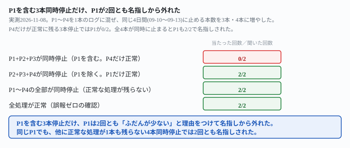
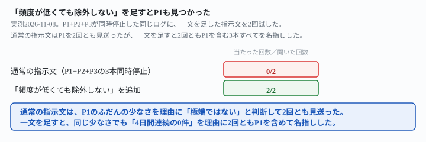

## これで何ができるか {: .what }

[監視対象を4本に増やしても](/recipes/four-process-log-keeps-each-own-baseline/)と[2つ同時に止まっても両方名指し](/recipes/simultaneous-stop-both-get-named/)は、同じ頼み方の実測です。「処理ごとに計算して」と頼めば、止まった処理をすべて見つけられることを確かめました。単独停止はP1〜P4のどれでも10回中10回です。2本同時停止も8回中8回です。ただし、どちらの記事も**同時に止まるのは最大2本まで**という条件でした。

結論を先に書きます。同じ4日間（09-10〜09-13）のまま、同時に止まる本数を増やした結果です。

| 止まった組み合わせ | 名指しできた回数 |
|---|---|
| P1+P2+P3（頻度が低いP1を含む。P4だけ正常） | P2・P3は2/2。**P1は0/2（2回とも名指しから外れた）** |
| P2+P3+P4（頻度が低いP1を除く。P1だけ正常） | 3/3が2回とも完全に名指し |
| P1〜P4の全部が同時停止（正常な処理が残らない） | 4/4が2回とも完全に名指し |
| 全処理が正常（誤報ゼロの確認） | 2回とも「該当なし」 |

<mark>頻度の低い処理（P1。1日1〜2回）を含む3本が同時に止まっても、ほかに正常に動いている処理が残っていると、P1だけ2回とも名指しから外れました。</mark><mark class="warn">P1を外した理由欄には「ふだんが少ないので、極端に少ないとまでは言えない」と自分から書いています。見落としではなく、明示的な除外です。</mark>一方、<mark>P1〜P4の全部が同時に止まり、正常な処理が1本も残らない構成では、同じP1でも2回とも名指しされました。</mark>

<figure class="figure">

<figcaption>P4だけが正常に残る3本停止では、P1だけ0/2。全4本が止まると2/2でした。</figcaption>
</figure>

## 前提 {: .need }

| | |
|---|---|
| かかる時間 | 20分 |
| 費用 | 無料。無料のチャットAIで足ります |
| 必要なもの | 複数の定期実行の、実行時刻が分かる記録（GitHub Actionsの実行履歴・ログファイルのタイムスタンプなど） |
| プログラミング | **不要**。実行時刻の一覧をそのまま貼るだけです |

材料は、先行記事と同じ架空の処理P1〜P4の実行時刻を1本にまとめたログです。どの構成も21日間（2026-09-01〜09-21）ぶんです。

- **P1**＝1日1〜2回（もっとも少ない）
- **P2**＝1日4〜8回
- **P3**＝1日10〜15回
- **P4**＝1日20〜30回（もっとも多い。P1の約17倍）

停止させるのは常に同じ4日間（09-10〜09-13）です。**止める本数を2本から3本・4本に増やし**、4つの構成を用意しました。

- **P1+P2+P3**（頻度が低いP1を含む）が同時に停止。正常に動くのはP4だけ
- **P2+P3+P4**（頻度が低いP1を除く）が同時に停止。正常に動くのはP1だけ
- **P1〜P4の全部**が同時に停止。正常に動く処理は1本も残らない
- **全処理が正常**（誤報ゼロの確認）

それぞれ生成後、日付ごと・処理ごとの行数を正規表現で再集計しました。確認したのは次の2点です。

- 意図した処理だけが、停止4日間に0件になっているか
- 他の処理に、意図しない0件の日が無いか

## AIへの頼み方 {: .ask }

### 1. P1を含む3本が同時に止まった場合（P4だけ正常）

先行記事で効いた頼み方を、そのまま使います。

これは、複数の定期実行処理が実際に動いた時刻を記録したログです。処理名は process=P1・process=P2・process=P3・process=P4 の4種類が混ざっています。

処理ごとに、その処理自身の記録から「ふだんの1日あたりの実行回数」の目安を計算してください。そのうえで、その処理だけの目安と比べて極端に少ない日（0件の日を含む）があれば、処理名・日付・実行回数を挙げてください。該当する日が無ければ「該当なし」と答えてください。

上に、P1・P2・P3が同時に09-10〜09-13の4日間停止した21日分のログを貼りました。2回試した結果です。

1回目は、P2・P3の目安を計算して4日間を正しく名指ししました。P1については「合計24回で約1.1回/日、日別は1〜2回です」と書いたうえで「0件が極端に少ないとは言えません。そのため該当としません」と、名指しの一覧から外しました。2回目も同じ形です。P2・P3は「明らかに異常」と表に挙げました。P1は「基準が約1回/日と少ないため、0回の日が1日あるだけなら通常の範囲です」「単独では『極端に少ない』とまでは言えないため、参考情報としてお伝えします」と格下げし、「極端に少ない日」の一覧には入れませんでした。

**P1は2回とも、見出しの名指し一覧から外れました。**0件の日自体には気づいています。同じ期間にP2・P3が止まっていることにも触れています。それでも理由欄で「ふだんが少ないので極端ではない」と自分から判断して除外しています。

### 2. P1を除く3本が同時に止まった場合（P1だけ正常）

止める処理を入れ替えて、もっとも頻度の低いP1を正常のまま残し、P2・P3・P4を同時に止めました。同じ指示文で2回試しました。

これは、複数の定期実行処理が実際に動いた時刻を記録したログです。処理名は process=P1・process=P2・process=P3・process=P4 の4種類が混ざっています。

処理ごとに、その処理自身の記録から「ふだんの1日あたりの実行回数」の目安を計算してください。そのうえで、その処理だけの目安と比べて極端に少ない日（0件の日を含む）があれば、処理名・日付・実行回数を挙げてください。該当する日が無ければ「該当なし」と答えてください。

1回目は「該当あり:P2・P3・P4の3つで、2026-09-10〜09-13の4日間が0件です」と3本すべてを表で名指ししました。P1については「1日あたり1回前後(1〜2回)と元々少ない処理です」「全21日で0件の日はないため該当なしです」と正しく除外しました。2回目も同じく、P2・P3・P4の3本を名指ししました。P1は「ふだんは1日1〜2回で、09-10〜09-13も毎日1件ずつ動いています」と、こちらも正しく該当なしでした。

**P1がそもそも止まっていない構成では、見逃しは2回とも0件でした。**

### 3. P1〜P4の全部が同時に止まった場合

最後に、正常に動く処理を1本も残さず、4本すべてを同じ4日間に止めました。同じ指示文で2回試しました。

これは、複数の定期実行処理が実際に動いた時刻を記録したログです。処理名は process=P1・process=P2・process=P3・process=P4 の4種類が混ざっています。

処理ごとに、その処理自身の記録から「ふだんの1日あたりの実行回数」の目安を計算してください。そのうえで、その処理だけの目安と比べて極端に少ない日（0件の日を含む）があれば、処理名・日付・実行回数を挙げてください。該当する日が無ければ「該当なし」と答えてください。

1回目は「該当あり。2026-09-10〜2026-09-13の4日間は、4処理すべてが0件でした」と表で4本を名指し。P1についても「少ない処理ですが、記録のある日は必ず1回以上動いています。そのため4日連続の0件は異常と判断しました」と明記しました。2回目も同じく「9/10〜9/13の4日間は、4処理すべてで0件です」とP1を含む4本すべてを表に挙げています。

**正常に動いている処理が1本も残らない構成では、同じP1でも2回とも名指しされました。**

### 4. 全処理が正常な構成（誤報ゼロの確認）

どの処理も止まっていない構成でも、誤報が出ないかを確かめました。

これは、複数の定期実行処理が実際に動いた時刻を記録したログです。処理名は process=P1・process=P2・process=P3・process=P4 の4種類が混ざっています。

処理ごとに、その処理自身の記録から「ふだんの1日あたりの実行回数」の目安を計算してください。そのうえで、その処理だけの目安と比べて極端に少ない日（0件の日を含む）があれば、処理名・日付・実行回数を挙げてください。該当する日が無ければ「該当なし」と答えてください。

2回とも「該当なし」でした。P1についても「もともと回数が少ない処理なので、1回の日を『少ない』とは判断していません」と書いています。頻度の低さそのものを、誤って異常扱いすることもありませんでした。

### なぜ、正常な処理が1本でも残っていると見逃すのか

P1が外れた2回は、どちらも「ふだんが少ないので極端ではない」という**自分の基準との比較**で判断していました。P4のような正常に動く処理が同じログの中にあると、AIはP1の0件を「個別の判定材料としては弱い」と位置づけてしまいます。一方、全部が同時に止まると比較対象になる「正常な処理」が消えるため、P1の4日間の0件も素直に「異常」として扱われました。**判定の基準が処理ごとの自分の目安だけでも、周りに正常な処理が残っているかどうかで、同じ0件の扱いが変わる**ということです。

## うまくいかないときの言い直し方 {: .fix }

### 頻度が低い処理が、他の正常な処理に埋もれるとき {: .trouble }

P1+P2+P3が同時に停止した同じログに、「頻度の低さを理由に除外しない」という一文を足して2回試しました。

これは、複数の定期実行処理が実際に動いた時刻を記録したログです。処理名は process=P1・process=P2・process=P3・process=P4 の4種類が混ざっています。

処理ごとに、その処理自身の記録から「ふだんの1日あたりの実行回数」の目安を計算してください。そのうえで、その処理だけの目安と比べて極端に少ない日（0件の日を含む）があれば、処理名・日付・実行回数を挙げてください。該当する日が無ければ「該当なし」と答えてください。

⚠️ ふだんの回数が1〜2回程度と少ない処理でも、0件が複数日連続していれば、頻度の低さを理由に除外せず、同じように挙げてください。

1回目は、P1・P2・P3の3本すべてを表で名指し。「P1は普段の回数が少ないですが、前後の日は毎日1〜2回動いています。そのため4日連続の0件は異常として挙げています」と、除外しなかった理由も自分から書きました。2回目も同じく「P1は、ふだんが1〜2回と少ない処理です。それでも4日連続で0回なので、頻度の低さを理由に除外していません」と、3本とも名指ししました。

<figure class="figure">

<figcaption>通常の指示文はP1を2回とも見送りましたが、一文を足すと2回とも名指しできました。</figcaption>
</figure>

→ **原因は、指示文が「その処理だけの目安と比べて極端に少ない」という、処理ごとの相対判断に委ねていたことです。**P1のふだんの目安自体が1〜2回と小さいと、4日連続の0件でも「極端」とは判定されにくくなります。[停止の長さを変えた記事](/recipes/short-stop-slips-through-on-the-quiet-process/)が確かめた「頻度が低い処理は見落とされやすい」という傾向と同じ根です。直すときは、「省略せずに」のような言い方では直りません（P1は無視されたのではなく、理由をつけて除外されています）。**「頻度の低さを理由に除外しない」と、除外の理由そのものを先回りして封じる**一文が必要です。

## 応用・次の一手 {: .next }

| 構成 | 名指しできた回数 |
|---|---|
| P1+P2+P3（P1を含む。P4だけ正常） | P2・P3は2/2。**P1は0/2** |
| P2+P3+P4（P1を除く。P1だけ正常） | 3/3 |
| P1〜P4の全部が同時停止 | 4/4（P1を含む） |
| 全処理が正常 | 2/2「該当なし」 |
| P1+P2+P3＋「頻度が低くても除外しない」 | **3/3（P1を含む）** |

通知やIssue登録につなげるなら、監視対象に頻度が大きく違う処理が混ざっているときは、最初から言い直し方の一文を入れておくのが安全です。

これは、複数の定期実行処理が実際に動いた時刻を記録したログです。処理名は process=P1・process=P2・process=P3・process=P4 の4種類が混ざっています。

処理ごとに、その処理自身の記録から「ふだんの1日あたりの実行回数」の目安を計算してください。そのうえで、その処理だけの目安と比べて極端に少ない日（0件の日を含む）があれば、処理名・日付・実行回数を挙げてください。処理ごとに「該当あり」か「該当なし」のどちらかを、省略せずに書いてください。

⚠️ ふだんの回数が少ない処理でも、0件が複数日連続していれば、頻度の低さを理由に除外せず、同じように挙げてください。

[2つ同時に止まっても両方名指し](/recipes/simultaneous-stop-both-get-named/)の「省略せずに」と、この記事の「頻度の低さを理由に除外しない」は、効く対象が違います。前者は「該当あり／なしを処理ごとに全部答えさせる」ための言い方です。後者は「ふだんが少ないことを理由に、該当から外さないようにする」ための言い方です。両方を重ねておくと、どちらの崩れ方にも備えられます。

⚠️ **この結果は、架空の処理4本・計10回（通常の指示文8回＋言い直し2回）の実測です。**「何本同時に止まっても崩れない」と一般化しないでください。試したのは、次の範囲までです。

- 3本同時に止まる構成は2組（P1+P2+P3・P2+P3+P4）のみ。P1+P2+P4・P1+P3+P4は試していません
- 停止は常に同じ4日間（09-10〜09-13）でした。長さを短く・長くしたときに同じ傾向になるかは、[停止の長さを変えた記事](/recipes/short-stop-slips-through-on-the-quiet-process/)の範囲を参照してください
- 「正常な処理が1本でも残っているか」で分かれるという見立ては、P4（もっとも頻度が高い処理）が最後まで正常に残った構成でしか確かめていません。正常に残る処理が、P1に近い低頻度だった場合は試していません

今回の生の返りと機械照合は `docs/evidence/three-stop-drops-the-quiet-one.md` に全文置いてあります。
