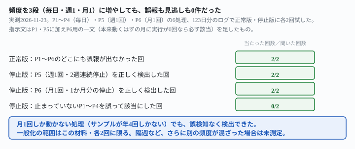

## これで何ができるか {: .what }

[処理ごとに日数を分けると誤報は消える、の記事](/recipes/per-cadence-threshold-clears-the-misfire/)は、最後にこう書いて終わっています。

「今回試したのは『毎日動く処理』と『週1回動く処理』の2種類だけです。月1回・隔週のような、さらに別の頻度が混ざったときに、この言い直しがそのまま機能するかは確かめていません」。

この記事はその先を試します。**毎日（P1〜P4）・週1回（P5）に加えて、月1回しか動かない処理（P6）を同じログに混ぜます。**

結論を先に書きます。

| 確認した項目 | 結果 |
|---|---|
| 正常版で誤報が出なかった回 | **2/2** |
| 停止版でP5（週1回・2週連続停止）を正しく検出した回 | **2/2** |
| 停止版でP6（月1回・1か月分の停止）を正しく検出した回 | **2/2** |
| 停止版でP1〜P4を誤って該当にした回 | **0/2** |

<figure class="figure">

<figcaption>3段階に増やしても、誤報も見逃しも出ませんでした。</figcaption>
</figure>

<mark>頻度ごとに固定日数の基準を分ける言い直しは、月1回の処理を足しても機能しました。</mark>正常版では2回とも「該当なし」でした。停止版では2回とも、P5（週1回の停止）とP6（月1回の停止）の両方を正しく検出し、止まっていないP1〜P4を巻き添えにした回はありませんでした。

⚠️ **月1回の処理は、このログの期間（123日）ではサンプルが4回しかありません。**週1回のP5が17回、毎日のP1〜P4が123回ぶんの記録を持つのに対し、月1回のP6はたった4回です。少ない手がかりからでも正しく判定できるかどうかが、この記事の芯です。

## 前提 {: .need }

| | |
|---|---|
| かかる時間 | 20分。[前作](/recipes/per-cadence-threshold-clears-the-misfire/)を先に読むと早いです |
| 費用 | 無料 |
| 必要なもの | 複数の定期実行の、実行時刻が分かる記録 |
| プログラミング | **不要**。実行時刻の一覧をそのまま貼るだけです |

材料は[前作](/recipes/per-cadence-threshold-clears-the-misfire/)と同じ考え方で、頻度の種類を2つから3つに増やして作り直しました。2026-07-01〜2026-10-31の123日分です。

- **P1〜P4**＝毎日動く処理（1日1〜2回〜20〜30回）。123日とも実行あり
- **P5**＝週1回、毎週月曜の朝6〜9時台に動く処理。期間中17回
- **P6**＝月1回、各月の最初の営業日の深夜に動く処理（7/1・8/3・9/1・10/1）。期間中4回

次の2つの版を用意しています。

- **正常版**＝P5・P6ともに本当の停止はありません
- **停止版**＝P5は09月の2回ぶん（09-14・09-21）が動かず、次は09-28。P6は9月の回がまるごと動かず、次は10月まで空きました（8/3〜10/1の約2か月間）

試した指示文は、[前作](/recipes/per-cadence-threshold-clears-the-misfire/)の指示文に、P6用の一文を足したものです。

これは、複数の定期実行処理が実際に動いた時刻を記録したログです。処理名は process=P1・process=P2・process=P3・process=P4・process=P5・process=P6 の6種類が混ざっています。

処理ごとに、その処理自身の記録から「ふだんの実行頻度」の目安を計算してください。そのうえで、その処理だけの目安と比べて極端に間隔が空いている期間（0件の期間を含む）があれば、処理名・期間・実行回数を挙げてください。該当する期間が無ければ「該当なし」と答えてください。

ただし、P1のように毎日動く処理で0件の日が2日以上続いたら、必ず該当として挙げてください。P5のように週1回しか動かない処理は、本来動くはずの曜日に0件が2回以上続いたら、必ず該当として挙げてください。P6のように月1回程度しか動かない処理は、本来動くはずの月（暦月）に実行が1回も無ければ、必ず該当として挙げてください。

実行方法は`claude --safe-mode --tools "" --print`による独立プロセス起動です。CLAUDE.md・skills・plugins・履歴を全部無効化するので、事前知識ゼロの条件です。正常版・停止版に各2回、計4回試しました。生の返りと機械照合は`docs/evidence/three-tier-cadence-adds-a-monthly-process.md`に全文置いてあります。

## AIへの頼み方 {: .ask }

### 正常版に試す

本当の停止が無いログに、3段階の指示文を試します。

これは、複数の定期実行処理が実際に動いた時刻を記録したログです。処理名は process=P1・process=P2・process=P3・process=P4・process=P5・process=P6 の6種類が混ざっています。

処理ごとに、その処理自身の記録から「ふだんの実行頻度」の目安を計算してください。そのうえで、その処理だけの目安と比べて極端に間隔が空いている期間（0件の期間を含む）があれば、処理名・期間・実行回数を挙げてください。該当する期間が無ければ「該当なし」と答えてください。

ただし、P1のように毎日動く処理で0件の日が2日以上続いたら、必ず該当として挙げてください。P5のように週1回しか動かない処理は、本来動くはずの曜日に0件が2回以上続いたら、必ず該当として挙げてください。P6のように月1回程度しか動かない処理は、本来動くはずの月（暦月）に実行が1回も無ければ、必ず該当として挙げてください。

1回目は「結論：全処理（P1〜P6）とも該当なし」でした。P6については月ごとに実行日を1件ずつ確認し（7月は7/1、8月は8/1が土曜なので8/3、9月は9/1、10月は10/1）、「どの月にも実行があり、条件には当たりません」と書いています。

これは、複数の定期実行処理が実際に動いた時刻を記録したログです。処理名は process=P1・process=P2・process=P3・process=P4・process=P5・process=P6 の6種類が混ざっています。

処理ごとに、その処理自身の記録から「ふだんの実行頻度」の目安を計算してください。そのうえで、その処理だけの目安と比べて極端に間隔が空いている期間（0件の期間を含む）があれば、処理名・期間・実行回数を挙げてください。該当する期間が無ければ「該当なし」と答えてください。

ただし、P1のように毎日動く処理で0件の日が2日以上続いたら、必ず該当として挙げてください。P5のように週1回しか動かない処理は、本来動くはずの曜日に0件が2回以上続いたら、必ず該当として挙げてください。P6のように月1回程度しか動かない処理は、本来動くはずの月（暦月）に実行が1回も無ければ、必ず該当として挙げてください。

2回目も「結論：該当なし」でした。「7月(1日)・8月(3日)・9月(1日)・10月(1日)のすべてに実行あり」とP6の4回を列挙しています。<mark>2回とも、正常版で誤報が起きませんでした。</mark>P1〜P4・P5についても同様に全日・全週の実行を確認した上での結論です。

### 停止版に試す

P5が09-14・09-21の2回ぶん、P6が9月の1回ぶん止まった版に、同じ指示文を試します。

これは、複数の定期実行処理が実際に動いた時刻を記録したログです。処理名は process=P1・process=P2・process=P3・process=P4・process=P5・process=P6 の6種類が混ざっています。

処理ごとに、その処理自身の記録から「ふだんの実行頻度」の目安を計算してください。そのうえで、その処理だけの目安と比べて極端に間隔が空いている期間（0件の期間を含む）があれば、処理名・期間・実行回数を挙げてください。該当する期間が無ければ「該当なし」と答えてください。

ただし、P1のように毎日動く処理で0件の日が2日以上続いたら、必ず該当として挙げてください。P5のように週1回しか動かない処理は、本来動くはずの曜日に0件が2回以上続いたら、必ず該当として挙げてください。P6のように月1回程度しか動かない処理は、本来動くはずの月（暦月）に実行が1回も無ければ、必ず該当として挙げてください。

1回目は「該当が2件あります」として、P5（8/17・8/24の月曜が2回連続で0件）とP6（2026年9月に実行が1回も無い。前回08-03・次回10-01と推定）を挙げました。P1〜P4は「0件の日はありません」と明記しています。

これは、複数の定期実行処理が実際に動いた時刻を記録したログです。処理名は process=P1・process=P2・process=P3・process=P4・process=P5・process=P6 の6種類が混ざっています。

処理ごとに、その処理自身の記録から「ふだんの実行頻度」の目安を計算してください。そのうえで、その処理だけの目安と比べて極端に間隔が空いている期間（0件の期間を含む）があれば、処理名・期間・実行回数を挙げてください。該当する期間が無ければ「該当なし」と答えてください。

ただし、P1のように毎日動く処理で0件の日が2日以上続いたら、必ず該当として挙げてください。P5のように週1回しか動かない処理は、本来動くはずの曜日に0件が2回以上続いたら、必ず該当として挙げてください。P6のように月1回程度しか動かない処理は、本来動くはずの月（暦月）に実行が1回も無ければ、必ず該当として挙げてください。

2回目も、同じP5（8/17・8/24）とP6（2026年9月）の2件だけを該当として挙げました。<mark>2回とも、本当の停止（週1回・月1回のそれぞれ1件ずつ）だけを正しく検出しました。</mark>P1〜P4を誤って該当にした回は、4回を通じて1件もありませんでした。

## うまくいかないときの言い直し方 {: .fix }

### 大きなログでは、集計の手段を自分から説明してくる {: .trouble }

<mark class="warn">4回のうち3回は、回答の中で「スクリプトは使わず、ログを目で追って確認した」という断りを自分から書きました。</mark>この実測は`--tools ""`でツールを全部無効化した環境なので、集計の道具が無いことは想定どおりです。[前作](/recipes/per-cadence-threshold-clears-the-misfire/)でも同じ断りが4回のうち3回出ており、ログが2,700行超から5,500行超に増えても、この傾向は変わりませんでした。

結論そのもの（P1〜P6の判定）は4回とも正しく、実際のログ生成条件と一致しています。ただし、**P3・P4のような件数の多い処理については「確認したのは一部の日だけ」という留保が付くことがあります。**ツールを使える環境では、この留保は起きない可能性があります。それでも、件数が多い処理を人がチャットで確認する場面では注意してください。

### 月1回の処理は、サンプルが年4回しかない {: .trouble }

P6は123日間でたった4回しか実行されていません。これだけ手がかりが少ないと、「ふだんの頻度」の目安そのものが不安定になりうる、という心配がありました。

実測では、4回とも「7月・8月・9月・10月」のように**暦月で1件ずつ数える**という安定した数え方をしており、頻度を「1か月に1回」という目安から外れて判断した回はありませんでした。<mark class="warn">ただしこれは、この記事の指示文がP6の基準を「平均や中央値」ではなく「暦月に1回あるかどうか」という数えやすい形で与えているためです。</mark>基準を渡さずにAI自身に頻度を推定させる場面では、サンプル4件からの推定がどれだけ安定するかは別に確かめる必要があります。

## 応用・次の一手 {: .next }

**この記事の値打ちは2つです。**①[前作](/recipes/per-cadence-threshold-clears-the-misfire/)が「まだ確かめていない」と明記していた頻度の種類（2→3）を実際に増やし、月1回の処理を足しても誤報・見逃しが出ないことを確かめたこと。②月1回の処理はサンプルが年4回しかないという弱点を持ちながらも、暦月単位で数える基準なら安定して判定できることを示したことです。

毎回この点検を自動で回すなら、[毎日決まった時刻にAIを動かす](/recipes/github-actions-daily-cron/)の形に載せてください。保存版はこの記事の指示文です。

これは、複数の定期実行処理が実際に動いた時刻を記録したログです。処理名は process=P1・process=P2・process=P3・process=P4・process=P5・process=P6 の6種類が混ざっています。

処理ごとに、その処理自身の記録から「ふだんの実行頻度」の目安を計算してください。そのうえで、その処理だけの目安と比べて極端に間隔が空いている期間（0件の期間を含む）があれば、処理名・期間・実行回数を挙げてください。該当する期間が無ければ「該当なし」と答えてください。

ただし、P1のように毎日動く処理で0件の日が2日以上続いたら、必ず該当として挙げてください。P5のように週1回しか動かない処理は、本来動くはずの曜日に0件が2回以上続いたら、必ず該当として挙げてください。P6のように月1回程度しか動かない処理は、本来動くはずの月（暦月）に実行が1回も無ければ、必ず該当として挙げてください。

この系列は[週1回の処理は2日ルールで誤報する記事](/recipes/weekly-cadence-trips-the-two-day-rule/)から始まり、[処理ごとに日数を分けると誤報は消える記事](/recipes/per-cadence-threshold-clears-the-misfire/)で日次・週次の2段階を解決し、この記事で月次を加えた3段階に広げました。

[更新停止の異常判定は一律にしない記事](/recipes/flat-threshold-misfires/)も、相手ごとに基準を分けると誤検知が減るという同じ方向の記事です。あちらは複数の相手を統計的に計算する形です。この記事は処理名ごとに固定日数（と暦月）を名指しする形です。

⚠️ **この記事が実測していないこと**は3つです。

- 隔週のような、毎日・週1回・月1回のどれにも当たらない頻度が混ざった場合
- P6の停止が2か月連続（2サイクル）に伸びた場合に、月1回のルール（1回でも該当）が引き続き過検知を起こさないか
- 大きなログを読ませたときの集計手段の自己申告（「目で数えた」等）が、ツールを使える環境でも同じように出るかどうか

今回の生の返りと機械照合は`docs/evidence/three-tier-cadence-adds-a-monthly-process.md`に全文置いてあります。

📌 この記事の実測は、架空のログ2版（正常版・停止版）・**全4回**です。[前作](/recipes/per-cadence-threshold-clears-the-misfire/)（計12回）と合わせて、この一連の検証は計16回になります。
