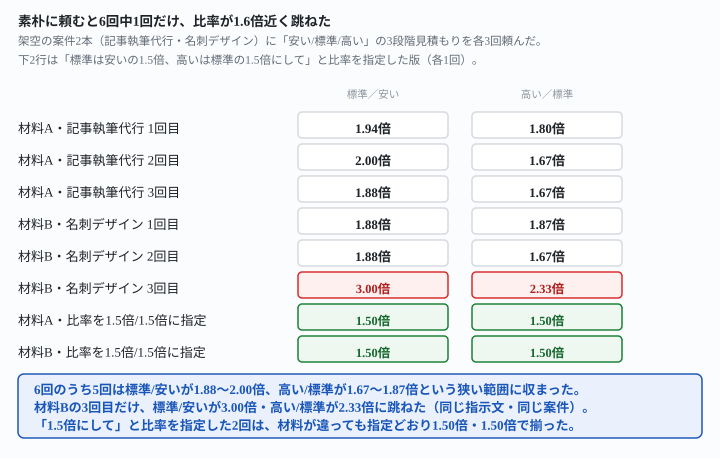
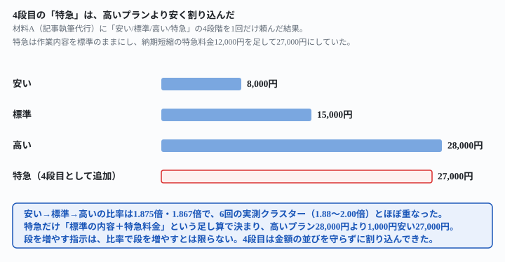

## これで何ができるか {: .what }

「見積もりは安い・標準・高いの3段階（松竹梅）で出すと、中間プランが選ばれやすく決まりやすい」。副業の価格提示でよく聞く助言です。架空の案件2本をAIに渡し、3段階見積もりを作らせて、プラン間の比率が本数をまたいで安定するかを数えました。

結論を先に書きます。

| 頼み方 | 標準／安いの比率 | 高い／標準の比率 |
|---|---|---|
| 素朴に3段階を頼む（6回） | 5回は1.88〜2.00倍、1回は3.00倍 | 5回は1.67〜1.87倍、1回は2.33倍 |
| 比率を「1.5倍に」と指定（2回） | 2回とも1.50倍 | 2回とも1.50倍 |

<figure class="figure">

<figcaption>6回のうち5回は狭い範囲に収まりましたが、1回だけ大きく外れました。</figcaption>
</figure>

<mark>素朴に3段階を頼むと、6回のうち5回は標準/安いが1.88〜2.00倍という狭い範囲に収まりました。</mark>ただし残りの1回は、同じ指示文・同じ案件なのに3.00倍まで跳ねました。<mark class="warn">比率が「いつも安定する」とは言い切れません。</mark>比率そのものを数値で指定すれば、材料が違っても2回とも指定どおりに揃いました。

この記事は、見積もりプランを3段階で作らせる6つの指示文と、比率がぶれたときの言い直し方をまとめたものです。試した記録は `docs/evidence/three-tier-estimate-ratio-slips-once-in-six.md` に全文あります。

## 前提 {: .need }

| | |
|---|---|
| かかる時間 | 15分 |
| 費用 | 無料。無料のチャットAIで足ります |
| 必要なもの | ブラウザで使えるAI（ChatGPT・Claude・Geminiなど） |
| プログラミング | **不要**。指示文をコピーして貼るだけです |

この記事の数字は、架空の案件2本（記事執筆代行・名刺デザイン）への実測です。実在の相場ではありません。<mark>この記事が測ったのは金額の水準ではなく、プラン間の比率そのものです。</mark>そのため、金額の目安ブロックは使っていません。

## AIへの頼み方 {: .ask }

### 1. まず素朴に3段階を頼む（材料A・記事執筆代行）

次の案件について、「安い」「標準」「高い」の3段階の見積もりプランを考えてください。それぞれ具体的な金額（円）と、含まれる作業内容の違いを明記してください。

案件：ブログ記事の執筆代行（1本・3,000字程度・指定キーワード1つを含める・初稿提出後に修正1回まで・納期5日）

3回試しました。3回とも、含まれる作業内容の違い（リサーチの深さ・構成提案の有無・修正対応の範囲）は明記されました。

- 1回目: 安い9,000円・標準17,500円・高い31,500円（金額が範囲で返った回は中央値）→比率1.94倍／1.80倍
- 2回目: 安い6,000円・標準12,000円・高い20,000円→比率2.00倍／1.67倍
- 3回目: 安い8,000円・標準15,000円・高い25,000円→比率1.88倍／1.67倍

3回だけを見ると、標準/安いは1.88〜2.00倍の狭い範囲でした。

### 2. 同じ文面を、別の案件に使う（材料B・名刺デザイン）

指示文の本文は1文字も変えず、案件の部分だけ入れ替えます。

次の案件について、「安い」「標準」「高い」の3段階の見積もりプランを考えてください。それぞれ具体的な金額（円）と、含まれる作業内容の違いを明記してください。

案件：名刺デザイン（データ納品のみ・両面・ロゴ画像は支給・修正2回まで・納期3日）

こちらも3回試しました。

- 1回目: 安い8,000円・標準15,000円・高い25,000円→比率1.88倍／1.67倍
- 2回目: 安い8,000円・標準15,000円・高い28,000円→比率1.88倍／1.87倍
- 3回目: 安い**5,000円**・標準15,000円・高い**35,000円**→比率**3.00倍／2.33倍**

<mark class="warn">3回目だけ、標準の金額（15,000円）は他と同じまま、安いが5,000円まで下がり、高いが35,000円まで上がりました。</mark>同じ指示文・同じ案件への3回目で、比率が大きく跳ねています。6回全体では、5回が1.88〜2.00倍／1.67〜1.87倍のクラスターに入り、1回だけ外れました。<mark>「中間プランの比率は安定する」という定説は、6回に1回は当てはまりませんでした。</mark>

### 3. 中間プランの比率を、自分で縛る

比率が気に入らないなら、比率そのものを指示文に書きます。

次の案件について、「安い」「標準」「高い」の3段階の見積もりプランを考えてください。標準の金額は安いの1.5倍、高いの金額は標準の1.5倍にしてください。それぞれ具体的な金額（円）と、含まれる作業内容の違いを明記してください。

案件：ブログ記事の執筆代行（1本・3,000字程度・指定キーワード1つを含める・初稿提出後に修正1回まで・納期5日）

材料Aでは安い4,000円・標準6,000円・高い9,000円が返りました。比率はぴたり1.50倍／1.50倍です。

次の案件について、「安い」「標準」「高い」の3段階の見積もりプランを考えてください。標準の金額は安いの1.5倍、高いの金額は標準の1.5倍にしてください。それぞれ具体的な金額（円）と、含まれる作業内容の違いを明記してください。

案件：名刺デザイン（データ納品のみ・両面・ロゴ画像は支給・修正2回まで・納期3日）

材料Bでは安い8,000円・標準12,000円・高い18,000円。こちらも1.50倍／1.50倍でした。<mark>比率を数字で渡した2回は、材料が違っても2回とも指定どおりに揃いました。</mark>§2の「3.00倍まで跳ねた」とは対照的です。

### 4. 出した金額の比率を、AI自身にも計算させる

比率が気になるなら、計算そのものもAIに検算させられます。

以下の見積もり金額について、標準は安いの何倍か、高いは標準の何倍かを、それぞれ計算してください。

安い：6,000円
標準：12,000円
高い：20,000円

返ってきた最終的な数字（標準/安い＝2倍、高い/標準＝約1.67倍）は、どちらも真値と一致しました。<mark class="warn">ただしAIの答えの途中に、本題と無関係な分数の書き違いらしき一文が挟まっていました。</mark>最終的な結論は合っていても、途中の記述まで信じてよいとは限りません。この検算は1回だけの結果です。

### 5. 段階を増やしても、比率は守られるか

3段階に慣れたら、4段階に増やしたくなるかもしれません。

次の案件について、「安い」「標準」「高い」「特急」の4段階の見積もりプランを考えてください。それぞれ具体的な金額（円）と、含まれる作業内容の違いを明記してください。

案件：ブログ記事の執筆代行（1本・3,000字程度・指定キーワード1つを含める・初稿提出後に修正1回まで・納期5日）

<figure class="figure">

<figcaption>4段目の「特急」は、比率ではなく足し算で決まり、3段目より安くなりました。</figcaption>
</figure>

安い8,000円・標準15,000円・高い28,000円までは§1のクラスターとほぼ同じ比率（1.88倍／1.87倍）でした。ところが4段目の「特急」は27,000円で、3段目の「高い」（28,000円）より安く割り込みました。<mark class="warn">特急は「標準プランの内容＋特急料金12,000円」という足し算で決まっていて、比率の延長ではありませんでした。</mark>段階を増やす指示は、既存の比率をそのまま延ばしてくれるとは限りません。

## うまくいかないときの言い直し方 {: .fix }

### 比率が毎回ばらついて、見積もりの説明に使いにくい {: .trouble }

§2で見たとおり、素朴に頼むだけでは比率が崩れることがあります。§3の指示文に戻り、「1.5倍」の部分を自分の決めた倍率（1.3倍・2倍など）に、案件の部分を自分の依頼内容に書き換えて使ってください。倍率を数字で渡す言い方そのものは、この記事では2回とも正確に守られました。

### 中間プランだけを選ばせたい（アンカリングの効果を知りたい） {: .trouble }

この記事で測ったのは「比率が安定するか」だけで、「中間プランが実際に選ばれやすいか」は別の問いです。<mark class="warn">架空の案件をAIに渡した対話では、人間の読み手が中間プランを選ぶかどうかは確かめられません。</mark>そこは実際の見積もり書を使って、自分の依頼主の反応を見るしかありません。

### 作業内容の違いが、金額ほど具体的に書かれない {: .trouble }

§1・§2の指示文はどの回も「含まれる作業内容の違いを明記してください」という一文を含んでいます。それでも説明が薄いと感じたら、同じ指示文に「表の形で」と一言だけ足してください。この記事の返りも、足さずに表やチェックリストの形で返ってきた回がほとんどでした。

## 応用・次の一手 {: .next }

比率を指定する言い方は、見積もりの根拠を数える頼み方とも組み合わせられます。見積もりの件数や根拠が実際に正しいかは、[見積もりの根拠件数を数えさせる](/recipes/count-the-estimate-basis/)で別に試しています。

3段階の見積もりを提案文の下書きに乗せるなら、[案件の提案文を下書きまで作る](/recipes/proposal-draft-what-actually-repeats/)の指示文と組み合わせてください。あちらは提案文そのものの再現性を扱っていて、今回の価格の比率とは別の軸です。

**今回の数字はすべて架空の案件2本での実測**（素朴な指示6回＋比率指定2回＋検算1回＋4段階1回＝計10回）です。生の返りと計算は `docs/evidence/three-tier-estimate-ratio-slips-once-in-six.md` に全文置いてあります。
