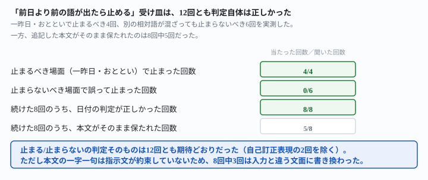
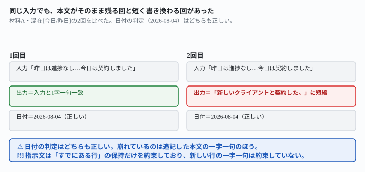

## これで何ができるか {: .what }

[新しい相対語も一般化で直る](/recipes/relative-word-generalizes-but-yesterday-slips/)は、記事の末尾にこう書いて終わっていました。「2日前・3日前を指す語（一昨日など）や、同じ走り書きに複数の相対語が混ざる場合も試していません」。同じ節で、先に受け皿も提案していました。「前日より前を指す語が出た場合は、作業を止めて人に確認してください」。

この受け皿を実際に足して測りました。

<figure class="figure">

<figcaption>止まる判定は12回とも正しかった。崩れたのは別の場所だった。</figcaption>
</figure>

<mark>結論は2つです。①「一昨日」「おととい」が出たとき、受け皿は4回とも正しく止まりました。②別の相対語（今日・昨日・本日・前日）が同じ行に混ざっても、誤って止まることは6回とも起きませんでした。</mark>指示文に例として書いていない「本日」「前日」という言い換えにも、受け皿の判断はそのまま広がりました。

<mark class="warn">③ただし、止まらず続けた8回のうち3回は、追記された本文が入力と違う文面に書き換わっていました。</mark>日付の判定はどの回も正しかったのですが、記録として残る文章そのものが短縮されていることがあります。[通知や記録を自動で残したい](/recipes/append-rounds-date-drift/)と考えている人に関わる落とし穴です。

## 前提 {: .need }

| | |
|---|---|
| かかる時間 | 20分。[前作](/recipes/relative-word-generalizes-but-yesterday-slips/)を先に読むと早いです |
| 費用 | 無料。無料のチャットAIで足ります |
| 必要なもの | ブラウザで使えるAI（ChatGPT・Claude・Geminiなど）と、毎日1行ずつ追記しているテキストファイル |
| プログラミング | **不要**。ファイルはメモ帳で作れるただのテキストです |

⚠️ **[新しい相対語も一般化で直る](/recipes/relative-word-generalizes-but-yesterday-slips/)を先に読んでください。**そちらが見つけた「今日にあたる語」と「前日にあたる語」を意味で区別する言い方を、この記事はそのまま引いています。「2日前以上は止めて確認する」という受け皿の提案も同じ記事からです。

📌 **この記事の数字は、すべて架空データでの実測です。**2026-11-01という日付だけは本物です。

## AIへの頼み方 {: .ask }

### 1. 受け皿を足した指示文を、まず「一昨日」「おととい」で試す

前作の指示文に、「前日より前を指す言葉（一昨日・おととい等）が出た場合は、日付を決めずに『確認が必要です』と書いて作業を止めてください」という1文を足しました。

下の「記録ファイル」の末尾に、【今日ぶん】を1行だけ追記してください。すでにある行は1文字も変えないでください。【今日ぶん】の中に日付の表記が無く、相対的な言葉だけで時点が書かれている場合は、実際のシステム上の今日の日付を使わないでください。その言葉が指す時点を、記録ファイルの最後の行を基準に判断してください。前の行からの続きとして今日にあたる言葉なら、記録ファイルの最後の行の次の日を使い、前の行と同じ日を指す言葉（前日を指す言葉など）なら、記録ファイルの最後の行と同じ日付を使ってください。ただし、前日より前を指す言葉（一昨日・おととい等）が出た場合は、日付を決めずに「確認が必要です」と書いて作業を止めてください。更新後のファイル全体を、コードブロックで出してください。

記録ファイル:
2026-08-01: クラウドワークスで新規案件2件に応募した。
2026-08-02: 応募した案件のうち1件から返信があり、初回ヒアリングを実施した。
2026-08-03: ヒアリング内容をもとに見積もりを作成し、クライアントへ送付した。

【今日ぶん】
一昨日の分の記録を忘れていたので追記します。別のクライアントから追加の修正依頼が来ました。

2回とも「確認が必要です」と書いて止まり、ファイルへの追記もコードブロックでの全文出力も行いませんでした。別の材料（店舗の引き継ぎノート）で「おととい」を試した2回も、同じく2回とも止まりました。

下の「記録ファイル」の末尾に、【今日ぶん】を1行だけ追記してください。すでにある行は1文字も変えないでください。【今日ぶん】の中に日付の表記が無く、相対的な言葉だけで時点が書かれている場合は、実際のシステム上の今日の日付を使わないでください。その言葉が指す時点を、記録ファイルの最後の行を基準に判断してください。前の行からの続きとして今日にあたる言葉なら、記録ファイルの最後の行の次の日を使い、前の行と同じ日を指す言葉（前日を指す言葉など）なら、記録ファイルの最後の行と同じ日付を使ってください。ただし、前日より前を指す言葉（一昨日・おととい等）が出た場合は、日付を決めずに「確認が必要です」と書いて作業を止めてください。更新後のファイル全体を、コードブロックで出してください。

記録ファイル:
2026-10-13: 新しいレジ端末の設定が完了した。
2026-10-14: 発注の締め日を毎週水曜に変更した。
2026-10-15: 新人スタッフの研修を1日目まで終えた。

【今日ぶん】
おとといのシフト表に誤りがあったので直しておきます。土曜の担当者が重複していました。

「一昨日」「おととい」という言い回しの違いにまたがって、受け皿は4回とも正しく機能しました。

### 2. 別の相対語が混ざった走り書きで、誤って止まらないかを試す

次は、止まるべきではない走り書きです。「昨日」や「本日」「前日」のような語が同じ行に混ざっても、本当の時点（今日）がはっきりしている場合を用意しました。

下の「記録ファイル」の末尾に、【今日ぶん】を1行だけ追記してください。すでにある行は1文字も変えないでください。【今日ぶん】の中に日付の表記が無く、相対的な言葉だけで時点が書かれている場合は、実際のシステム上の今日の日付を使わないでください。その言葉が指す時点を、記録ファイルの最後の行を基準に判断してください。前の行からの続きとして今日にあたる言葉なら、記録ファイルの最後の行の次の日を使い、前の行と同じ日を指す言葉（前日を指す言葉など）なら、記録ファイルの最後の行と同じ日付を使ってください。ただし、前日より前を指す言葉（一昨日・おととい等）が出た場合は、日付を決めずに「確認が必要です」と書いて作業を止めてください。更新後のファイル全体を、コードブロックで出してください。

記録ファイル:
2026-08-01: クラウドワークスで新規案件2件に応募した。
2026-08-02: 応募した案件のうち1件から返信があり、初回ヒアリングを実施した。
2026-08-03: ヒアリング内容をもとに見積もりを作成し、クライアントへ送付した。

【今日ぶん】
昨日は特に進捗がなかったので記録していませんでしたが、今日は新しいクライアントと契約しました。

2回とも止まらず、正しく2026-08-04として続けました。「本日」「前日」という、指示文に例として挙げていない言い換えでも試しました。

下の「記録ファイル」の末尾に、【今日ぶん】を1行だけ追記してください。すでにある行は1文字も変えないでください。【今日ぶん】の中に日付の表記が無く、相対的な言葉だけで時点が書かれている場合は、実際のシステム上の今日の日付を使わないでください。その言葉が指す時点を、記録ファイルの最後の行を基準に判断してください。前の行からの続きとして今日にあたる言葉なら、記録ファイルの最後の行の次の日を使い、前の行と同じ日を指す言葉（前日を指す言葉など）なら、記録ファイルの最後の行と同じ日付を使ってください。ただし、前日より前を指す言葉（一昨日・おととい等）が出た場合は、日付を決めずに「確認が必要です」と書いて作業を止めてください。更新後のファイル全体を、コードブロックで出してください。

記録ファイル:
2026-10-13: 新しいレジ端末の設定が完了した。
2026-10-14: 発注の締め日を毎週水曜に変更した。
2026-10-15: 新人スタッフの研修を1日目まで終えた。

【今日ぶん】
前日の発注分はまだ届いていませんが、本日は棚卸しを無事終えました。

<mark>「前日」という字面には「前」が入っているのに、「前日より前」という受け皿の条件とは混同されませんでした。</mark>2回とも止まらず、正しく2026-10-16として続けました。別の相対語が混ざった6回のうち、誤って止まった回は0回でした。

### 3. 「今日というか昨日」のような自己訂正の言い方も試す

受け皿のどちらの条件にも当てはまらない、もう1つの形も試しました。「今日」と言ってから「昨日」に言い直す走り書きです。

下の「記録ファイル」の末尾に、【今日ぶん】を1行だけ追記してください。すでにある行は1文字も変えないでください。【今日ぶん】の中に日付の表記が無く、相対的な言葉だけで時点が書かれている場合は、実際のシステム上の今日の日付を使わないでください。その言葉が指す時点を、記録ファイルの最後の行を基準に判断してください。前の行からの続きとして今日にあたる言葉なら、記録ファイルの最後の行の次の日を使い、前の行と同じ日を指す言葉（前日を指す言葉など）なら、記録ファイルの最後の行と同じ日付を使ってください。ただし、前日より前を指す言葉（一昨日・おととい等）が出た場合は、日付を決めずに「確認が必要です」と書いて作業を止めてください。更新後のファイル全体を、コードブロックで出してください。

記録ファイル:
2026-08-01: クラウドワークスで新規案件2件に応募した。
2026-08-02: 応募した案件のうち1件から返信があり、初回ヒアリングを実施した。
2026-08-03: ヒアリング内容をもとに見積もりを作成し、クライアントへ送付した。

【今日ぶん】
今日というか昨日の分になりますが、追加の経費精算を済ませました。

<mark>「今日というか昨日」という書き方では、2回とも同じ判断でした。</mark>「というか」の後半（昨日）を正解として、記録ファイルの最後の行と同じ日付（2026-08-03）にしました。前日より前を指す語は無いので、受け皿は作動せず、止まりませんでした。2回とも答えが揺れなかった点は確認できましたが、この言い方が受け皿のどちらの条件にも明記されていないことに変わりはありません。

### 4. 止まらなかった8回で、本文そのものが保たれているかを見る

ここまでの「止まる/止まらない」の判定はすべて正しかったのですが、続けた8回の出力を見比べると、別の崩れ方に気づきました。

<figure class="figure">

<figcaption>日付は毎回正しかった。崩れたのは追記した本文のほうだった。</figcaption>
</figure>

同じ入力「昨日は特に進捗がなかったので記録していませんでしたが、今日は新しいクライアントと契約しました。」に対し、1回目は入力と1字一句一致した本文を追記しましたが、2回目は「新しいクライアントと契約した。」に短縮されていました。<mark class="warn">続けた8回のうち3回、追記された本文が入力と違う文面になっていました。</mark>日付の判定はどちらの回も正しいままです。

🔑 **原因は指示文の抜けです。**指示文は「すでにある行は1文字も変えないでください」とだけ約束していて、**新しく追記する行の本文そのものを一字一句保つとは約束していません。**AIは日付を正しく判断したうえで、本文のほうは要約してよいと解釈したようです。

## うまくいかないときの言い直し方 {: .fix }

### 止まる判定は合っているのに、記録された本文が短くなっている {: .trouble }

2番の指示文に、「追記する本文は、入力された文章を一字一句そのまま使ってください」という1文を足してください。

下の「記録ファイル」の末尾に、【今日ぶん】を1行だけ追記してください。すでにある行は1文字も変えないでください。【今日ぶん】の中に日付の表記が無く、相対的な言葉だけで時点が書かれている場合は、実際のシステム上の今日の日付を使わないでください。その言葉が指す時点を、記録ファイルの最後の行を基準に判断してください。前の行からの続きとして今日にあたる言葉なら、記録ファイルの最後の行の次の日を使い、前の行と同じ日を指す言葉（前日を指す言葉など）なら、記録ファイルの最後の行と同じ日付を使ってください。ただし、前日より前を指す言葉（一昨日・おととい等）が出た場合は、日付を決めずに「確認が必要です」と書いて作業を止めてください。追記する本文は、入力された文章を一字一句そのまま使ってください。更新後のファイル全体を、コードブロックで出してください。

⚠️ **この言い直しは、この記事では実測していません。**どの程度確実に効くかは、ご自分の環境で2回以上試して確かめてください。「すでにある行」だけでなく「追記する行」にも保持を求める一文を足す、という考え方自体は、[積み上げた指示ファイルを掃除する](/recipes/date-decides-which-note-wins/)などで繰り返し効いている形です。

### 「前日より前」の受け皿を足していない

1番・2番の指示文のまま、受け皿の一文を外すと、「一昨日」「おととい」が出ても止まりません。前作が実測したとおり、素朴な一般化だけでは「前日」にあたる語（昨日など）すら2回に1回揺れました。受け皿の一文は必ず残してください。

## 応用・次の一手 {: .next }

**この記事の結論は2つです。**①「前日より前を指す語が出たら止めて確認する」という受け皿は、「一昨日」「おととい」という言い回しの違いにまたがって4回とも正しく機能しました。②別の相対語（今日・昨日・本日・前日）が同じ行に混ざっても、誤って止まることは6回とも起きませんでした。指示文に例として無い言い換え（本日・前日）にも、意味の区別はそのまま広がりました。

⚠️ **③は注意が必要です。**止まらず続けた8回のうち3回、追記された本文そのものが入力と違う文面に短縮されていました。日付の判定はどの回も正しく、「新着があったこと」自体は毎回分かります。**ただし元の走り書きをそのまま記録に残したい場合は、本文の一字一句まで指示文で約束してください。**

📌 **この記事が実測していないこと**は次の2つです。

- 「今日というか昨日の分になりますが」のような自己訂正の言い方は、2回とも同じ判断（前日）で揺れませんでしたが、受け皿のどちらの条件にも明記されていない振れ方でした。もっと多様な自己訂正の言い方でも同じ判断になるかは確かめていません。
- 材料は副業の作業記録と店舗の引き継ぎノートの2本です。[前作](/recipes/relative-word-generalizes-but-yesterday-slips/)が残した「2日前・3日前を指す語」のうち、3日前以上を指す語（「3日前」そのものなど）は試していません。
