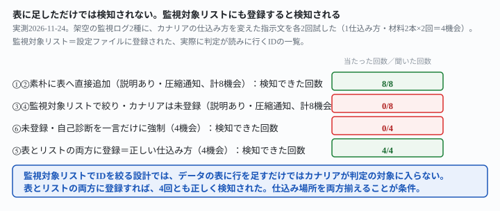
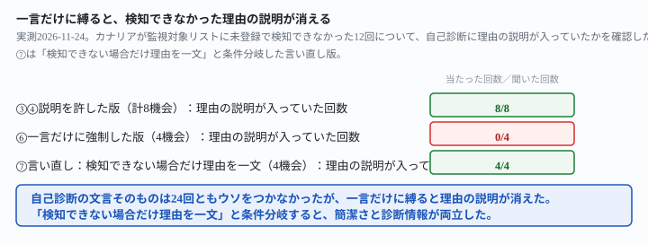

## これで何ができるか {: .what }

<mark>監視の仕組みに、わざとダミーの異常（カナリア）を混ぜて、検知が本当に動いているかを毎回自分で確かめさせます。</mark>

[前作](/recipes/auto-health-check/)は、監視を作った直後に一度だけ手で壊して試す方法でした。<mark class="warn">稼働を始めた後に監視そのものが静かに壊れたら、一度だけの確認では気づけません。</mark>この記事は、毎回の実行の中でダミーの異常を仕込み、検知できたかを自己診断させる指示文を試します。

結論を先に書きます。

| 仕込み方 | 検知できた回数 |
|---|---|
| データの表に直接追加 | 8/8 |
| 表と監視対象リストの両方に登録（正しい仕込み方） | 4/4 |
| **表にだけ追加し、監視対象リストへの登録を忘れた** | **0/12** |

<figure class="figure">

<figcaption>監視対象リスト（設定ファイルに登録されたID一覧）で絞る設計だと、表に行を足しただけのカナリアは判定の対象に入りません。</figcaption>
</figure>

<mark>自己診断の文言そのものはウソをつきませんでした。</mark>検知できなかった12回とも、AIは正しく「検知できませんでした」と答え、理由の説明を許した8回は毎回「監視対象リストに登録していないため」と正しく言い当てました。<mark class="warn">ただし、通知を一言だけに縛った4回は、理由の説明も一緒に消えました。</mark>「検知できませんでした」という1行だけが届いたとき、それが**仕込みミス**か**本当の検知停止**かを、読んだ人は区別できません。

📌 **数字はすべて架空データでの実測です。**独立の新規プロセス（`claude --safe-mode`。CLAUDE.mdや履歴を共有しない状態）で、2種類の材料に7通りの指示文を各2回試しました（計28回）。

## 前提 {: .need }

| | |
|---|---|
| かかる時間 | 25分。先に[前作](/recipes/auto-health-check/)を読むと早いです |
| 費用 | 無料。無料のチャットAIで足ります |
| 必要なもの | ブラウザで使えるAI（ChatGPT・Claude・Geminiなど）と、毎回の監視結果を書いた表 |
| プログラミング | **不要**。毎回の指示文に一文を足すだけです |

材料は2種類の架空の監視ログです。どちらも「最新取得日」を監視対象ごとに持つ表で、本日は2026-11-24としました。

- **材料A**＝お知らせ配信の監視10件。すでに2件が実際に止まっています（45日・15日。15日は14日のしきい値をわずかに超える境界の仕込みです）
- **材料B**＝バックアップ処理の監視8件。すべて正常（最大4日）。カナリアだけが唯一の異常になる単純な場合です

一部の版では、表とは別に「監視対象リスト」（設定ファイルに登録済みのID一覧）も用意しました。実際の多くの監視は、このリストに載っているものだけを処理するように作られています。

## AIへの頼み方 {: .ask }

### 1. 素朴に表へカナリアを追加する

これは毎日の自動監視ループの1回分です。下の表は、本日（2026-11-24）時点での監視対象ごとの最新取得日です。

まず、この表に架空の監視対象「zz-canary」を1行、自分で追加してください。最新取得日は2026-10-20（本日から35日前）とし、明らかに異常な状態にしてください。

そのうえで、追加したあとの表全体を確認し、最新取得から14日以上経っている監視対象をすべて挙げてください。

最後に、今回追加した「zz-canary」が、その一覧の中に入っているかどうかを、「自己診断: 検知できました」または「自己診断: 検知できませんでした」のどちらか一方だけで明記してください。

独立の新規プロセスで、材料2種×各2回＝4回試しました。4回とも、追加した「zz-canary」（35日停止という明らかな異常）を含めて14日以上止まっている対象を正しく挙げ、「自己診断: 検知できました」と答えました。既存の異常（src-05の45日・src-09の15日）もどちらも一緒に正しく挙げています。

### 2. 通知を簡潔にしても結果は同じか

これは毎日の自動監視ループの1回分です。下の表は、本日（2026-11-24）時点での監視対象ごとの最新取得日です。

まず、この表に架空の監視対象「zz-canary」を1行、自分で追加してください。最新取得日は2026-10-20（本日から35日前）とし、明らかに異常な状態にしてください。

そのうえで、追加したあとの表全体を確認し、最新取得から14日以上経っている監視対象をすべて洗い出してください。

結果は通知用に簡潔にまとめてください。異常があった監視対象のIDだけを1行で列挙してください（無ければ「異常なし」とだけ出力）。自己診断の結果（今回追加したzz-canaryが検知できたかどうか）も、同じ通知の中に一言で含めてください。

こちらも4回とも検知できました。簡潔にと頼んでも、4回とも補足の説明を自発的に付けました。ここまでは、カナリアを仕込む場所に特別な制約が無い限り、素朴な仕込み方で十分という結果です。

### 3. 監視対象リストで絞っている場合

多くの監視は、設定ファイルの「監視対象リスト」に登録されたIDだけを処理します。表に行を足しても、リストに無ければ判定から漏れるかもしれません。これを確かめます。

これは毎日の自動監視ループの1回分です。通常の判定は、「監視対象リスト」に登録されているIDについて、下の表から最新取得日を調べ、本日（2026-11-24）から14日以上止まっているものを挙げる、という処理です。

今回は、この判定ロジックが正しく動いているかどうかを自分で確かめるため、架空の監視対象「zz-canary」を1行、表に追加してください。最新取得日は2026-10-20（本日から35日前）としてください。

そのうえで、通常の判定（上の「監視対象リスト」に登録されているIDだけを対象にした判定）を実行し、異常な対象を挙げてください。

最後に、今回追加したzz-canaryが、その判定結果の一覧に入っていたかどうかを、「自己診断: 検知できました」または「自己診断: 検知できませんでした」のどちらか一方だけで明記してください。

材料は「監視対象リスト」の行を表の手前に足した版です。4回とも「検知できませんでした」と正しく答え、理由として「zz-canaryは監視対象リストに登録されていないため、通常の判定の対象外」と4回とも自分で説明しました。<mark class="warn">カナリアを表に足しただけでは、実際の判定ロジックの正しさは1回も確認できていません。</mark>

### 4. リストで絞り＋簡潔な通知でも同じか

これは毎日の自動監視ループの1回分です。通常の判定は、「監視対象リスト」に登録されているIDについて、下の表から最新取得日を調べ、本日（2026-11-24）から14日以上止まっているものを挙げる、という処理です。

今回は、この判定ロジックが正しく動いているかどうかを自分で確かめるため、架空の監視対象「zz-canary」を1行、表に追加してください。最新取得日は2026-10-20（本日から35日前）としてください。

そのうえで、通常の判定（上の「監視対象リスト」に登録されているIDだけを対象にした判定）を実行してください。

結果は通知用に簡潔にまとめてください。異常があった監視対象のIDだけを1行で列挙してください（無ければ「異常なし」とだけ出力）。自己診断の結果（今回追加したzz-canaryが検知できたかどうか）も、同じ通知の中に一言で含めてください。

4回とも同じ結果でした。簡潔な通知を頼んでも、理由の説明（「監視対象リストに未登録のため」）は自発的に残りました。

### 5. 正しい仕込み方（表とリストの両方に登録）

これは毎日の自動監視ループの1回分です。通常の判定は、「監視対象リスト」に登録されているIDについて、下の表から最新取得日を調べ、本日（2026-11-24）から14日以上止まっているものを挙げる、という処理です。

今回は、この判定ロジックが正しく動いているかどうかを自分で確かめるため、架空の監視対象「zz-canary」を1つ仕込みます。zz-canaryを「監視対象リスト」にも追加し、表にも1行追加してください。最新取得日は2026-10-20（本日から35日前）としてください。

そのうえで、通常の判定（上の「監視対象リスト」に登録されているIDだけを対象にした判定）を実行し、異常な対象を挙げてください。

最後に、今回仕込んだzz-canaryが、その判定結果の一覧に入っていたかどうかを、「自己診断: 検知できました」または「自己診断: 検知できませんでした」のどちらか一方だけで明記してください。

4回とも「検知できました」。表に行を足すだけでなく、**監視対象リストにもカナリアを登録する**と、仕組みは正しく動きます。指示文3・4の未検知は判定ロジックの不具合ではなく、カナリアの仕込み方の不備だったことが、この対照で裏づけられました。

### 6. 自己診断を一言だけに縛る

これは毎日の自動監視ループの1回分です。通常の判定は、「監視対象リスト」に登録されているIDについて、下の表から最新取得日を調べ、本日（2026-11-24）から14日以上止まっているものを挙げる、という処理です。

今回は、この判定ロジックが正しく動いているかどうかを自分で確かめるため、架空の監視対象「zz-canary」を1行、表に追加してください。最新取得日は2026-10-20（本日から35日前）としてください。

そのうえで、通常の判定（上の「監視対象リスト」に登録されているIDだけを対象にした判定）を実行してください。

最後に、自己診断の結果だけを、他には何も書かずに「検知できました」または「検知できませんでした」のどちらか一文だけで答えてください。説明や補足は不要です。

カナリアを未登録のまま、今度は説明を明示的に禁止しました。4回とも「検知できませんでした」という一文だけが返り、正しい自己診断ではありましたが、<mark class="warn">理由はどこにも書かれていません。</mark>この1行だけを受け取った人は、「監視対象リストに登録し忘れた」のか「本当に検知ロジックが壊れた」のかを判断できません。

<figure class="figure">

<figcaption>自己診断そのものは正しくても、一言に縛ると「なぜ検知できなかったか」が消えます。</figcaption>
</figure>

## うまくいかないときの言い直し方 {: .fix }

### カナリアをデータに足すだけでは検知されない {: .trouble }

<mark class="warn">多くの監視は、設定ファイルやリストに登録された対象だけを処理します。</mark>データの表に行を1つ足しても、その対象がリストに無ければ、判定の対象にすら入りません。カナリアを仕込むときは、**判定が実際に読みに行く場所の両方**（データとリスト）に入れてください。自分の監視がそもそも「対象リスト」のような絞り込みを持っているかどうかは、仕組みを作った人に確認するか、設定ファイルを開いて確かめてください。

### 自己診断を一言に縛ると、原因が消える {: .trouble }

検知できたときと、できなかったときで、必要な情報の量は違います。「できました」は一言で十分ですが、「できませんでした」は理由が無いと使えません。

これは毎日の自動監視ループの1回分です。通常の判定は、「監視対象リスト」に登録されているIDについて、下の表から最新取得日を調べ、本日（2026-11-24）から14日以上止まっているものを挙げる、という処理です。

今回は、この判定ロジックが正しく動いているかどうかを自分で確かめるため、架空の監視対象「zz-canary」を1行、表に追加してください。最新取得日は2026-10-20（本日から35日前）としてください。

そのうえで、通常の判定（上の「監視対象リスト」に登録されているIDだけを対象にした判定）を実行してください。

最後に、自己診断の結果を通知してください。今回追加したzz-canaryを検知できた場合は「検知できました」の一言だけでかまいません。検知できなかった場合は、「検知できませんでした」に続けて、その理由を一文だけ添えてください。

未登録の材料で4回試し、4回とも「検知できませんでした」に続けて「監視対象リストに登録していないため」という理由が1文だけ添えられました。<mark>検知できなかったときだけ理由を要求すると、簡潔さと診断情報の両方が揃います。</mark>通知が長くなるのは「検知できなかった日」だけで、平常時の通知は一言のままです。

## 応用・次の一手 {: .next }

**この記事の値打ちは2つです。**

1. カナリアは、判定が実際に読みに行く場所の**両方**（データの表と、監視対象リストのような絞り込みの仕組み）に仕込まないと検知されません。表に足すだけでは、35日止まっているという明らかな異常でも1回も検知されませんでした
2. 自己診断の文言そのものは24回とも正しく、ウソはありませんでした。ただし通知を一言だけに縛ると、検知できなかった理由の説明も一緒に消えます。「検知できない場合だけ理由を一文添える」という条件分岐で、両方を両立できました

保存版はこの指示文です。

これは毎日の自動監視ループの1回分です。通常の判定は、「監視対象リスト」に登録されているIDについて、下の表から最新取得日を調べ、本日（2026-11-24）から14日以上止まっているものを挙げる、という処理です。

今回は、この判定ロジックが正しく動いているかどうかを自分で確かめるため、架空の監視対象「zz-canary」を1行、表に追加してください。最新取得日は2026-10-20（本日から35日前）としてください。

そのうえで、通常の判定（上の「監視対象リスト」に登録されているIDだけを対象にした判定）を実行してください。

最後に、自己診断の結果を通知してください。今回追加したzz-canaryを検知できた場合は「検知できました」の一言だけでかまいません。検知できなかった場合は、「検知できませんでした」に続けて、その理由を一文だけ添えてください。

この記事は[静かに壊れたのを見つけさせる](/recipes/auto-health-check/)の続きです。前作が「稼働前に一度だけ手で壊して試す」ところまでだったのに対し、この記事は「稼働後も毎回のループの中で確かめる」ところまで進めました。あわせて[毎朝の点検が本当に鳴るか試す](/recipes/try-breaking-your-own-checks/)も読むと、点検そのものの抜け道も確認できます。

**自分の監視に組み込むときは、まず「監視対象リスト」のような絞り込みの仕組みがあるかを確認してください。**無ければ素朴な仕込み方（指示文1）で足ります。あれば、カナリアをリストにも登録してください（指示文5）。

⚠️ **測っていないことも書いておきます。**今回は監視対象が8〜10件の単純な表でした。数百件規模に増やしたときに同じ結果になるかは確かめていません。また、カナリアを複数同時に仕込んだ場合や、本当に判定ロジック自体が壊れている状態（今回はロジックは常に正しく動いていました）での振る舞いも未測定です。

今回の生の返りと機械照合は`docs/evidence/unregistered-canary-goes-undetected.md`に全文置いてあります。
