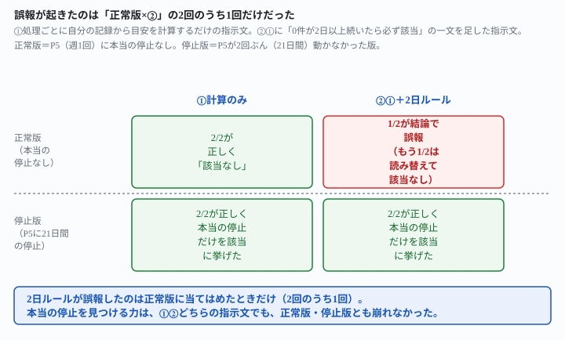
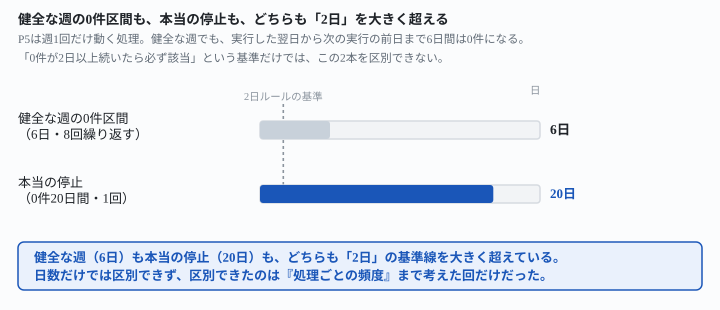

## これで何ができるか {: .what }

[頻度の低い処理の停止を2日で見逃した記事](/recipes/short-stop-slips-through-on-the-quiet-process/)は、
直し方として「0件の日が2日以上続いたら、ふだんの範囲内と判断せず必ず該当として挙げてください」という
一文を勧めました。<mark>この記事は、この「0件が2日以上続いたら必ず該当」という一文を**週1回しか動かない処理**に当てはめました。</mark>
週1回の処理は、健全なときでも実行日の翌日から次の実行日の前日まで、6日間ずっと0件です。
「2日以上」という基準を文字どおり読めば、**健全な週がすべて「該当」になってしまいます。**

結論を先に書きます。

| 材料 | 指示文 | 結果 |
|---|---|---|
| 正常版（本当の停止なし） | ①自分の記録から計算するだけ | 2回とも「該当なし」。P5を週次処理と正しく認識 |
| 正常版（本当の停止なし） | ②①＋「2日ルール」 | **2回のうち1回、結論で「該当になります」と誤報**。もう1回は読み替えて該当なし |
| 停止版（P5に21日間の本当の停止） | ①自分の記録から計算するだけ | 2回とも、本当の停止の日だけを正しく名指し |
| 停止版（P5に21日間の本当の停止） | ②①＋「2日ルール」 | 2回とも、本当の停止の日だけを正しく名指し。ルールを「本来動く日」に読み替えて適用 |

<mark class="warn">前の記事が勧めた直し方そのものが、頻度の低い処理の種類によって新しい誤報を生みました。</mark>
一方、「自分の記録から目安を計算するだけ」の指示文（固定ルールの一文を足さない版）は、
正常版・停止版のどちらでも4回とも崩れませんでした。

<figure class="figure">

<figcaption>誤報が起きたのは「正常版×2日ルール」の組み合わせだけでした。</figcaption>
</figure>

⚠️ **これは1種類の週次処理（P5）・各2回・計8回の実測です。**「固定の日数ルールは低頻度処理に
使えない」と一般化はしません——**この材料・この回数で、誤報が起きたという事実だけが実測です**。

## 前提 {: .need }

| | |
|---|---|
| かかる時間 | 20分。[先行記事](/recipes/short-stop-slips-through-on-the-quiet-process/)を先に読むと早いです |
| 費用 | 無料。無料のチャットAIで足ります |
| 必要なもの | 複数の定期実行の、実行時刻が分かる記録（GitHub Actionsの実行履歴・ログファイルのタイムスタンプなど） |
| プログラミング | **不要**。実行時刻の一覧をそのまま貼るだけです |

材料は、[先行記事](/recipes/short-stop-slips-through-on-the-quiet-process/)と同じP1〜P4
（1日1〜2回〜20〜30回、60日間・2026-08-15〜10-13、いずれも正常）に、新しく**P5**を足しました。

- **P5**＝週1回（毎週月曜の朝6〜9時台）だけ動くバッチ処理。実行する月曜は3〜6回を記録

用意した2つの版です。

- **正常版**＝P5は期間中の月曜9回すべてで実行（08-17〜10-12）。本当の停止はありません
- **停止版**＝P5が09-07の実行のあと2回ぶん（09-14・09-21）動かず、次の実行は09-28。
  直前の実行から次の実行まで**21日間**空きました

ログを生成したあと、別のスクリプトで日付ごと・処理ごとに正規表現で再集計し、
次の2点を確認しました。

- P1〜P4は60日間すべてに1件以上の記録があり、意図しない0件の日が無いこと
- P5の実行日が、正常版・停止版それぞれで意図した日付と1日のずれもなく一致すること

2つの指示文を、それぞれ正常版・停止版に2回ずつ（計8回）試しました。
実行方法は `claude --safe-mode --tools "" --print` による独立プロセス起動です
（CLAUDE.md・skills・plugins・履歴を全部無効化するので、答えを知らない側として厳密な
事前知識ゼロの条件です。会話は継続せず、1回につき新規プロセスを起動しました）。
生の返りと機械照合は `docs/evidence/weekly-cadence-trips-the-two-day-rule.md` に全文置いてあります。

## AIへの頼み方 {: .ask }

### 正常版に、計算するだけの指示文を試す

[先行記事](/recipes/short-stop-slips-through-on-the-quiet-process/)で使った指示文に、
処理名をP5まで増やしただけです。固定の日数ルールは足していません。

<div class="prompt">これは、複数の定期実行処理が実際に動いた時刻を記録したログです。処理名は process=P1・process=P2・process=P3・process=P4・process=P5 の5種類が混ざっています。

処理ごとに、その処理自身の記録から「ふだんの1日あたりの実行回数」の目安を計算してください。そのうえで、その処理だけの目安と比べて極端に少ない日（0件の日を含む）があれば、処理名・日付・実行回数を挙げてください。該当する日が無ければ「該当なし」と答えてください。</div>

1回目は「結果：該当なし」。P5について「月曜以外は記録がありませんが、これは週1回の処理だからです。
止まっていたわけではありません。8/17から10/12までの9回の月曜すべてに実行があり、抜けた週はありません」
と、理由まで正しく書いています。

<div class="prompt">これは、複数の定期実行処理が実際に動いた時刻を記録したログです。処理名は process=P1・process=P2・process=P3・process=P4・process=P5 の5種類が混ざっています。

処理ごとに、その処理自身の記録から「ふだんの1日あたりの実行回数」の目安を計算してください。そのうえで、その処理だけの目安と比べて極端に少ない日（0件の日を含む）があれば、処理名・日付・実行回数を挙げてください。該当する日が無ければ「該当なし」と答えてください。</div>

2回目も「結論：該当なし」。「記録があるのは08-17、08-24、…、10-12で、いずれも月曜日です。
期間中の月曜9回すべてに記録があり、月曜以外に0件なのはもともとの実行スケジュールどおりと
考えられます」と判断しています。<mark>固定ルールを足さなければ、2回とも誤報は起きませんでした。</mark>

### 正常版に、「2日ルール」を足した指示文を試す

[先行記事](/recipes/short-stop-slips-through-on-the-quiet-process/)が直し方として勧めた一文を足します。

<div class="prompt">これは、複数の定期実行処理が実際に動いた時刻を記録したログです。処理名は process=P1・process=P2・process=P3・process=P4・process=P5 の5種類が混ざっています。

処理ごとに、その処理自身の記録から「ふだんの1日あたりの実行回数」の目安を計算してください。そのうえで、その処理だけの目安と比べて極端に少ない日（0件の日を含む）があれば、処理名・日付・実行回数を挙げてください。該当する日が無ければ「該当なし」と答えてください。

ただし、その処理がふだん1日1〜2回しか動かないような少ない回数の処理であっても、0件の日が2日以上続いたら、「ふだんの範囲内」と判断せず、必ず該当として挙げてください。</div>

1回目は、冒頭の結論でこう書きました。「**P5は、ご指定の『0件が2日以上続いたら必ず該当』ルールにより
該当になります。** ただし、毎週月曜だけに動く週次処理で、9回の月曜すべてで実行されています」。
そのうえで、月曜以外の6日間の0件区間を9つとも「0件が2日以上続いた期間」として表に挙げ、
最後に「P5を週次処理として見るなら、異常はありません。1日単位で監視する前提なら、
上の期間がすべて該当になります」と締めています。<mark class="warn">結論の見出しは「該当になります」で、
健全な週がルールの文字どおりの対象として挙げられました。</mark>

<div class="prompt">これは、複数の定期実行処理が実際に動いた時刻を記録したログです。処理名は process=P1・process=P2・process=P3・process=P4・process=P5 の5種類が混ざっています。

処理ごとに、その処理自身の記録から「ふだんの1日あたりの実行回数」の目安を計算してください。そのうえで、その処理だけの目安と比べて極端に少ない日（0件の日を含む）があれば、処理名・日付・実行回数を挙げてください。該当する日が無ければ「該当なし」と答えてください。

ただし、その処理がふだん1日1〜2回しか動かないような少ない回数の処理であっても、0件の日が2日以上続いたら、「ふだんの範囲内」と判断せず、必ず該当として挙げてください。</div>

2回目は結論の見出しが「結論：該当なし（P5の扱いだけ補足あり）」でした。「P5は週1回（月曜）の処理と
判断し、月曜以外の0件は『ふだん通り』として扱いました」としたうえで、ルールを文字どおり当てはめた
場合の9つの区間は、本文末尾の補足に回しています。

同じ指示文・同じログで、**結論の見出しが「該当になります」か「該当なし」かが回によって割れました。**
2回とも、ルールと自分の判断が矛盾していることには気づいています。違ったのは、矛盾に気づいたときに
**どちらを結論として前に出すか**でした。

<figure class="figure">

<figcaption>健全な週（6日）も本当の停止（20日）も、どちらも「2日」の基準線を超えています。</figcaption>
</figure>

→ **「2日以上」という基準そのものが、週1回の処理では区別の役に立ちません。**健全な週の0件区間
（6日）も、本当の停止（20日）も、どちらも2日の基準をはるかに超えています。基準を文字どおり
当てはめれば両方とも「該当」になり、当てはめなければ区別はAIの読み替えに任されます。
この記事の実測では、正常版のときだけ、読み替えるかどうかが2回で割れました。

### 停止版で、本当の停止を両方の指示文で確かめる

P5が09-14・09-21の2回ぶん（21日間）止まった版に、同じ2つの指示文を試しました。
固定ルールの一文を**足さない**指示文です。

<div class="prompt">これは、複数の定期実行処理が実際に動いた時刻を記録したログです。処理名は process=P1・process=P2・process=P3・process=P4・process=P5 の5種類が混ざっています。

処理ごとに、その処理自身の記録から「ふだんの1日あたりの実行回数」の目安を計算してください。そのうえで、その処理だけの目安と比べて極端に少ない日（0件の日を含む）があれば、処理名・日付・実行回数を挙げてください。該当する日が無ければ「該当なし」と答えてください。</div>

2回とも「極端に少ない日があったのはP5の2日のみ」「結論：極端に少ない日はP5の2日だけ」という
見出しで、**09-14・09-21の2件だけ**を正しく名指ししました。「P5の月曜以外の日の0件は、通常の動き
なので異常としていません。ただ、09-14と09-21は2週連続で丸ごと欠けています」と、
健全な0件と本当の停止を区別した理由も書いています。

固定ルールを足した指示文も試しました。

<div class="prompt">これは、複数の定期実行処理が実際に動いた時刻を記録したログです。処理名は process=P1・process=P2・process=P3・process=P4・process=P5 の5種類が混ざっています。

処理ごとに、その処理自身の記録から「ふだんの1日あたりの実行回数」の目安を計算してください。そのうえで、その処理だけの目安と比べて極端に少ない日（0件の日を含む）があれば、処理名・日付・実行回数を挙げてください。該当する日が無ければ「該当なし」と答えてください。

ただし、その処理がふだん1日1〜2回しか動かないような少ない回数の処理であっても、0件の日が2日以上続いたら、「ふだんの範囲内」と判断せず、必ず該当として挙げてください。</div>

2回とも、結論は「09-14・09-21の2件だけが該当」でした。2回目は、ルールを文字どおり読んだときの
扱いまで自分から説明しています。「ご指定の『0件の日が2日以上続いたら該当』というルールを日単位で
そのまま当てはめると、P5は毎週火〜日曜がすべて該当してしまい、意味のある判定になりません。
そこでこのルールは『本来実行されるはずの日（P5なら月曜日）に0件が2回以上続いた場合』と
読み替えて適用しました」。<mark>本当の停止を仕込んだ版では、2回とも「本来動く日」への読み替えが安定しました。</mark>

## うまくいかないときの言い直し方 {: .fix }

### 固定の日数で「必ず該当」を書くなら、処理ごとの頻度も一緒に渡す {: .trouble }

[先行記事](/recipes/short-stop-slips-through-on-the-quiet-process/)の「2日ルール」は、
1日1〜2回動く処理P1を前提に作った基準でした。週1回しか動かない処理には、
**そもそも「2日」という単位が合っていません。**この記事の実測では、同じ一文を
そのまま使うと、正常版で2回に1回、結論の見出しが変わりました。

言い直すなら、固定の日数を処理の頻度ごとに分けて渡すのが筋です。**⚠️ この案はまだ試していないので、
`<div class="prompt">`の形では載せません**（このサイトは、試していない指示文を「こう返ってきます」
とは書きません）。

```
ただし、P1のように毎日動く処理で0件の日が2日以上続いたら、必ず該当として挙げてください。P5のように週1回しか動かない処理は、本来動くはずの日（曜日）に0件が2回以上続いたら、必ず該当として挙げてください。
```

上の一文を、元の指示文の末尾に足す案です。「毎日動く処理」と「週1回しか動かない処理」を
名指しで分けて基準を渡します。次に測るなら、この版を正常版・停止版それぞれ2回以上試して、
結論の見出しが割れずに安定するかを確かめる必要があります。

### 固定ルールが要らないなら、まず足さずに試す {: .trouble }

この記事の実測で崩れなかったのは、**固定ルールの一文を足さない指示文**でした
（正常版2回・停止版2回、計4回とも結論は正しく、見出しが割れることもありませんでした）。
[先行記事](/recipes/short-stop-slips-through-on-the-quiet-process/)でP1の見逃しを直すために
固定ルールを足したのは、「AI自身の判断に任せると見逃す」処理が見つかったからです。
**見逃しが実際に起きていない処理に、見つかった直し方を先回りして足す必要はありません。**

## 応用・次の一手 {: .next }

**定期実行の異常判定で、安全策の一文（「0件がN日続いたら必ず該当」）を書くときは、
対象の処理の中にその日数より短い間隔で正常に動く処理が無いかを先に確かめてください。**
[更新間隔が1日・15日・30日に散らばる記事](/recipes/wide-interval-mix-splits-the-ambiguous-call/)
でも、固定の窓は間隔の種類が増えるほど誤判定が残ることが分かっています。
今回の実測で分かったのは3点です。

1. 週1回しか動かない処理では、健全な週の0件区間（6日）が「2日ルール」の基準を
   最初から超えている。ルールを文字どおり適用すれば、毎週が「該当」になりうる
2. ただし、ルールを足した指示文が実際に誤報したのは、正常版2回のうち1回だけだった。
   もう1回は、AIが自分でルールを「本来動く日」に読み替えて誤報を避けた
3. 固定ルールを足さない指示文は、正常版・停止版のどちらでも4回とも崩れなかった

[毎日決まった時刻にAIを動かす仕掛けを作らせる](/recipes/github-actions-daily-cron/)で
この指示文を定期的に走らせるなら、次の順番がおすすめです。

- 監視対象のなかに、週1回・月1回のような低頻度の処理があるかを先に確認する
- あれば、「0件がN日続いたら必ず該当」という固定ルールは**足さずに**、
  「処理ごとに自分の記録から目安を計算する」だけの指示文から試す
- それでも見逃しが実際に起きたときだけ、その処理の頻度に合わせた基準（曜日・月初など）を
  名指しで足す。[先行記事](/recipes/short-stop-slips-through-on-the-quiet-process/)のP1のように、
  「毎日動くはずの処理」に限定して固定ルールを足すのは安全だった

⚠️ **この記事が実測していないこと**は3つです。

- 週1回より低頻度（月1回など）の処理。6日間の0件区間がさらに伸びたときに、同じ割れ方が
  強まるか弱まるかは未確認
- 「処理の頻度ごとに基準を分けて渡す」言い直し版（上の「言い直し方」）を、実際に試した結果
- 正常版で結論が割れた比率（2回中1回）が、3回目・4回目を試しても同じ比率になるかどうか。
  この比率を一般化はしません

今回の生の返りと機械照合は `docs/evidence/weekly-cadence-trips-the-two-day-rule.md` に全文置いてあります。
