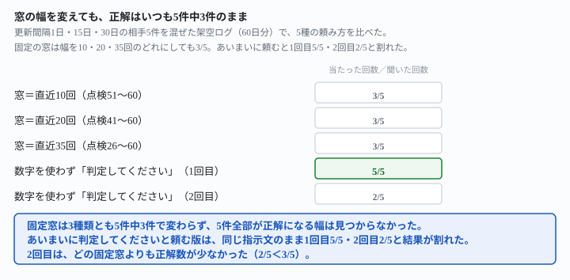
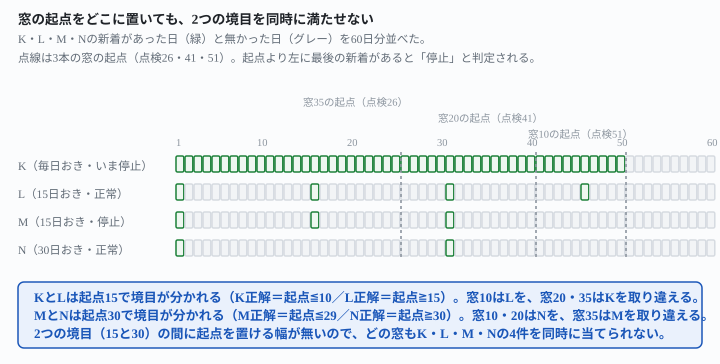

## これで何ができるか {: .what }

[直近5回に絞ると復活相手は直る](/recipes/recent-window-fixes-the-comeback-traps-the-slow-source/)は、更新間隔が最長14日の相手までを確かめた記事です。「窓を広げる」か「あいまいに判定してください」と頼めば直ることが分かりました。この記事は、間隔差をもっと広げたときの話です。**更新間隔が1日・15日・30日おきまで散らばると、どちらの直し方も崩れます。**

架空の監視ログ（情報源5つ・60日分）で確かめた結果は次の2つです。

| 頼み方 | 正解数 | 内容 |
|---|---|---|
| 窓＝直近10回（点検51〜60） | 3/5・3/5 | 間隔の長い健全な相手2件を誤って「停止」に |
| 窓＝直近20回（点検41〜60） | 3/5・3/5 | 本当に停止した相手1件を見逃し、別の1件を誤判定 |
| 窓＝直近35回（点検26〜60） | 3/5・3/5 | 本当に停止した相手2件を見逃す |
| あいまいに「判定してください」 | 5/5・2/5・4/5・5/5 | 同じ指示文・同じデータで結果が回によって割れる |

<mark>固定の窓は、幅を10回・20回・35回のどれにしても、5件中3件しか正解しませんでした。</mark>短い間隔の相手の本当の停止を捉えるには窓を狭くする必要があり、長い間隔の相手の健全な間隔を誤判定しないためには窓を広げる必要があります。この2つの条件は同時に満たせないので、<mark>間違う2件の組み合わせが入れ替わるだけで、正解数そのものは3/5のまま動きませんでした。</mark>

<figure class="figure">

<figcaption>窓の幅を変えても、正解はいつも5件中3件のまま。</figcaption>
</figure>

<mark class="warn">数字の窓を使わず「判定してください」と頼む版は、4回試すと全問正解が2回、取り違えが2回（3件・1件）でした。</mark>指示文は毎回同じ、データも毎回同じです。[前作](/recipes/recent-window-fixes-the-comeback-traps-the-slow-source/)ではこの頼み方が2回とも9/9で、固定窓より明らかに優れていました。今回は、固定窓のどの幅よりも悪い結果（2/5）になる回もありました。

📌 **この記事の数字はすべて架空データでの実測です。**実在の個人・企業の情報は含みません。材料や仮説を知らない独立した新規会話で、**合計6本の指示文・12回・判定60件**試しました。生の返りと機械照合は `docs/evidence/wide-interval-mix-splits-the-ambiguous-call.md` に全文置いてあります。

## 前提 {: .need }

| | |
|---|---|
| かかる時間 | 20分 |
| 費用 | 無料。無料のチャットAIで足ります |
| 必要なもの | 複数の相手を定期的にチェックしている記録（取得件数と新着件数の両方が分かる形） |
| プログラミング | **不要**。記録の表をそのまま貼るだけです |

**取得件数と新着件数が何を指すかは**[死活判定は数字の選び方で変わる](/recipes/raw-count-catches-it-new-count-misses-it/)**と同じです。**取得件数はページから読み取れた記事の総数（更新が無くても0にはならない）、新着件数は前回チェックより増えた件数です。

材料は5情報源・60日分です。更新間隔を1日・15日・30日おきまで大きく散らばらせました。

1. **K＝毎日おきの相手。今は本当に停止しています。**点検1〜50は毎日新着があり、点検51〜60の10日間は新着ゼロです
2. **L＝15日おきの健全な相手。**新着は点検1・16・31・46だけで、最後の新着（46）から点検60までは14日しか経っていません
3. **M＝15日おきだが本当に停止した相手。**新着は点検1・16・31だけで、点検32以降29日間新着がありません（本来の間隔の約2周期ぶん）
4. **N＝30日おきの健全な相手。**新着は点検1・31だけで、最後の新着（31）から点検60までは29日しか経っていません
5. **O＝取得自体ができない相手。**取得件数が60回とも0です

正解（真値）はK・M＝「取得はできているが中身の更新が止まっている」、L・N＝「正常」、O＝「取得自体ができません」です。

## AIへの頼み方 {: .ask }

### 1. 基準を明示「直近10回分（点検51〜60）」

<div class="prompt">次の表は、5つの情報源を毎日1回チェックする自動監視の記録です（点検1〜60は60日分）。「取得件数」はその回にページから読み取れた記事の総数です（更新がなくても、記事がページに残っていれば0にはなりません）。「新着件数」は前回のチェックより後に増えた記事の数です。

次の基準で、情報源ごとに通知文を1行ずつ書いてください。
- 取得件数が3回連続して0だったら「取得自体ができません」という文にしてください
- 取得件数は0でない（取得はできている）のに、直近10回分（点検51〜60）の新着件数が一度も1以上にならなかったら「取得はできていますが、中身の更新が止まっています」という文にしてください
- どちらにも当たらなければ「正常です」とだけ書いてください

情報源ごとに1行で、前置きやまとめは書かずに返してください。</div>

（上記の直後に、5情報源の取得件数の表と新着件数の表を両方そのまま貼った）

**2回とも、同じ2件を誤判定しました。**

```
L: 取得はできていますが、中身の更新が止まっています
N: 取得はできていますが、中身の更新が止まっています
```

真値（L・N＝正常）と食い違います。他の3情報源（K・M・O）は2回とも真値と一致しました。**3/5・3/5です。**窓が10回分しかないので、L（最後の新着から14日）もN（最後の新着から29日）も、そのふだんの間隔に関係なく「停止」に見えてしまいます。

### 2. 基準を明示「直近20回分（点検41〜60）」

<div class="prompt">次の表は、5つの情報源を毎日1回チェックする自動監視の記録です（点検1〜60は60日分）。「取得件数」はその回にページから読み取れた記事の総数です（更新がなくても、記事がページに残っていれば0にはなりません）。「新着件数」は前回のチェックより後に増えた記事の数です。

次の基準で、情報源ごとに通知文を1行ずつ書いてください。
- 取得件数が3回連続して0だったら「取得自体ができません」という文にしてください
- 取得件数は0でない（取得はできている）のに、直近20回分（点検41〜60）の新着件数が一度も1以上にならなかったら「取得はできていますが、中身の更新が止まっています」という文にしてください
- どちらにも当たらなければ「正常です」とだけ書いてください

情報源ごとに1行で、前置きやまとめは書かずに返してください。</div>

（上記の直後に、5情報源の取得件数の表と新着件数の表を両方そのまま貼った。表は指示文1と同じ）

**2回とも、Lは正しく「正常」に直りましたが、代わりに別の2件を誤判定しました。**

```
K: 正常です
N: 取得はできていますが、中身の更新が止まっています
```

**3/5・3/5です。**Kは点検50まで新着があり、その新着が窓（点検41〜60）の中に入ってしまうため、51〜60の本当の10日間停止が見えなくなりました。<mark class="warn">窓を広げてLの誤判定を直すと、引き換えに本当に停止している相手Kを見逃すようになりました。</mark>Nは依然として誤判定されたままです。

### 3. 基準を明示「直近35回分（点検26〜60）」

<div class="prompt">次の表は、5つの情報源を毎日1回チェックする自動監視の記録です（点検1〜60は60日分）。「取得件数」はその回にページから読み取れた記事の総数です（更新がなくても、記事がページに残っていれば0にはなりません）。「新着件数」は前回のチェックより後に増えた記事の数です。

次の基準で、情報源ごとに通知文を1行ずつ書いてください。
- 取得件数が3回連続して0だったら「取得自体ができません」という文にしてください
- 取得件数は0でない（取得はできている）のに、直近35回分（点検26〜60）の新着件数が一度も1以上にならなかったら「取得はできていますが、中身の更新が止まっています」という文にしてください
- どちらにも当たらなければ「正常です」とだけ書いてください

情報源ごとに1行で、前置きやまとめは書かずに返してください。</div>

（上記の直後に、5情報源の取得件数の表と新着件数の表を両方そのまま貼った。表は指示文1と同じ）

**2回とも、Nは正しく「正常」に直りましたが、今度は本当に停止している2件とも見逃しました。**

```
K: 正常です
M: 正常です
```

**3/5・3/5です。**窓を35回まで広げると、Kの最後の新着（点検50）もMの最後の新着（点検31）も窓の中に入ります。どちらの本当の停止も、これで見えなくなりました。<mark>窓を10回・20回・35回のどれにしても、正解数はいつも5件中3件でした。</mark>間違う2件の組み合わせが変わるだけです。

### 4. 基準をあいまいに「判定してください」

<div class="prompt">次の表は、5つの情報源を毎日1回チェックする自動監視の記録です（点検1〜60は60日分）。「取得件数」はその回にページから読み取れた記事の総数です。「新着件数」は前回のチェックより後に増えた記事の数です。

この記録から、情報源ごとに次の3種類のどれかを判定してください。
- 正常
- 取得自体ができていない
- 取得はできているが中身の更新が止まっている

情報源ごとに1行で、判定とその根拠を書いてください。</div>

（上記の直後に、5情報源の取得件数の表と新着件数の表を両方そのまま貼った。表は指示文1と同じ）

**1回目は5/5で全問正解でした。**根拠の一部を引用します。

> N（正常）: 新着は点検1・31の2回のみで間隔は約30日。60時点では31から29日しか経っておらず、これまでの約30日周期の範囲内であり、まだ更新停止とは判断できない。

<mark>1回目は、K・L・M・Nそれぞれの「ふだんの周期」を自分で見積もり、4件とも正しく判定しました。</mark>

**ところが2回目は、3件を取り違えました。**

```
K: 正常。(更新ペースが落ち着いただけで異常とは判断できない)
L: 取得はできているが中身の更新が止まっている。(点検51以降は10回連続で新着0件)
N: 取得はできているが中身の更新が止まっている。(点検32以降は29回連続で新着0件)
```

**2/5です。固定窓のどの幅よりも悪い結果でした。**2回目の判定理由には、2種類の壊れ方があります。

- **Kの判定＝事実は認めるが、理由で打ち消す。**「新着が10日連続0」という事実は認めています。そのうえで「更新ペースが落ち着いただけ」と理由を付け、異常ではないとみなしました
- **L・Nの判定＝絶対の日数だけで決める。**<mark class="warn">「10回連続0」「29回連続0」という日数だけを見て停止と判定しています。</mark>Lの15日周期・Nの30日周期という、その相手自身の普通を考慮していません

1回目はK・L・Nの3件とも正しく推論できていました。**同じ指示文・同じデータでも、回によって「相手ごとの普通を見るか」「絶対の日数で見るか」が入れ替わります。**

### 5. 「直近20回分」を相対表現「表の末尾20行」に直す

実際の運用では点検回数が伸び続けるので、絶対の点検番号は書き換えが要ります。指示文2を相対表現に直して、誤判定が表現の違いで変わらないかを確かめました。

<div class="prompt">次の表は、5つの情報源を毎日1回チェックする自動監視の記録です（点検1〜60は60日分）。「取得件数」はその回にページから読み取れた記事の総数です（更新がなくても、記事がページに残っていれば0にはなりません）。「新着件数」は前回のチェックより後に増えた記事の数です。

次の基準で、情報源ごとに通知文を1行ずつ書いてください。
- 取得件数が3回連続して0だったら「取得自体ができません」という文にしてください
- 取得件数は0でない（取得はできている）のに、直近20回分（表の末尾20行）の新着件数が一度も1以上にならなかったら「取得はできていますが、中身の更新が止まっています」という文にしてください
- どちらにも当たらなければ「正常です」とだけ書いてください

情報源ごとに1行で、前置きやまとめは書かずに返してください。</div>

（上記の直後に、5情報源の取得件数の表と新着件数の表を両方そのまま貼った。表は指示文1と同じ）

**2回とも、指示文2（絶対の点検番号）とまったく同じ2件（K・N）を誤判定しました。**絶対の点検番号を使わず「表の末尾20行」と相対表現にしても、誤判定の件数・対象は1件も変わりません。<mark>窓の誤判定は表現の書き方ではなく、窓の幅と各相手の更新間隔の関係だけで起きています。</mark>

### 6. あいまい判定を、列順を入れ替えてもう一度試す

指示文4の2回目に出た取り違え（K・L・N）が、表の中の列の位置に依存していないかを確かめます。列順をN・M・L・K・Oに入れ替え、同じ指示文をもう一度試しました。

<div class="prompt">次の表は、5つの情報源を毎日1回チェックする自動監視の記録です（点検1〜60は60日分）。「取得件数」はその回にページから読み取れた記事の総数です。「新着件数」は前回のチェックより後に増えた記事の数です。

この記録から、情報源ごとに次の3種類のどれかを判定してください。
- 正常
- 取得自体ができていない
- 取得はできているが中身の更新が止まっている

情報源ごとに1行で、判定とその根拠を書いてください。</div>

（指示文は指示文4と1文字も変えていない。表のみ、5情報源の列順をN・M・L・K・Oに変えたものに差し替えた）

**1回目は、別の1件（M）を取り違えました。**

```
M: 正常。(新着は点検1・16・31に1件ずつ、約15日間隔で発生しており、取得・更新ともに問題はない)
```

Mは本当は停止していますが、「正常」と判定されました。**4/5です。**

**2回目は5/5で全問正解でした。**

<mark>列順を入れ替えても、取り違えの対象はK・L・Nの組み合わせではなく、今度はMの1件に変わりました。</mark>指示文4・6を合わせた4回では、全問正解が2回、取り違えが2回（3件・1件）です。特定の列位置に依存する誤りではなく、**あいまいに頼むたびに、相手ごとの周期を正しく推論できるかどうかが安定しません。**

<figure class="figure">

<figcaption>窓の起点をどこに置いても、2つの境目を同時に満たせない。</figcaption>
</figure>

## うまくいかないときの言い直し方 {: .fix }

### 窓を狭くしても広くしても、正解数は増えない {: .trouble }

指示文1〜3のとおり、**固定の窓は幅をどこに置いても5件中3件しか正解しませんでした。**理由は図のとおりです。KとLの境目（起点15）、MとNの境目（起点30）の間には、窓の起点を置ける余地がありません。<mark class="warn">窓を1つの数字に決める設計である限り、更新間隔が極端に散らばった相手を混ぜると、必ずどこかで誤判定が残ります。</mark>直し方は、相手ごとに別の窓を持つ（情報源ごとに`stale_days`のような個別の値を持たせる）か、数字の窓をやめることです。

### 「あいまいに判定して」も、安全とは限らない {: .trouble }

[前作](/recipes/recent-window-fixes-the-comeback-traps-the-slow-source/)では、数字で窓を縛らず「判定してください」と頼む版が2回とも9/9でした。今回の指示文4・6では、4回のうち2回しか全問正解しませんでした。<mark class="warn">同じ指示文・同じデータでも、相手ごとの周期を正しく見積もれるかどうかは回によって変わります。</mark>これに頼るなら、1回の結果だけで安全だと判断せず、複数回試して結果が揃うかを確かめてください。

### この記事が実測していないこと {: .trouble }

情報源は5つに絞りました。[見張りの対象を100件に増やしてもボロが出ないか](/recipes/backlog-scale-holds-brevity-breaks-it/)と同じ軸で、情報源の数を増やしたときに同じ結論が成り立つかは確かめていません。更新間隔も1日・15日・30日の3種類だけです。間隔の種類がさらに増えたとき（たとえば60日おきの相手も混ざるとき）に、あいまい判定の不安定さがどう変わるかも、次に測るべき課題です。

## 応用・次の一手 {: .next }

**この記事の結論は、窓を1つの数字に決める設計そのものが、更新間隔が極端に散らばった監視には向かないということです。**[直近5回に絞ると復活相手は直る](/recipes/recent-window-fixes-the-comeback-traps-the-slow-source/)が確かめた「窓を相手の間隔に合わせて広げる」という直し方は、間隔差が小さい（最長14日程度）うちは効きます。間隔差が1日から30日まで広がると、1つの窓では両端を同時に満たせません。[更新停止の異常判定は一律にしない](/recipes/flat-threshold-misfires/)が複数の監視対象に同じ固定閾値を当てたときに確かめた崩れと、同じ構図がここでも出ました。

直し方は2つ考えられます。

1. **情報源ごとに別の窓を持たせる。**このサイトのトラッカーでは `sources.yml` の `stale_days` が同じ役目です。実測した間隔が長いソースだけ、個別に閾値を延ばしています
2. **数字の窓を使わず「判定してください」と頼む。**ただし**今回の実測では4回のうち2回しか正解しませんでした。**この方法に頼るなら、1回だけでなく複数回試して結果が揃うことを確かめるか、「相手ごとの普通の間隔」を指示文の中に明示して渡してください

- 1回だけでなく複数回試して、結果が揃うことを確かめる
- 「相手ごとの普通の間隔」を指示文の中に明示して渡す言い方を試す

[毎日決まった時刻にAIを動かす仕掛け](/recipes/github-actions-daily-cron/)で複数の相手を見張っているなら、更新間隔がどこまで散らばっているかを先に確認してください。間隔差が大きいほど、固定の窓では正解できない相手の組み合わせが必ず残ります。
