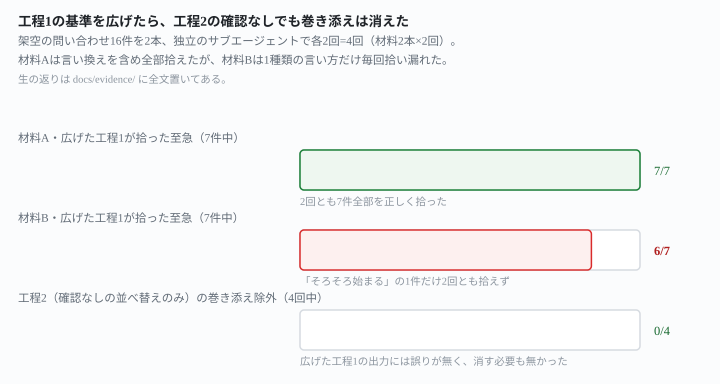

## これで何ができるか {: .what }

[前作「工程2に確認させると誤りは直る」の記事](/recipes/doubt-fixes-added-not-dropped/)は、最後にこう書いて終わっています。

「直すべきは工程2ではなく工程1です。『本文に至急という語が無くても、明日の予定に間に合わせるために今日中に必要な作業は含めてください』。工程1側の判定基準を、こう広げる必要があります。この一文は今回の実測では試していません。試すなら、それは次の実測になります」。

この記事はその案を実際に試します。

結論を先に書きます。

| | 旧設計（工程2に確認を足す・前作） | 今回（工程1の基準を広げる） |
|---|---|---|
| 工程1が拾う範囲 | 「至急」などの語があるものだけ | 語が無くても締切の近さを含める |
| 材料Aでの回収 | 至急7件中5件（2件を拾い漏れ） | 至急7件中**7件**（2回とも） |
| 材料Bでの回収 | 至急7件中5件（2件を拾い漏れ） | 至急7件中**6件**（2回とも。1件は残存） |
| 工程2の巻き添え | 健全な5件でも**4/4**で1件を誤って除外 | 確認を外しても**0/4**で除外なし |

<figure class="figure">

<figcaption>材料Aは完全回収。材料Bは1種類の言い方だけ、毎回拾い漏れました。</figcaption>
</figure>

工程1の指示文に一文を足しました。「語が無くても、締切の近さから今日中に必要と判断できる作業は含める」という内容です。<mark>材料A（丁寧な長文）は、至急7件を2回とも完全に回収しました。</mark>

工程2の「本当に該当するか確認して」という一言は外しました。確認なしの並べ替えだけを渡しても、巻き添え除外は4回とも0件でした。前作の確認版は、健全な5件に対しても4/4で巻き添えを起こしていました。**確認の工程そのものをやめたことで、その発生条件が無くなった**ということです。

<mark class="warn">ただし、材料B（口語の社内チャット）では、同じ一文が7件中6件しか拾えませんでした。「そろそろ始まる」という言い方だけ、2回とも拾い漏れています。</mark>基準を広げる効果は、言い換えの種類によって均一ではありませんでした。

📌 **数字はすべて架空データでの実測です。**材料・真値は前作とまったく同じ16件×2本を使い、変えたのは工程1の指示文だけです。**独立の新規会話（このセッションの文脈を共有しない別々のAI呼び出し）で、材料A・Bそれぞれ2回ずつ、計4回**試しました。

## 前提 {: .need }

| | |
|---|---|
| かかる時間 | 20分。[前作](/recipes/doubt-fixes-added-not-dropped/)を先に読むと早いです |
| 費用 | 無料。無料のチャットAIで足ります |
| 必要なもの | ブラウザで使えるAI（ChatGPT・Claude・Geminiなど）と、毎日処理したいテキスト |
| プログラミング | **不要**。工程1の指示文に一文を足すだけです |

材料は[前作](/recipes/doubt-fixes-added-not-dropped/)と完全に同じ架空の社内ヘルプデスク16件×2本（丁寧な長文の材料A・口語の材料Bそれぞれ16件）です。真値（至急＝今日中の対応が必要かどうか）も変えていません。各材料とも7件が至急・9件が至急ではない、という構成です。

試すのは、前作の工程1の指示文に、**前作が「試していない」と明記していた一文を足したもの**だけです。工程2の指示文は前作の「確認なし版」（並べ替えて対応方針を添えるだけ）に戻します。

## AIへの頼み方 {: .ask }

### 1. 工程1の基準を広げる

下の16件の社内ヘルプデスクへの問い合わせについて、本文に「至急」「今すぐ」「本日中」のように今日中の対応が必要だと明記されているもの、または、本文に至急という語が無くても、明日の予定に間に合わせるために今日中に必要な作業も含めて抜き出してください。書いていないものは入れないでください。抜き出したものは、そのままの文面で出してください。

このあとに16件を貼ります。**材料A・材料Bそれぞれ、独立のサブエージェントで2回ずつ＝計4回**試しました。

材料Aでは、**2回とも真値どおりの7件が完全に一致**しました。

> HD-2201・HD-2203・HD-2206・HD-2208・HD-2210・HD-2213・HD-2215

旧版の指示文では2回とも拾い漏れていた2件も、今回は拾えています。

- HD-2208（「明日の朝一の役員会議」）
- HD-2213（「まもなく始まる」）

<mark>紛れ込み（解決済みの至急であるHD-2211など）は2回とも0件でした。</mark>

### 2. 材料Bでも同じ指示文を試す

下の16件の社内ヘルプデスクへの問い合わせについて、本文に「至急」「今すぐ」「本日中」のように今日中の対応が必要だと明記されているもの、または、本文に至急という語が無くても、明日の予定に間に合わせるために今日中に必要な作業も含めて抜き出してください。書いていないものは入れないでください。抜き出したものは、そのままの文面で出してください。

口語の材料Bでは、**2回とも同じ6件**が返りました。

> HD-3301・HD-3303・HD-3306・HD-3308・HD-3310・HD-3315

<mark class="warn">真値7件のうち、HD-3313（「客先とのオンラインがそろそろ始まるんだけど」）だけを、2回とも拾い漏れました。</mark>HD-3308（「明日朝イチの役員会議」）は、材料Aの「明日の朝一」と同じ型です。こちらは2回とも正しく拾えました。

- **通った言い換え**＝「明日」を含む期限の言い換え
- **通らなかった言い換え**＝「そろそろ」という開始の近さの言い換え

紛れ込み（HD-3311など）は2回とも0件でした。

### 3. 広げた工程1の出力を、確認なしで工程2にそのまま渡す

下は、至急（今日中の対応が必要）と判断された問い合わせの一覧です。対応の緊急度が高い順に並べ替えて、それぞれに一言、対応方針を添えてください。並べ替えた一覧だけを出してください。

材料Aの工程1実出力（7件）を渡すと、**2回とも7件全部が残りました。**除外0件です。

### 4. 材料Bの出力でも同じ指示文を試す

下は、至急（今日中の対応が必要）と判断された問い合わせの一覧です。対応の緊急度が高い順に並べ替えて、それぞれに一言、対応方針を添えてください。並べ替えた一覧だけを出してください。

材料Bの工程1実出力（6件）を渡しても、**2回とも6件全部が残りました。**こちらも除外0件です。

<mark>広げた工程1の出力には、そもそも誤りが混ざっていません。前作で確認版が健全な5件に対して4/4で起こしていた巻き添え（正しい項目の誤った除外）は、今回の4回すべてで0件でした。</mark>工程2に「本当に該当するか確認して」を足す必要そのものが、無くなっています。

## うまくいかないときの言い直し方 {: .fix }

### 「そろそろ」型はまだ拾えない {: .trouble }

今回試した一文（「明日の予定に間に合わせるために今日中に必要な作業も含めて」）は、期限の言い換えには効きました。開始の近さの言い換えには効きませんでした。

材料Aの「まもなく始まる」（HD-2213）は拾えました。材料Bの「そろそろ始まる」（HD-3313）は2回とも拾えませんでした。<mark class="warn">フォーマルな言い回しと口語の言い回しで、同じ一文の効き方が変わる可能性があります。</mark>

📌 **直す案はまだ試していません。**候補は「『そろそろ』『まもなく』のように、開始が近いことを示す言い方も含めてください」と、**開始の近さを別枠で名指しする**ことです。この一文は今回の実測では試していません。試すなら、それは次の実測になります。

### 「直った」をひとまとめにしない {: .trouble }

<mark class="warn">「基準を広げたら巻き添えが消えた」という一言の中には、実際には2つの違う事実が混ざっています。</mark>

1. 工程2の確認工程をやめられたこと（巻き添えは0/4で消えた）
2. 工程1の拾い漏れそのものが直ったこと（材料Bでは2種類のうち1種類だけ）

この2つを分けずに「直った」と書くと、**材料Bに残った拾い漏れ（HD-3313）が隠れます。**自動化に組み込むときは、「巻き添えが消えたか」と「拾い漏れが消えたか」を別の指標として、それぞれ確認してください。

## 応用・次の一手 {: .next }

**この記事の値打ちは2つです。**

1. [前作](/recipes/doubt-fixes-added-not-dropped/)が「まだ試していない」として指示文の形にしなかった案（工程1の基準を広げる）を実際に試し、工程2の巻き添えが消えることを確かめた
2. その効き方が材料・言い換えの種類によって均一でないことを発見した（材料Bの「そろそろ始まる」型だけ2回とも拾えなかった）

保存版はこの2本の指示文です。

下の16件の社内ヘルプデスクへの問い合わせについて、本文に「至急」「今すぐ」「本日中」のように今日中の対応が必要だと明記されているもの、または、本文に至急という語が無くても、明日の予定に間に合わせるために今日中に必要な作業も含めて抜き出してください。書いていないものは入れないでください。抜き出したものは、そのままの文面で出してください。

下は、至急（今日中の対応が必要）と判断された問い合わせの一覧です。対応の緊急度が高い順に並べ替えて、それぞれに一言、対応方針を添えてください。並べ替えた一覧だけを出してください。

[「AIには工程を分けて頼め」を測った記事](/recipes/split-into-stages-what-breaks/)から始まったこの系列は、[工程2への確認を足す実測](/recipes/doubt-fixes-added-not-dropped/)と[確認の基準を固定する実測](/recipes/narrowed-criteria-fixes-dirty-not-clean/)に続きます。今回は、**直す場所を下流から上流へ移すと何が起きるか**を測りました。

**直すべき場所を間違えないことが大事です。**下流（工程2）をどう直しても、上流（工程1）が渡さなかったものは戻りません。ただし上流を直せば、下流の確認そのものが不要になることもあります。

⚠️ **測っていないことも書いておきます。**「そろそろ」「まもなく」を名指しする言い直しは試していません。今回仕込んだ言い換えの型は2種類（期限の近さ・開始の近さ）だけです。「もうすぐ」「あと少しで」などの他の言い換えや、英語混じりの文面は未測定です。[2回ぶんの出力を自分で見比べる](/recipes/compare-two-runs-yourself/)の要領で、自分の材料でも複数回は突き合わせてください。

今回の生の返りと機械照合は `docs/evidence/widen-stage1-clears-the-collateral.md` に全文置いてあります。
