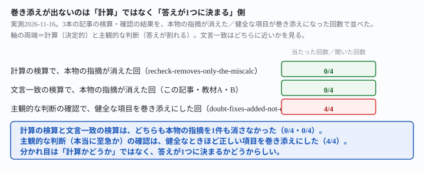
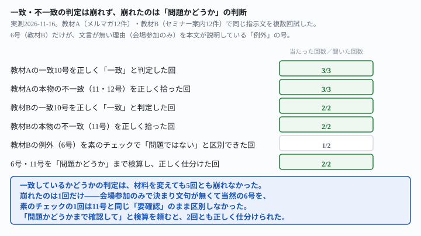

## これで何ができるか {: .what }

毎朝の自動チェックが「決まり文句が他の号と違います」と指摘してきても、一致しているかどうかという一字一句の判定そのものは崩れませんでした。<mark>9回とも、健全な号を誤って「不一致」にしませんでした。</mark>プログラミングは要りません。

[誤検知だけを検算で消す](/recipes/recheck-removes-only-the-miscalc/)は、金額や日付の**計算**の検算を試し、本物の指摘を消さないことを確かめました。ただし著者自身が末尾に書き残していました。「確認できるのは、この記事では数字と日付の指摘だけです。文言の一致や、判断が分かれる指摘まで同じように信頼してよいかは、まだ確かめていません」。この記事は、その文言の一致（計算ではなく照合）を実際に試した続きです。

<figure class="figure">

<figcaption>巻き添えが出ないのは「計算」ではなく「答えが1つに決まる」側。</figcaption>
</figure>

材料は[「重要です」を足しても見逃しは減らない](/recipes/urgent-wording-does-not-catch-more/)と同じ、架空のメルマガ下書き12件（教材A）・セミナー案内下書き12件（教材B）です。どちらにも、他の号に共通する決まり文句があります。

- 教材A＝「送料無料（5,000円以上のご注文で）」
- 教材B＝「オンライン参加の方には後日、資料と録画を送付します」

どちらの教材も、1号だけこの決まり文句が理由なく抜けています。

**独立した新規会話で、合計9回試しました。**内訳は、素の一致判定6回（教材A3回・教材B2回・出力形式を変えた版1回）と、検算4回（教材Aの指摘結果に2回・教材Bの仕分けに2回）です。実測は、毎回前の回のことを一切知らない独立した新規会話で行いました。<mark>一致しているかどうかの判定そのものは、材料を変えても9回とも崩れませんでした。</mark>崩れたのは、**教材Bにだけある「決まり文句が無くて当然の号」を、本物の欠落と区別できるかどうか**でした。

## 前提 {: .need }

| | |
|---|---|
| かかる時間 | 15分 |
| 費用 | 無料 |
| 必要なもの | 特にありません。チャットAIに一覧を貼るだけです |
| プログラミング | **不要** |

この記事は[誤検知だけを検算で消す](/recipes/recheck-removes-only-the-miscalc/)の続きです。あの記事は「指摘した号だけ、計算をもう一度やり直して確認して」という検算を試しました。金額や日付の指摘では、この検算が本物を消しませんでした。

一方、別の2本は逆の結果です。[工程2に確認させると誤りは直る](/recipes/doubt-fixes-added-not-dropped/)と[基準を固定しても、健全な5件の巻き添えは消えない](/recipes/narrowed-criteria-fixes-dirty-not-clean/)は、「本当に該当するか確認して」という**主観的な判断**の確認を試しました。こちらは、健全な項目まで繰り返し巻き添えにしています。

この2つの結果は、「計算だから巻き添えが出ない」のか「答えが1つに決まるから巻き添えが出ない」のかを区別していません。文言が一字一句一致しているかという照合は、**計算ではないが答えは1つに決まる**という、軸のちょうど中間にあります。この記事はそこを埋めます。

毎朝の自動チェックに、決まり文句の一致確認を組み込んでいるなら、この記事はその裏づけにあたります。

## AIへの頼み方 {: .ask }

### 1. 教材Aで、決まり文句の一字一句比較を頼む

次の12件のメルマガ下書きを確認してください。各号の本文に出てくる「送料無料」に関する決まり文句を、他の号と一字一句（句読点や括弧の全角半角も含めて）比較してください。表記が完全に一致していない号があれば、その号の番号を挙げて、実際の文言を引用してください。全部一致していれば「全号一致」と書いてください。

（この下に、12件のメルマガ下書きをそのまま貼ります。教材Aは1〜10号・12号が「送料無料（5,000円以上のご注文で）。」で一字一句同一で、11号だけ「送料無料でお届けします。」と条件部分が無い表現です）

**返ってきたのは「11号と12号が他号と異なる」でした。**1〜10号は完全一致と正しく判定し、11号は条件部分の欠落、12号は決まり文句自体が本文に無いことまで、理由とともに挙げています。<mark>一致している10号を誤って「不一致」とした号は0件でした。</mark>

### 2. 同じ指示文を、独立した新規会話でもう一度試す

次の12件のメルマガ下書きを確認してください。各号の本文に出てくる「送料無料」に関する決まり文句を、他の号と一字一句（句読点や括弧の全角半角も含めて）比較してください。表記が完全に一致していない号があれば、その号の番号を挙げて、実際の文言を引用してください。全部一致していれば「全号一致」と書いてください。

材料は指示文1とまったく同じです。**結果も一致しました。**1〜10号は完全一致、11号・12号は不一致と、理由も同じ内容で返ってきています。

### 3. 出力を簡潔な二択に変えても試す

自動化に組み込むなら、理由つきの文章より**号ごとの二択**で受け取りたい場面があります。出力の形だけを変えて試しました。

次の12件のメルマガ下書きについて、各号の「送料無料」に関する決まり文句が他の号と一字一句一致しているかどうかだけを、号ごとに「一致」または「不一致」の二択で、1号から12号まで改行区切りで出力してください。説明や理由は書かないでください。

**1〜10号「一致」・11号「不一致」・12号「不一致」と、理由付きの版とまったく同じ仕分けでした。**[誤検知だけを検算で消す](/recipes/recheck-removes-only-the-miscalc/)では出力形式を圧縮すると本物の指摘が1件消えましたが、この記事の3回では出力を削っても結果は動きませんでした。

### 4. 教材Aの指摘結果に、検算を頼む

指示文1・2の指摘結果（11号・12号を「不一致」とした判定）に、検算を頼みます。[誤検知だけを検算で消す](/recipes/recheck-removes-only-the-miscalc/)と同じ形の一言です。

以下は、下書き一覧の内容確認で指摘された結果です。指摘した号だけを対象に、決まり文句をもう一度一字一句突き合わせて確認してください。一致していれば「指摘は誤り」、一致していなければ「指摘は正しい」と号ごとに理由とともに書いてください。

（この下に、12件の本文の送料無料に関する部分だけと、11号・12号を「不一致」とした指摘結果を貼ります）

**11号・12号とも「指摘は正しい」のまま、1件も取り下げられませんでした。**11号は条件部分の欠落、12号は文言自体が無いことを、検算でも同じ理由で確認しています。

### 5. 同じ検算を、独立した新規会話でもう一度試す

以下は、下書き一覧の内容確認で指摘された結果です。指摘した号だけを対象に、決まり文句をもう一度一字一句突き合わせて確認してください。一致していれば「指摘は誤り」、一致していなければ「指摘は正しい」と号ごとに理由とともに書いてください。

材料は指示文4とまったく同じです。**結果も一致しました。**11号・12号とも「指摘は正しい」のまま残っています。<mark>検算を2回頼んでも、本物の指摘（11号・12号×2回＝4件）は1件も消えませんでした。</mark>

### 6. 教材を変えて（セミナー案内）、同じ一字一句比較を試す

[「重要です」を足しても見逃しは減らない](/recipes/urgent-wording-does-not-catch-more/)の台帳には「2回転は同じ材料で2回では足りない」という教訓があります。材料を変えて確かめます。

次の12件のセミナー案内下書きを確認してください。各号の本文に出てくる「オンライン参加の方への資料・録画送付」に関する決まり文句を、他の号と一字一句（句読点を含めて）比較してください。表記が完全に一致していない号、または文言自体が無い号があれば、その号の番号と状況を挙げてください。全部一致していれば「全号一致」と書いてください。

教材Bには、教材Aに無い**第3の号**があります。6号は「今回は会場参加のみの開催で、オンライン配信は行いません」と明記された号で、決まり文句が無いのは当然です。（11号は違います。何の説明もなく決まり文句が抜けている、本物の欠落です。）

**返ってきたのは「10号は完全一致・6号は仕様上の理由で文言なし（問題なし）・11号は説明のない欠落（要確認）」でした。**6号と11号を、理由まで含めて正しく区別しています。

### 7. 同じ指示文を、独立した新規会話でもう一度試す

次の12件のセミナー案内下書きを確認してください。各号の本文に出てくる「オンライン参加の方への資料・録画送付」に関する決まり文句を、他の号と一字一句（句読点を含めて）比較してください。表記が完全に一致していない号、または文言自体が無い号があれば、その号の番号と状況を挙げてください。全部一致していれば「全号一致」と書いてください。

材料は指示文6とまったく同じです。**10号の完全一致・11号の指摘は変わりませんでしたが、6号の扱いが変わりました。**今回は「6号はこの文言自体が存在しません。......決まり文句と矛盾する内容になっています」とだけ書かれ、11号と同じ「不一致」の並びに置かれています。<mark class="warn">会場参加のみで決まり文句が無くて当然の6号を、本物の欠落である11号と区別せずに扱った回が1回ありました。</mark>

**一致しているかどうかの判定（6号・11号とも「決まり文句が無い」）自体は、指示文6・7のどちらも正しく言えています。**崩れたのは、その「無い」が指摘すべき問題かどうかの一段上の判断でした。

### 8. 6号・11号だけを対象に、「問題かどうか」まで検算する

指示文7の結果（6号・11号を区別せず並べた判定）に、文言の有無だけでなく**問題かどうか**まで確認させます。

以下は、12件のセミナー案内下書きについて「オンライン参加の方への資料・録画送付」の決まり文句の有無を確認した結果です。指摘された号（6号・11号）だけを対象に、本文の全体を読み直し、決まり文句が無いことが本当に指摘すべき問題（本来あるべきなのに抜けている）なのか、それとも問題ではない（他の記述から、この号に限っては無くて当然）なのかを、号ごとに判定してください。

（この下に、12件の本文と、6号・11号を「決まり文句なし」とした指摘結果を貼ります）

**6号は「問題ではない（誤検知）」、11号は「問題である（指摘は正しい）」と、正しく仕分けられました。**6号は「会場参加のみ・オンライン配信は行いません」という記述と整合することが、11号はそうした断りが本文に一切無いことが、それぞれ理由として挙がっています。

### 9. 同じ検算を、独立した新規会話でもう一度試す

以下は、12件のセミナー案内下書きについて「オンライン参加の方への資料・録画送付」の決まり文句の有無を確認した結果です。指摘された号（6号・11号）だけを対象に、本文の全体を読み直し、決まり文句が無いことが本当に指摘すべき問題（本来あるべきなのに抜けている）なのか、それとも問題ではない（他の記述から、この号に限っては無くて当然）なのかを、号ごとに判定してください。

材料は指示文8とまったく同じです。**結果も一致しました。**6号は「問題ではない（誤指摘）」として取り下げ、11号は「本来あるべき抜け」として維持されています。

<figure class="figure">

<figcaption>一致・不一致の判定は崩れず、崩れたのは「問題かどうか」の判断。</figcaption>
</figure>

**この記事は、架空データ2本・9回の実測記録です。**決まり文句は2種類（送料無料の条件・オンライン参加者への送付案内）だけで、これより多い号数や、もっと長い決まり文句では試していません。

## うまくいかないときの言い直し方 {: .fix }

### 「一致しているか」を聞くだけでは、例外の号を巻き込むことがある {: .trouble }

指示文6・7のとおり、同じ指示文でも**決まり文句が無い号を2つとも「不一致」として並べるか、片方を「問題なし」と分けるかが回によって割れました。**理由を本文に書かせても、一致・不一致の判定が「指摘すべき問題かどうか」の仕分けまで保証してくれるわけではありません。<mark class="warn">決まり文句が複数の号で欠けうる自動チェックなら、「無い号」をそのまま一覧にするだけでなく、「無くて当然の号が混ざっていないか」を次の一段で確認してください。</mark>

### 「問題かどうかまで確認して」と名指しすると、2回とも直った {: .trouble }

指示文8・9のように、**「無いこと」ではなく「無いことが問題かどうか」を名指しで聞くと**、2回とも正しく仕分けられました。自動チェックの検算に一言足すなら、「一致しているか」だけでなく「一致していないことが本当に問題か」まで聞いてください。

### この記事で確かめていないこと {: .trouble }

決まり文句は、どちらの教材も1文だけです。<mark class="warn">複数の決まり文句が同時に欠けている号や、決まり文句そのものが2種類以上ある場合は試していません。</mark>どちらの教材も12件という規模です。数十件・数百件に増えたときに同じ精度が保てるかは、[監視の記録が育って数百件を超えたら、分割のどちらで崩れるか](/recipes/split-across-chunks-keeps-the-edge-row/)のような別の実測が必要です。

## 応用・次の一手 {: .next }

**この記事は、[誤検知だけを検算で消す](/recipes/recheck-removes-only-the-miscalc/)への答えです。**あの記事は末尾に「文言の一致や、判断が分かれる指摘まで同じように信頼してよいかは、まだ確かめていません」と書き残していました。決まり文句が一字一句一致しているかという照合は、計算と同じ「答えが1つに決まる」問いです。9回の実測すべてで、健全な号を誤って不一致にすることはありませんでした。検算を頼んでも同じです。本物の指摘（教材A・Bあわせて4回の検算）は1件も消えませんでした。

[工程2に確認させると誤りは直る](/recipes/doubt-fixes-added-not-dropped/)と[基準を固定しても、健全な5件の巻き添えは消えない](/recipes/narrowed-criteria-fixes-dirty-not-clean/)は逆でした。「本当に該当するか」という主観的な判断の確認は、健全な項目を繰り返し巻き添えにしています。**この3本を並べると、分かれ目は「計算かどうか」ではなく「答えが1つに決まるかどうか」らしいと分かります。**決まり文句の一致・不一致は計算ではありません。それでも答えが1つに決まるので、巻き添えが出ませんでした。

**ただし、この記事にも巻き添えが一度だけ出ました。**それは「一致しているか」ではなく、「一致していないことが問題かどうか」という、もう一段別の判断（教材Bの6号）でした。これは答えが1つに決まらない問いなので、[工程2に確認させると誤りは直る](/recipes/doubt-fixes-added-not-dropped/)の軸に近づきます。**自動チェックの決まり文句照合に「有無」だけでなく「例外」が混ざりうるなら、検算の一言に「問題かどうか」まで名指しで加えてください。**この材料・この9回での実測なので、一般法則としては書きません。

毎朝の自動チェックに文言一致の確認を組み込んでいるなら、検算の一言を足すこと自体は、この記事の範囲では安全です。次に試すべきは、決まり文句が3種類以上ある場面や、件数を増やした場面での同じ検証です。
