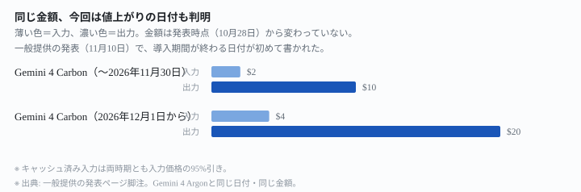
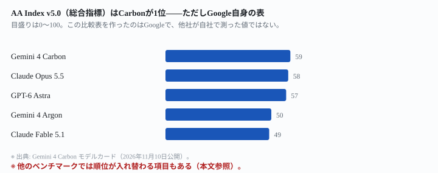
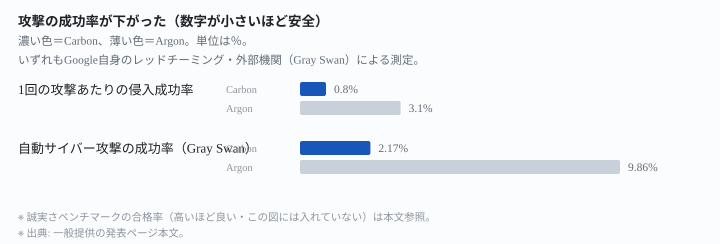

## 結論：今の立場ごとに、こうなります

Google は2026年11月10日、**Gemini 4 Carbon** の一般提供を始めました（出典: 発表ページ）。
10月28日の前回発表（[自己採点1位のCarbon——使えるのはまだ一部](/tools/gemini-4-carbon/)）
では「一般公開はできるだけ早く行う」としか書かれておらず、仕様の多くも非公表でした。

| 今の立場 | 今できること | どうなるか |
|---|---|---|
| **今すぐ試したい開発者・会社員** | AI Studio・Gemini for business（有料枠）から使える。Google AI Ultra契約者はAntigravity・Geminiアプリ・AI Mode in Searchでも使える | 前回「一部のサイバー防御担当者のみ」だった提供範囲が、一般の開発者・企業・個人にまで広がった |
| **価格を基準に判断したい人** | 導入価格（入力$2・出力$10）で使い始められる | 前回「非公表」だった値上がりの日付が、**2026年11月30日**と判明。Gemini 4 Argonと同じ日付・同じ金額 |
| **他社と比べて選びたい人** | モデルカードの比較表を見る | 前回は自社測定の4項目しかなかったが、今回はGPT-6 Astra・Claude Opus 5.5・Claude Fable 5.1も含む17項目の比較表が加わった |

<mark>一言でいうと、使える人の範囲が広がり、前回「非公表」だった数字の多くが今回で判明しました。</mark>

先に断っておきます。**この記事は運営者がCarbonを実際に使った記録ではありません。**公式の発表ページ・モデルカード・料金ページに書かれている数字だけを読んで整理したものです。

ここから下は、表の3行がなぜそうなるのかの説明です。

## なぜそうなるのか

### 使える範囲が、サイバー防御担当者から一般へ広がった

発表ページは、提供範囲をこう書いています（出典: 発表ページ）。

> Today, we're making Gemini 4 Carbon available to developers, enterprises, scientists, and consumers. [...] Two weeks ago, we released Carbon to a set of cybersecurity defenders via our Fairwind Program.

前回記事で「公開前に、米国政府の自主的な試験プロセスに関わっている」としていた限定提供から、今回は次の4つの立場に向けて同時に広がっています（出典: 発表ページ「Getting started」節）。

| 立場 | 使える場所 |
|---|---|
| 開発者 | Gemini API有料枠（AI Studio・Android Studio）。Google AI Ultra契約者はAntigravityでも |
| 企業 | Gemini for business（API・モデル選択・Antigravity・CodeMender） |
| 一般利用者 | Geminiアプリ・AI Mode in Search（いずれもGoogle AI Ultra契約者向け） |
| 科学者・研究者 | Antigravityの最上位枠を6か月無料（抽選制・審査あり） |

<mark class="warn">サイバー防御担当者向けのFairwind Programは終わっていません。</mark>発表ページは「Carbon for cyber」という別枠を維持し、引き続き申請制で提供すると明記しています（出典: 同上）。一般提供される版とサイバー防御向けの版は、同じ値段でも中身が違う可能性がある、という前回記事の注記は今も有効です。

### 価格は変わらないが、終わる日が判明

前回記事で「導入期間がいつ終わるか、発表に書かれていない」とした部分が、今回判明しました。一般提供の発表ページには、こう脚注が付いています（出典: 発表ページ脚注）。

> After the introductory period expires on November 30, 2026, the price of $4 per 1M input tokens and $20 per 1M output tokens will apply. Applies to the Carbon model intended for public access only.

Google Cloud の料金ページでも、同じ日付を確認しました（出典: Vertex AI 料金ページ）。

| | 入力（100万トークン） | 出力（100万トークン） | キャッシュ済み入力 |
|---|---|---|---|
| 〜2026年11月30日 | $2.00 | $10.00 | $0.10（95%引き） |
| 2026年12月1日から | $4.00 | $20.00 | $0.20（95%引き） |

<figure class="figure">

<figcaption>金額は変わらない。判明したのは「いつ値上がりするか」です</figcaption>
</figure>

<mark>この日付は、一般提供の発表ページの脚注とGoogle Cloudの料金ページという、2つの独立したページに同じ数字で書かれています。</mark>Gemini 4 Argonと**1円も違わない金額・同じ日付**です（出典: 前掲のVertex AI料金ページには、Argonも同じ2026年11月30日・2026年12月1日の区切りで載っています）。

### 仕様も、前回の「非公表」から判明した

前回記事では「コンテキストウィンドウ・出力の上限・知識の締め切りのいずれも公表されていない」と書きました。今回、モデルカードが公開され、次のように判明しています（出典: Gemini 4 Carbon モデルカード）。

> Inputs: Text strings [...], images, audio, and video files, with a combined input-output token context window of up to 1M.
> Outputs: Text, with up to a 1M token input + output.
> The knowledge cutoff for Gemini 4 Carbon is March 2026, though in some domains the model's knowledge may be less up to date.

| 項目 | 前回（10月28日時点） | 今回（モデルカード） |
|---|---|---|
| コンテキストウィンドウ | 公表されていない | 入出力合計で最大100万トークン |
| 知識の締め切り | 公表されていない | 2026年3月（分野によってはこれより古いことがある） |
| アーキテクチャ・学習データ | 公表されていない | 「Gemini 4 Argonに基づく」とだけ記載。詳細はArgon側のモデルカードを参照、との案内 |

<mark class="warn">既定の呼び出し（1回あたり何トークンまで書けるか）の具体的な上限は、今回もモデルカードに書かれていません。</mark>Argonが一般提供を始めたときの記事（[Argon一般提供開始](/tools/gemini-4-argon-ga/)）では、次の切り分けを確認しました。

- 既定（同期呼び出し）の出力上限: 65,536トークン
- long decodeという別機能を使った場合の出力上限: 最大1,048,576トークン

この切り分けがCarbonにも当てはまるかどうかは**確認できませんでした**。Gemini APIの公式モデルページ（`ai.google.dev`）は、この記事を書いた環境では`aistudio.google.com`への転送先が許可リストに無く、経路遮断で開けませんでした。

### 性能：今回はモデルカードに5社の比較表が付いた

前回記事は「発表ページが挙げた4項目はいずれもGoogle自身の測定」と書きました。今回公開されたモデルカードには、Gemini 4 Carbon・Gemini 4 Argon・GPT-6 Astra・Claude Opus 5.5・Claude Fable 5.1 の5モデルを並べた比較表が載っています（出典: Gemini 4 Carbon モデルカード）。

<figure class="figure">

<figcaption>総合指標ではCarbonが最高値。ただし作ったのはGoogleです</figcaption>
</figure>

このサイトの方針として、<mark>性能テストの点数は各社が自社で測っていて測り方も対象も違うため、他社モデルと横に並べて「どちらが賢いか」を結論づけません。</mark>この表を作ったのもGoogleで、他社が同じ条件で自社測定した値ではありません。

その前提のうえで、この記事が17項目すべてを1行ずつ数えた結果だけ書いておきます。<mark>17項目のうち、Carbonが最高値だったのは15項目です。</mark>残り2項目は他社が上でした（出典: 同モデルカード）。

| ベンチマーク | 何を測るか | 最高値だったモデル | Carbonの値 |
|---|---|---|---|
| FrontierSWE 2 | 実用的なソフト開発タスク | GPT-6 Astra（65.5%） | 61.2% |
| OSWorld-2.1（オフライン subset） | パソコン操作の自動化 | Claude Opus 5.5（87.2%） | 81.5% |

<mark class="warn">自社が作った比較表の中でも、全項目で勝っているわけではありません。</mark>とくにOSWorld-2.1では、Claude Opus 5.5がCarbonより5.7ポイント上です。

### 安全性：Argonとの比較で改善を主張

発表ページは、Argon比でいくつかの安全性の改善を挙げています（出典: 発表ページ）。

> The Carbon safeguards lowered the per-attempt breach rate to just 0.8% (down from 3.1% on Argon). Our safeguards also lowered the automated cyberattack query success rate to 2.17% in Gray Swan's testing, compared to 9.86% on Argon.

<figure class="figure">

<figcaption>2項目とも、Argonより低い（安全な）数字になっています</figcaption>
</figure>

<mark>誠実さを測る375件のベンチマークでは、Carbonの合格率は92%でした（Argonは70%）。</mark>発表ページはこう説明しています（出典: 同上）。

> On our 375-task agentic honesty benchmark, it passed 92% of tasks (compared to 70% for Argon) — declining to fill in missing experimental data 98% of the time and flagging methodological flaws 68% of the time.

<mark>これらはすべてGoogle自身の内部評価か、Gray Swan・Trajectory Labsといった提携先による評価です。</mark>外部のTrajectory Labsによるテストでは「132時間・13,000件超のリクエストで、新しい汎用的なjailbreakは0件」と報告されていますが、他社モデルを同じ条件で測った数字は発表にありません。

## 他社の最上位モデルと比べると

### 単価

各社の公式ページから直接取った数字だけを並べます。

| モデル | 提供元 | 入力（100万トークン） | 出力（100万トークン） | キャッシュ済み入力 |
|---|---|---|---|---|
| Gemini 4 Carbon（〜2026年11月30日） | Google | $2.00 | $10.00 | $0.10（95%引き） |
| Gemini 4 Carbon（2026年12月1日から） | Google | $4.00 | $20.00 | $0.20（95%引き） |
| Gemini 4 Argon（現在の価格） | Google | $2.00 | $10.00 | $0.10（95%引き） |
| Claude Opus 5.5（Anthropic） | Anthropic | $4.00 | $20.00 | $0.20（5%） |
| GPT-6 Astra（OpenAI・短い入力） | OpenAI | $10.00 | $50.00 | $1.00（90%引き） |

出典: Carbon・Argonは発表ページ脚注と<https://cloud.google.com/vertex-ai/generative-ai/pricing>、Claude Opus 5.5は<https://platform.claude.com/docs/en/about-claude/pricing>、GPT-6 Astraは<https://developers.openai.com/api/docs/pricing>（いずれも2026年11月11日に確認）

<mark>Carbonの導入価格は、Claude Opus 5.5の半額・GPT-6 Astraの1/5の入力単価です。</mark>ただし<mark class="warn">2026年12月1日からは、Claude Opus 5.5と単価が1円も違わなくなります。</mark>入力$4・出力$20・キャッシュ済み入力$0.20までぴたりと一致します。

### 仕様

| モデル | コンテキストウィンドウ | 出力の上限 | 知識の締め切り | 提供状況 |
|---|---|---|---|---|
| Gemini 4 Carbon | 100万トークン（入出力合計） | 確認できず（経路遮断） | 2026年3月 | 一般提供 |
| Gemini 4 Argon | 1,048,576トークン（入出力を統合） | 65,536（既定）／long decode利用時は最大1,048,576 | 公表されていない | 一般提供 |
| Claude Opus 5.5 | 1,000,000トークン | 128,000トークン | 2026年6月 | 一般提供 |
| GPT-6 Astra | 1,050,000トークン（入力922,000＋出力128,000） | 128,000トークン | 2026年4月30日 | 一般提供 |

出典: Carbonはモデルカード（前掲）、Argonは<https://cloud.google.com/vertex-ai/generative-ai/pricing>・前回記事で確認済みの公式モデルページ、Claude Opus 5.5は<https://platform.claude.com/docs/en/about-claude/models/overview>、GPT-6 Astraは<https://developers.openai.com/api/docs/models/gpt-6-astra>

<mark>4モデルの中で、知識の締め切りが最も新しいのはCarbon（2026年3月）ですが、Argonだけは今も非公表です。</mark>Carbonは「Argonに基づく」モデルなのに、知識の締め切りの表記方法が2モデルで揃っていません。

## どういう人に効くか

**今、関係がある人**

- 今日から試したい開発者・会社員。AI Studio・Gemini for businessの有料枠から使えます。
- 導入価格のうちに使い始めたい人。11月30日までは入力$2・出力$10です。
- 知識の締め切りの新しさを重視する人。Carbonの2026年3月は、今回比較した4モデルの中で最も新しいとされています。

**急がなくていい人**

- 値上がり後の値段だけを見て「Carbonは安い」と判断したい人。12月からはClaude Opus 5.5と同額です。
- 1回の呼び出しで何トークンまで書けるかを先に知りたい人。既定の出力上限はこの記事を書いた環境からは確認できませんでした。
- 性能の良さだけで判断したい人。モデルカードの比較表はGoogle自身が作ったもので、OSWorld-2.1のようにCarbonが最高値ではない項目もあります。

## この記事で分からないこと

- 既定の呼び出し（long decodeを使わない場合）での出力トークンの上限
- Fairwind Program経由のCyber Permissive版と、一般提供される版の性能差の具体的な数字
- 実際に使ったときの体感、日本語での品質

いずれも公式ページに数字がないか、この記事を書いた環境から確認できなかったため、運営者も試していないので書けません。

## 出典一覧

すべて各社の公式ページです。まとめ記事・ニュースサイト・個人ブログは1件も使っていません。

1. Gemini 4 Carbon 一般提供の発表（Google・2026年11月10日）: <https://blog.google/innovation-and-ai/models-and-research/gemini-models/gemini-4-carbon-now-available/>
2. Gemini 4 Carbon のモデルカード（Google DeepMind公式）: <https://deepmind.google/models/model-cards/gemini-4-carbon>
3. Vertex AI の料金ページ（Google Cloud公式）: <https://cloud.google.com/vertex-ai/generative-ai/pricing>
4. 料金（Anthropic公式ドキュメント）: <https://platform.claude.com/docs/en/about-claude/pricing>
5. モデル一覧と仕様（Anthropic公式ドキュメント）: <https://platform.claude.com/docs/en/about-claude/models/overview>
6. APIの料金（OpenAI公式ドキュメント）: <https://developers.openai.com/api/docs/pricing>
7. GPT-6 Astraのモデルページ（OpenAI公式ドキュメント）: <https://developers.openai.com/api/docs/models/gpt-6-astra>

料金と仕様は変わります。実際に支払う前に、必ず上記の公式ページで現在の値を確認してください。
