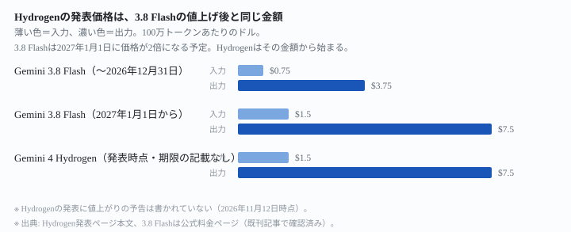
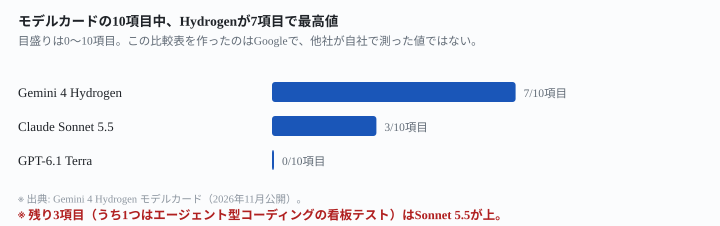
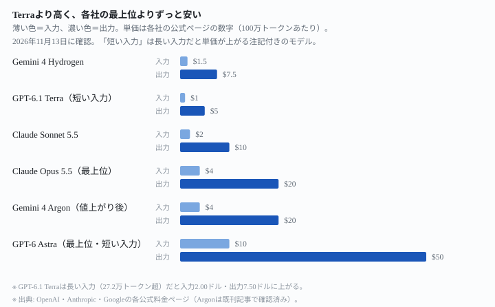

## 何が変わったか

Google は2026年11月12日に **Gemini 4 Hydrogen** を発表しました（出典: <https://blog.google/innovation-and-ai/models-and-research/gemini-models/introducing-gemini-4-hydrogen/>）。発表ページとモデルカードに書かれている数字だけを並べます。3行にすると、こうなります。

- Hydrogenは「すばやく動く」実務モデルです。<mark>Google自身が、じっくり考える役のGemini 4 Carbon・Argonとは別の役割だと説明しています</mark>（出典: 同上）。
- 単価は入力100万トークンあたり **$1.50**、出力 **$7.50**。値上がりの予告は書かれていません（出典: 同上）。
- 公式の説明は2つです。前のモデル（Gemini 3.8 Flash）より既定設定で2.5倍速いこと。Terminal-Bench 4.1は18.2%から57.0%に上がったこと（出典: 同上）。

先に断っておきます。**この記事は運営者がこのモデルを試した記録ではありません。**公式ページとモデルカードに書かれていることを読んで整理したものです。「速かった」「賢くなった」といった使用感は一切書いていません。

前のモデルの話は [Gemini 4 Carbon は一般提供開始](/tools/gemini-4-carbon-ga/) に書いています。

## 役割は「はやく安く」。Carbon・Argonの続きではない

モデルカードは、Hydrogenが **Gemini 4 Carbon をもとに作られた派生モデル**だと明記しています（出典: <https://storage.googleapis.com/deepmind-media/Model-Cards/Gemini-4-Hydrogen-Model-Card.pdf>）。そのうえで役割をこう分けています。

- **Carbon・Argon**＝いちばん難しい問題を、時間をかけてじっくり考える「frontier」役
- **Hydrogen**＝日常のコーディングや、複数手順の自動作業（エージェント作業）を、すばやくこなす役

つまりHydrogenは「Carbonの弟分」であって、Carbon・Argonを置き換えるものではありません（出典: 同上）。

## 前のモデルとの違い

### 速さとコーディング力

発表ページは、Gemini 3.8 Flashからの乗り換えを念頭に、次の数字を挙げています。

| 指標 | 内容 | 数字 |
|---|---|---|
| Terminal-Bench 4.1（チート調整済み） | エージェント型の端末作業 | 18.2% → 57.0% |
| 体感速度（既定のhigh設定） | 3.8 Flashとの比較 | 2.5倍速 |
| 初期パートナーの実測 | 複雑な表・SQL・データ処理での利用 | 2.0〜2.8倍速、トークン使用量は12〜23%減 |

出典: すべて <https://blog.google/innovation-and-ai/models-and-research/gemini-models/introducing-gemini-4-hydrogen/>

<mark>Terminal-Bench 4.1は18.2%から57.0%に、3倍以上に上がりました</mark>（出典: 同上）。初期パートナーの実測は「2.0〜2.8倍速」という幅で書かれていて、ひとつの数字ではありません（出典: 同上）。

<figure class="figure">

<figcaption>Hydrogenの発表価格は、3.8 Flashの値上げ後と同じ金額です</figcaption>
</figure>

料金ページどうしを見比べると、気づくことがあります。Gemini 3.8 Flashの価格は、2026年12月31日まで入力$0.75・出力$3.75でした。2027年1月1日からは$1.50・$7.50に上がる予定でした（出典: 既刊記事「[Gemini 3.8 Flashは値段そのまま](/tools/gemini-3-8-flash/)」。同記事が公式料金ページで確認済みです）。<mark>Hydrogenの発表価格$1.50・$7.50は、この「値上げ後」の金額とぴったり同じです</mark>。この一致はこの記事が気づいたもので、公式の説明ではありません。「新しい高速モデル＝これまでの導入価格並みに安い」とは限らない例です。

### 安全性は全面的に改善ではない

モデルカードには、Gemini 3.8 Flashとの差をポイント（pt）で示した表があります。比較対象が3.8 Flashだと表の見出しに明記されています。

| 評価項目 | 良い方向 | 3.8 Flashとの差 | 判定 |
|---|---|---|---|
| Text to Text Safety | 高いほど良い | +0.80pt | 改善 |
| Multilingual Safety | 高いほど良い | +1.10pt | 改善 |
| Image to Text Safety | 高いほど良い | +7.00pt | 改善 |
| Tone（拒否の言い方） | 高いほど良い | -0.65pt | 悪化 |
| Unjustified-refusals（不要な拒否） | 低いほど良い | +5.57pt | 悪化 |

出典: Gemini 4 Hydrogen モデルカード（Google・2026年11月公開）: <https://storage.googleapis.com/deepmind-media/Model-Cards/Gemini-4-Hydrogen-Model-Card.pdf>

<mark>5項目中3項目は改善、2項目は悪化です</mark>。公式は「画像を含む安全性は3.8 Flashを上回るが、本来なら答えてよい質問を断る『不要な拒否』は増えた。とくに画像つきの質問で目立つ」と説明しています（出典: 同上）。

### 「入出力あわせて100万トークン」には条件がある

発表ページは「ネイティブに100万トークンの入力と、最大100万トークンの出力をあわせ持つ」と書いています（出典: 発表ページ）。<mark class="warn">ところがモデルカードを読むと、これは入力と出力をあわせた1つの枠（100万トークン）のことです。既定の同期呼び出しでは、出力は6.4万トークンのままです。100万トークンまで出すには「long decode」という別の仕組みが要ります</mark>（出典: モデルカード）。

| | Gemini 4 Hydrogen |
|---|---|
| 入出力あわせた文脈枠 | 100万トークン |
| 既定の出力上限（同期呼び出し） | 6.4万トークン |
| long decode利用時の出力上限 | 100万トークン |
| 入れられるもの | 文章・画像・音声・動画 |
| 学習データの締め切り | 2026年3月 |

出典: モデルカード（同上）

<mark>学習データの締め切りは2026年3月と、モデルカードにそのまま書かれています</mark>（出典: 同上）。ただし「分野によっては、これより古い知識にとどまることがある」という但し書きも付いています（出典: 同上）。1つ前のGemini 4 Argonの発表にも「出力100万トークン」という同じ型の宣伝文句がありました。実際には既定の出力上限が旧モデルと同じで、同じ構造の注記が必要でした（出典: 既刊記事「[Argon一般提供開始](/tools/gemini-4-argon-ga/)」）。

## 他社の最上位モデルとの比較

### Googleが自分で選んだ比較相手

モデルカードには、Hydrogen・Claude Sonnet 5.5・GPT-6.1 Terraの3モデルを並べた比較表があります。10項目を全部書き出します。

| ベンチマーク | 分野 | Hydrogen | Claude Sonnet 5.5 | GPT-6.1 Terra |
|---|---|---|---|---|
| SWE-sweep | エージェント型コーディング | 13.5% | 3.1% | 5.8% |
| Terminal-Bench 4.1（チート調整済み） | エージェント型コーディング | 57.0% | 63.9% | — |
| Agents' Last Exam v1.1 | 知識労働 | 71.6% | 60.4% | 69.8% |
| AutomationBench-AA | 知識労働 | 76.1% | 71.8% | 60.2% |
| Vending-Bench 2（口座残高） | 知識労働 | $14,549 | $11,165 | $9,107 |
| OSWorld-2.1（オフライン分） | コンピュータ操作 | 77.6% | 83.9% | 74.2% |
| MKA（Climb WSR正答率） | マルチモーダル理解 | 53.4% | 52.0% | 43.8% |
| Chartography | マルチモーダル理解 | 66.6% | 61.6% | 63.2% |
| Terminal-Bench-Science 0.1 | 科学・数学 | 51.4% | 59.9% | 58.3% |
| HLE-Diamond | 推論 | 58.8% | 53.3% | 47.3% |

出典: Gemini 4 Hydrogen モデルカード（同上）

<figure class="figure">

<figcaption>モデルカードの10項目中、Hydrogenが7項目で最高値でした</figcaption>
</figure>

<mark>10項目中7項目でHydrogenが最高値でした</mark>（出典: 同上）。<mark class="warn">残り3項目——Terminal-Bench 4.1・OSWorld-2.1・Terminal-Bench-Science 0.1——はClaude Sonnet 5.5のほうが上でした</mark>。このうちTerminal-Bench 4.1は、発表ページ自身が「3倍以上に上がった」と誇った、まさにそのテストです。GPT-6.1 Terraが最高値になった項目はありません。

<mark class="warn">ただし、この表を作ったのはGoogleです</mark>。他社が同じ条件で測った値ではありません。

### 選ばれたのは最上位モデルではない

<mark class="warn">Claude Sonnet 5.5もGPT-6.1 Terraも、それぞれの会社の最上位モデルではありません</mark>。Anthropicの最上位はClaude Opus 5.5、OpenAIの最上位はGPT-6 Astraです（出典: 各社公式ページ）。単価だけを並べます。

| モデル | 提供元 | 位置づけ | 入力（100万トークン） | 出力（100万トークン） |
|---|---|---|---|---|
| Gemini 4 Hydrogen | Google | 高速・低コスト | $1.50 | $7.50 |
| GPT-6.1 Terra（短い入力） | OpenAI | 高速・低コスト | $1.00 | $5.00 |
| Claude Sonnet 5.5 | Anthropic | 中位 | $2.00 | $10.00 |
| Claude Opus 5.5 | Anthropic（最上位） | 最上位 | $4.00 | $20.00 |
| Gemini 4 Argon（値上がり後） | Google（自社の最上位格） | 最上位格 | $4.00 | $20.00 |
| GPT-6 Astra（短い入力） | OpenAI（最上位） | 最上位 | $10.00 | $50.00 |

出典: OpenAIは <https://developers.openai.com/api/docs/pricing>、Anthropicは <https://platform.claude.com/docs/en/about-claude/pricing>、Hydrogenは発表ページ、Argonは既刊記事で確認済みの公式料金ページ

<figure class="figure">

<figcaption>Terraより高く、各社の最上位よりずっと安い価格帯です</figcaption>
</figure>

<mark>Hydrogenの単価は、各社の最上位モデルの3〜7分の1です</mark>。入力で見るとGPT-6 Astraの約6.7分の1、Claude Opus 5.5の約2.7分の1です。この倍率は上の表の数字から、この記事が計算したものです。いっぽうで、逆転もあります。10項目中すべてでHydrogenに負けたGPT-6.1 Terraのほうが、単価はHydrogenより安いのです。

GPT-6.1 Terraには注記があります。入力が27.2万トークンを超える「長い入力」では単価が上がります。入力$2.00・出力$7.50です（出典: OpenAI公式料金ページ）。それでもHydrogenの$1.50・$7.50よりは安いか同程度です。

## どういう人に効くか

**いま動かしてみるといい人**

- 日常のコーディングやエージェント作業を、Carbon・Argonより安く速くこなしたい人。公式はTerminal-Bench 4.1で3倍以上の点数を挙げています。
- Carbonと組み合わせて使う人。発表ページは、CarbonとHydrogenをセッション内で切り替える使い方を挙げています（Antigravityのオーケストレーター機能）。Terminal-Bench 4.0の実測では、Carbon単体に近い成功率を保てました。そのうえで使用量を約24%減らし、約19%速く終えたと説明しています（出典: 発表ページ）。
- 単価の上限を決めて使いたい人。発表時点では値上がりの予告がありません。

**急がなくていい人**

- 単価だけでGPT-6.1 Terraから乗り換えたい人。性能はHydrogenが上回る項目が多い一方、単価はTerraのほうが安いというねじれがあります。
- 長い出力を一度に書かせたい人。既定では6.4万トークンまでです。
- エージェント型コーディングの性能だけで選びたい人。看板テストのTerminal-Bench 4.1は、Claude Sonnet 5.5のほうが高い点数でした。

**この記事で分からないこと**

実際に使ったときの体感、日本語での品質、返答が返ってくるまでの待ち時間。安全性の全文レポート（Safety & Security Report）は、この記事を書いた時点では未公開です。モデルカードには「近日公開」とだけ書かれています。運営者も試していないので書けません。

## 出典一覧

すべて各社の公式ページです。まとめ記事・ニュースサイト・個人ブログは1件も使っていません。

1. Gemini 4 Hydrogen の発表（Google・2026年11月12日）: <https://blog.google/innovation-and-ai/models-and-research/gemini-models/introducing-gemini-4-hydrogen/>
   （Google DeepMind側の <https://deepmind.google/blog/introducing-gemini-4-hydrogen/> を開くと、このページへ転送されます）
2. Gemini 4 Hydrogen のモデルカード（Google公式）: <https://storage.googleapis.com/deepmind-media/Model-Cards/Gemini-4-Hydrogen-Model-Card.pdf>
3. APIの料金（OpenAI公式ドキュメント）: <https://developers.openai.com/api/docs/pricing>
4. モデル一覧（OpenAI公式ドキュメント）: <https://developers.openai.com/api/docs/models>
5. 料金（Anthropic公式ドキュメント）: <https://platform.claude.com/docs/en/about-claude/pricing>
6. モデル一覧と仕様（Anthropic公式ドキュメント）: <https://platform.claude.com/docs/en/about-claude/models/overview>
7. Gemini 3.8 Flashの料金（既刊記事「[Gemini 3.8 Flashは値段そのまま](/tools/gemini-3-8-flash/)」で確認済みの公式料金ページ）
8. Gemini 4 Argonの料金（既刊記事「[Argon一般提供開始](/tools/gemini-4-argon-ga/)」で確認済みの公式料金ページ）

料金と仕様は変わります。実際に支払う前に、必ず上記の公式ページで現在の値を確認してください。
