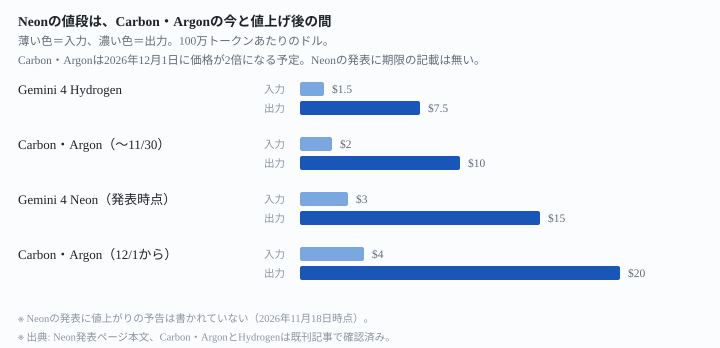
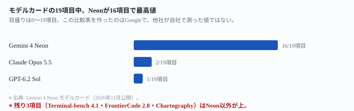
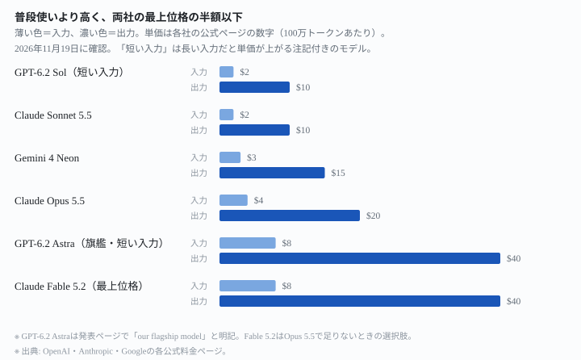

## 何が変わったか

Google は 2026年11月18日に **Gemini 4 Neon** を発表しました（出典: <https://blog.google/innovation-and-ai/models-and-research/gemini-models/introducing-gemini-4-neon/>）。モデルカードに書かれている数字だけを並べます。3行にすると、こうなります。

- Neonの位置づけは、**Carbon**（いちばん難しい長期プロジェクト向け）と**Hydrogen**（高速な日常実行向け）の中間です。公式は「深さと効率のバランスを取る」と説明しています（出典: Gemini 4 Neon モデルカード）。
- 単価は入力100万トークンあたり**$3**、出力**$15**。<mark>キャッシュ済み入力は$0.15（95%引き）で、値上がりの予告はいまのところ書かれていません</mark>（出典: 発表ページ本文）。
- Googleが自社のモデルカードに載せた比較表19項目のうち、<mark>Neonが最高値だったのは16項目</mark>です（出典: Gemini 4 Neon モデルカード）。

先に断っておきます。**この記事は運営者がこのモデルを試した記録ではありません。**公式ページとモデルカードに書かれていることを読んで整理したものです。「速かった」「賢くなった」といった使用感は一切書いていません。

前の2モデルの話は [Gemini 4 Carbon一般提供](/tools/gemini-4-carbon-ga/) と [Gemini 4 Hydrogen](/tools/gemini-4-hydrogen/) に書いています。

## 前のモデルとの違い

### CarbonとHydrogenの「中間」という位置づけ

モデルカードは、Neonの立ち位置をこう説明しています。

> While Carbon tackles your hardest, long-horizon projects and Hydrogen handles fast everyday execution, Neon balances depth and efficiency. It delivers frontier-level reasoning for complex, high-frequency workflows faster and more cost efficiently.

（出典: Gemini 4 Neon モデルカード）日本語にすると「Carbonはいちばん難しい長期プロジェクトを、Hydrogenは高速な日常実行を担当する。Neonは深さと効率のバランスを取り、複雑で頻度の高い作業に、より速く・より安く、最先端の推論を届ける」という内容です。

<mark>モデルカードは「Gemini 4 Neon is adapted from Gemini 4 Carbon」と明記しています</mark>（出典: 同上）。アーキテクチャ・学習データ・ハードウェア・ソフトウェアの節は、すべて「詳しくはCarbonのモデルカードを見よ」で終わっています。Hydrogenが独立した節を持っていたのとは対照的に、Neonは中身の大半をCarbonから引き継いだモデルです。

### 価格に期限の記載がない

発表ページ本文には、料金についてこう書かれています。

> The model is priced at $3 per million input tokens ($0.15 per million cached input tokens, a 95% discount) and $15 per million output tokens.

（出典: 発表ページ本文）これまでのGemini 4シリーズ（Argon・Carbon）は「導入価格はいつまで」という期限が料金ページに明記されていましたが、<mark class="warn">Neonの発表には、価格が将来上がるという予告が一切書かれていません</mark>。Hydrogenの発表（2026年11月12日）も同様に期限の記載がありませんでした。

<figure class="figure">

<figcaption>Neonの値段は、Carbon・Argonの「今」と「値上げ後」のあいだにあります</figcaption>
</figure>

いま（2026年11月19日）時点のNeonの単価を、Carbon・Argonと並べます。

- <mark>Carbon・Argonの導入価格（入力$2・出力$10）より、Neon（入力$3・出力$15）のほうが高い</mark>
- 2026年12月1日からのCarbon・Argonの値上げ後価格（入力$4・出力$20）より、Neonのほうが安い

出典: Gemini 4 Carbon一般提供の発表・Neon発表ページ。Carbon・Argonの価格が12月1日に2倍になれば、Neonはそのときから3モデルの中でいちばん安いモデルではなくなります。

### 読める量・書ける量・知識の締め切り

| | Gemini 4 Neon |
|---|---|
| 入力できるもの | 文章・画像・音声・動画 |
| 一度に読める量（入力＋出力の合計） | 100万トークン |
| 一度に書ける量（既定の同期呼び出し） | 6.4万トークン |
| 一度に書ける量（`long decode`機能を使った場合） | 100万トークン |
| 学習データの締め切り | 2026年3月 |

出典: すべて Gemini 4 Neon モデルカード

<mark class="warn">「一度に100万トークン」という書き方だけを見ると、普段の呼び出しでもその量を書けるように読めますが、既定（同期呼び出し）の出力上限は6.4万トークンのままです</mark>。100万トークンまで出すには`long decode`という別機能が要ります。これはArgon・Carbon・Hydrogenの発表でも繰り返し見つかった同じ型の注記です。

知識の締め切りは2026年3月で、モデルカードは「分野によっては2025年1月までの知識にとどまることがある」とも但し書きしています（出典: 同上）。

### Hydrogenとの比較での安全性の数字

モデルカードには、Hydrogenを基準にした安全性評価の差分表があります。

| 評価項目 | Hydrogenとの差（パーセンテージポイント） |
|---|---|
| Text to Text Safety（高いほど良い） | 0.00pp |
| Multilingual Safety（高いほど良い） | -0.40pp |
| Image to Text Safety（高いほど良い） | +1.90pp |
| Tone（高いほど良い） | +1.25pp |
| Unjustified-refusals（低いほど良い） | -3.00pp |

出典: Gemini 4 Neon モデルカード（「vs. Gemini 4 Hydrogen」の比較表）

5項目のうち、はっきり改善したのは2つです。「Unjustified-refusals」（過剰な拒否）が3.00ポイント減り、「Image to Text Safety」が1.90ポイント上がりました。<mark class="warn">詳しい安全性レポート（Safety & Security Report）自体は、この記事を書いた時点ではモデルカードに「近日公開（coming soon）」とだけ書かれており、まだ読めません</mark>（出典: 同上）。

Frontier Safety Framework（4月2026）に基づく危険性評価（CBRN・サイバーセキュリティ・制御喪失など）も、今回は前回のArgonの評価結果をそのまま引き継いでいます。Neon独自の再評価は、まだ行われていません（出典: 同上）。

## 他社の最上位モデルとの比較

### モデルカードの比較表19項目

Gemini 4 Neon モデルカードには、Neon・**Claude Opus 5.5**・**GPT-6.2 Sol**の3モデルを並べた比較表があります。この記事で1行ずつ数えました。

| 分類 | テスト名 | Gemini 4 Neon | Claude Opus 5.5 | GPT-6.2 Sol |
|---|---|---|---|---|
| 総合指標 | AA Index v5.0.1 | 61 | 59 | 57 |
| 総合指標 | Vals Index v2.2 | 70.9% | 70.1% | 66.1% |
| エージェント型コーディング | CursorBench 4.1 | 65.4% | 58.1% | — |
| エージェント型コーディング | Terminal-bench 4.1（不正行為調整後） | 65.2% | **65.8%** | 61.5% |
| エージェント型コーディング | FrontierCode 2.0 | 46.2% | **47.3%** | 43.8% |
| エージェント型コーディング | SWE-sweep（提供元ハーネス） | 39.0% | 10.1% | 8.3% |
| エージェント型コーディング | SWE-sweep（Mini-SWEハーネス） | 12.8% | 3.6% | 11.6% |
| 知的業務 | AutomationBench | 56.3% | 42.5% | 41.3% |
| 知的業務 | Agents' Last Exam v1.1 | 75.8% | 71.6% | 73.0% |
| 科学・数学 | RiemannBench | 84.0% | 80.0% | 80.0% |
| 科学・数学 | Terminal-Bench-Science 0.1 | 70.5% | 63.3% | 68.0% |
| 推論 | HLE-Diamond | 71.3% | 67.9% | 64.0% |
| マルチモーダル理解 | MKA（Climb WSR） | 56.5% | 53.0% | 52.7% |
| マルチモーダル理解 | Chartography | 73.5% | 66.3% | **75.1%** |
| マルチモーダル理解 | LVBench | 89.0% | 83.7% | 87.6% |
| 長い文脈 | GraphWalks（256kから1M・BFS F1） | 95.2% | 66.8% | 80.1% |
| サイバーセキュリティ | CWE-Bench v2 | 70.7% | 67.1% | 66.0% |
| サイバーセキュリティ | SEC-bench Pro | 90.5% | — | 88.3% |
| サイバーセキュリティ | WebExploitBench v1.2 | 51.3% | 37.1% | — |

出典: すべて Gemini 4 Neon モデルカード（太字はその項目の最高値）

<figure class="figure">

<figcaption>モデルカードの19項目中、Neonが16項目で最高値</figcaption>
</figure>

<mark>19項目のうち、Neonが最高値だったのは16項目です</mark>。残り3項目は他社が上でした。Claude Opus 5.5が勝ったのは2項目です（Terminal-bench 4.1の不正行為調整後の正解率・FrontierCode 2.0）。GPT-6.2 Solが勝ったのは1項目です（Chartography＝図表の読み取り、出典: 同上）。<mark>ただし、この表を作ったのはGoogleです</mark>。他社が同じ条件で同じテストを測った値ではありません。

### 🔍 比較相手は、どちらも「現在の最上位」ではない

ここが、この記事でいちばん確かめたかったことです。<mark>Googleがモデルカードの比較表に選んだClaude Opus 5.5とGPT-6.2 Solは、どちらもAnthropic・OpenAIそれぞれの現在の最上位モデルではありません</mark>。

OpenAIの公式モデル一覧ページは、GPT-6.2 Astraをこう説明しています。

> If you're not sure where to start, use GPT-6.2 Astra, our flagship model for complex reasoning and coding.

（出典: <https://developers.openai.com/api/docs/models>）「flagship（旗艦）」という言葉を公式が使っているのはGPT-6.2 Astraで、比較表にあったGPT-6.2 Solではありません。GPT-6.2 Solの説明は「Our go-to model for everyday work（日常業務の頼れる相棒）」「Choose GPT-6.2 Sol to balance intelligence and cost（知性とコストのバランスを取りたいならGPT-6.2 Sol）」です（出典: 同上）。<mark class="warn">以前の記事（Hydrogen・2026年11月14日）で最上位として扱った「GPT-6 Astra」は、2026年11月19日時点のモデル一覧ページには名前が出てきません</mark>（料金表には行が残っています）。OpenAIのモデル名は、この5日間だけでも変わりうるということです。

Anthropicの公式ページも同様です。モデル一覧の説明では、Claude Opus 5.5が「ほとんどの作業にまず使う」モデルとされる一方、Claude Fable 5.2はこう案内されています。

> Use Claude Fable 5.2 for demanding reasoning and long-horizon agentic work, or when your evals on Claude Opus 5.5 at higher effort still fall short.

（出典: <https://platform.claude.com/docs/en/about-claude/models/overview>）「Opus 5.5で足りないときに使う」モデルという位置づけで、単価もOpus 5.5より高額です。Anthropicは「flagship」という単語は使っていませんが、価格でも用途の説明でもFable 5.2のほうが上位に置かれています。

### 単価の並び

| モデル | 位置づけ（公式の説明） | 入力（100万トークン） | 出力（100万トークン） |
|---|---|---|---|
| GPT-6.2 Sol（短い入力） | 日常業務の頼れる相棒 | $2.00 | $10.00 |
| Claude Sonnet 5.5 | 速さと知性の組み合わせ | $2.00 | $10.00 |
| Gemini 4 Neon | 深さと効率のバランス | $3.00 | $15.00 |
| Claude Opus 5.5 | 長期のエージェント型コーディング・知的業務向け | $4.00 | $20.00 |
| GPT-6.2 Astra（短い入力） | 旗艦モデル | $8.00 | $40.00 |
| Claude Fable 5.2 | Opus 5.5で足りないときの選択肢 | $8.00 | $40.00 |

出典: Geminiは発表ページ、Claudeは<https://platform.claude.com/docs/en/about-claude/pricing>、OpenAIは<https://developers.openai.com/api/docs/pricing>（いずれも2026年11月19日確認）

<figure class="figure">

<figcaption>普段使いより高く、両社の最上位格の半額以下</figcaption>
</figure>

<mark>Neonの単価は、両社の「普段使い」モデル（GPT-6.2 Sol・Claude Sonnet 5.5）の1.5倍で、両社の最上位格モデル（GPT-6.2 Astra・Claude Fable 5.2）の半額以下です</mark>。モデルカードの比較表で19項目中16項目に勝った相手が、実は両社の最上位格ではなく中位〜準上位のモデルだったという点は、数字を公式ページまで遡らないと分かりませんでした。

## どういう人に効くか

**いま動かしてみるといい人**

- CarbonとHydrogenの中間の性能・価格帯を試したい人。モデルカードの比較表では19項目中16項目で、Claude Opus 5.5・GPT-6.2 Solより高い値が出ています。
- サイバー防御のコード点検・侵入テスト・脆弱性の優先順位付けをしたい人。発表ページは「サイバー防御向けに作った」と明記しており、Fairwind Programの信頼できる防御者には数日以内に提供が始まるとされています（出典: 発表ページ）。
- 値上がりの心配なく今の単価で計画したい人。発表に期限の記載がないので、少なくとも公式が次の案内を出すまでは$3/$15のままと読めます。

**急がなくていい人**

- 一度に長い文章を書かせたい人。既定では6.4万トークンまでで、Claude Opus 5.5・GPT-6.2 Solの12.8万トークンの半分です。
- 不正行為を調整したコーディングの点数や、図表の読み取りだけを重視する人。この2項目はClaude Opus 5.5・GPT-6.2 Solのほうが上でした。
- 詳しい安全性レポートを確認してから使いたい人。モデルカードの安全性レポート本体は、この記事を書いた時点でまだ「近日公開」のままです。

**この記事で分からないこと**

実際に使ったときの体感、日本語での品質、返答が返ってくるまでの待ち時間。Neon自身の安全性レポート本体の中身（コーディングでの不正行為率・プロンプトインジェクション耐性など、Carbonの発表時にあった詳しい数字）も、この記事を書いた時点では未公開です。運営者も試していないので書けません。

## 出典一覧

すべて各社の公式ページです。まとめ記事・ニュースサイト・個人ブログは1件も使っていません。

1. Gemini 4 Neon の発表（Google・2026年11月18日）: <https://blog.google/innovation-and-ai/models-and-research/gemini-models/introducing-gemini-4-neon/>
   （Google DeepMind 側の <https://deepmind.google/blog/introducing-gemini-4-neon/> を開くと、このページへ転送されます）
2. Gemini 4 Neon のモデルカード（Google 公式PDF）: <https://storage.googleapis.com/deepmind-media/Model-Cards/Gemini-4-Neon-Model-Card.pdf>
3. モデル一覧（Anthropic 公式ドキュメント）: <https://platform.claude.com/docs/en/about-claude/models/overview>
4. 料金（Anthropic 公式ドキュメント）: <https://platform.claude.com/docs/en/about-claude/pricing>
5. モデル一覧（OpenAI 公式ドキュメント）: <https://developers.openai.com/api/docs/models>
6. API の料金（OpenAI 公式ドキュメント）: <https://developers.openai.com/api/docs/pricing>
7. Gemini 4 Carbon 一般提供の発表（既刊記事で確認済みの料金）: <https://deepmind.google/blog/gemini-4-carbon-is-now-available/>

料金と仕様は変わります。実際に支払う前に、必ず上記の公式ページで現在の値を確認してください。
