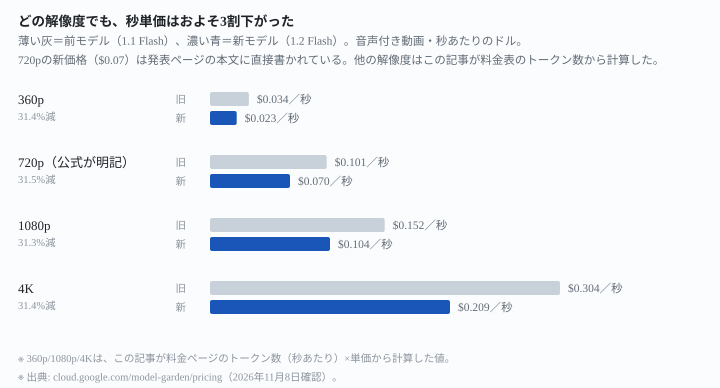
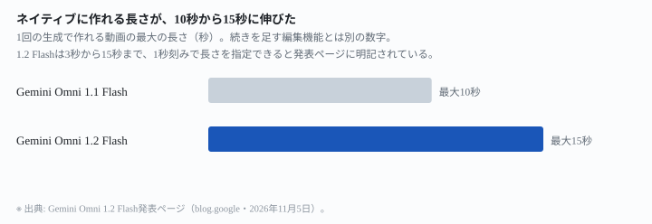
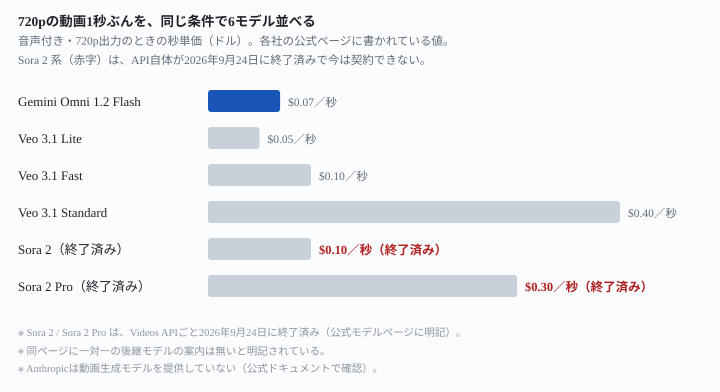

## 何が変わったか

Google は 2026年11月5日に **Gemini Omni 1.2 Flash** を発表しました（出典: <https://blog.google/innovation-and-ai/technology/developers-tools/introducing-gemini-omni-1-2-flash/>）。公式ページに書かれている数字だけを並べます。3行にすると、こうなります。

- <mark>1回の生成で作れる動画の長さが、最大10秒から最大15秒に伸びました</mark>。3秒から15秒まで、1秒刻みで長さを指定できます（出典: 同上）。
- **秒単価がおよそ3割下がりました。**720pの動画は1秒あたり $0.07 で、公式は「前モデル（Omni 1.1 Flash）より30%安い」と説明しています（出典: 同上）。
- 同じクリップを会話の続きで直せる「複数ターンでの編集」が使えるようになりました。背景や照明、アスペクト比を差し替えるのに、作り直す必要がありません（出典: 同上）。

先に断っておきます。**この記事は運営者がこのモデルを試した記録ではありません。**公式ページと料金ページに書かれていることを読んで整理したものです。「きれいに繋がった」「速かった」といった使用感は一切書いていません。

前の世代の話は [Gemini Omni 1.1 Flash](/tools/gemini-omni-1-1-flash/) に書いています。解像度ごとに値段が10倍違う、という前回の指摘は今回も変わっていません。

## 値段はどの解像度でも3割下がった

公式発表ページには「Omni 1.1 Flashより価格を30%下げ、720pの動画は1秒あたり $0.07 になった」と明記されています（出典: <https://blog.google/innovation-and-ai/technology/developers-tools/introducing-gemini-omni-1-2-flash/>）。Google Cloud 側の発表ページには、さらに踏み込んだ一文があります。<mark>「他の解像度でも同程度の値下げになる」</mark>（出典: <https://cloud.google.com/blog/products/ai-machine-learning/gemini-omni-1-2-flash-generally-available>）。

720p以外の数字は本文に出ていないため、この記事が Vertex AI の料金ページから計算しました。料金ページには、動画出力の単価（100万トークンあたり）と、解像度ごとの秒あたりトークン数の両方が載っています。

| | 動画出力（100万トークンあたり） |
|---|---|
| Gemini Omni Flash・1.1 Flash（旧） | $17.50 |
| Gemini Omni 1.2 Flash（新） | $12.00 |

出典: <https://cloud.google.com/model-garden/pricing>（2026年11月8日確認。入力は$1.50、テキスト出力は$9.00で、新旧とも変わらない）

同じページの注記に「720pの動画は1秒あたり5,792トークン」など、解像度ごとのトークン数が書かれています。これを単価に掛けると、秒単価が出ます。

| 解像度 | 旧（1.1 Flash・1秒あたり） | 新（1.2 Flash・1秒あたり） | 下がった割合 |
|---|---|---|---|
| 360p | $0.034（この記事の計算） | $0.023（この記事の計算） | 約31% |
| 720p | $0.10（旧発表時の公式表記） | **$0.07（公式が本文に明記）** | 約31% |
| 1080p | $0.15（この記事の計算） | $0.10（この記事の計算） | 約31% |
| 4K | $0.30（この記事の計算） | $0.21（この記事の計算） | 約31% |

出典: 単価は<https://cloud.google.com/model-garden/pricing>、720pの新価格は<https://blog.google/innovation-and-ai/technology/developers-tools/introducing-gemini-omni-1-2-flash/>（いずれも2026年11月8日確認）

<figure class="figure">

<figcaption>どの解像度でも、下がった割合はほぼ同じ約31%です</figcaption>
</figure>

計算すると約31%下がっていますが、公式は「30%」と説明しています（$12.00 ÷ $17.50 = 68.57%、下がった割合は31.43%）。四捨五入の差で、数字自体に矛盾はありません。

もう1つ注意が必要です。<mark class="warn">今回安くなったのは「動画の出力」だけです</mark>。入力（テキスト・画像・動画・音声の読み込み、100万トークンあたり $1.50）と、テキスト出力（100万トークンあたり $9.00）は、旧モデルから1円も変わっていません（出典: <https://cloud.google.com/model-garden/pricing>）。「30%安い」という説明は、動画を書き出す部分だけの話です。

## 前のモデルとの違い

### 1回で作れる長さが、10秒から15秒に

発表ページには「ネイティブに15秒までの動画を生成・編集できる。Omni 1.1 の10秒から伸びた」と明記されています（出典: <https://blog.google/innovation-and-ai/technology/developers-tools/introducing-gemini-omni-1-2-flash/>）。長さは3秒から15秒まで、1秒刻みで指定できます（出典: 同上）。

<figure class="figure">

<figcaption>作り直す回数を減らせるぶん、15秒まで一気に作れます</figcaption>
</figure>

⚠️ **これは1回の生成で作れる長さの話です。**前モデル（Omni 1.1 Flash）には、生成した動画の「続き」を10秒刻みで最大40秒まで足せる別の機能がありました（詳しくは[前回の記事](/tools/gemini-omni-1-1-flash/)）。今回の発表ページには、この40秒という上限を1.2 Flashでも維持しているかどうかの記載が無いため、「分からないこと」に残しておきます。

### 複数ターンでの編集ができるようになった

発表ページには「同じクリップを会話の続きで、ターンごとに直せる」とあり、例として「商品や背景の差し替え」「照明や天候の変更」「アスペクト比の変更」を挙げています（出典: 同上）。<mark>この編集は15秒ぶんのクリップ全体に対して効き、作り直す必要がありません</mark>（出典: 同上）。

一方で、音声の参照には制限があります。Google Cloud 側の発表ページには「音声参照は許可リスト制限の対象」と明記されています（出典: <https://cloud.google.com/blog/products/ai-machine-learning/gemini-omni-1-2-flash-generally-available>）。<mark class="warn">申請して許可されないと、音声を参照に使う機能は使えません</mark>。

### 公式ページどうしで、提供状況の説明が食い違っている

発表の翌日に Google Cloud が出した別の発表ページがあり、内容はほぼ重複していますが、1か所だけ違う記述があります。

| ページ | 「Gemini for business」での提供状況 |
|---|---|
| 発表ページ（blog.google・11月5日） | 「Gemini API と Gemini for business の両方で一般提供を開始した」 |
| Google Cloud の発表ページ（11月6日） | 「Gemini for business への提供は近日公開（coming soon）」 |

出典: <https://blog.google/innovation-and-ai/technology/developers-tools/introducing-gemini-omni-1-2-flash/>、<https://cloud.google.com/blog/products/ai-machine-learning/gemini-omni-1-2-flash-generally-available>

<mark class="warn">同じ会社が1日違いで出した2つのページで、Gemini for business がもう使えるのか、近日公開なのかが一致しません</mark>。どちらが正しいかは公表されていないので、この記事では両方書いておきます。なお、消費者向けの Gemini アプリでの提供は「Google AI Ultra 契約者向けに展開中」とされており、全員がすぐ使えるわけではありません（出典: 発表ページ、同上）。

## 他社の最上位モデルとの比較

720pで音声付きの動画を1秒作る値段を、同じ条件で並べます。

| モデル | 720p・1秒あたり |
|---|---|
| Gemini Omni 1.2 Flash | $0.07 |
| Veo 3.1 Lite | $0.05 |
| Veo 3.1 Fast | $0.10 |
| Veo 3.1 Standard | $0.40 |
| Sora 2（OpenAI・終了済み） | $0.10 |
| Sora 2 Pro（OpenAI・終了済み） | $0.30 |

出典: Google の3モデルは<https://cloud.google.com/model-garden/pricing>、OpenAIの2モデルは<https://developers.openai.com/api/docs/models/sora-2>（いずれも2026年11月8日確認）

<figure class="figure">

<figcaption>Sora 2の値段は、もう契約できる値段ではありません</figcaption>
</figure>

前回の記事（Omni 1.1 Flash・2026年9月4日公開）では、「OpenAIはSora 2・Sora 2 Proを含むVideos APIを2026年9月24日に終了すると告知している」と書きました。<mark>今回確認したところ、実際にそのとおり終了していました</mark>（出典: <https://developers.openai.com/api/docs/models/sora-2>）。公式モデルページには次のように明記されています。

> The Sora 2 models and Videos API were shut down on September 24, 2026 and are no longer available. There is no one-to-one replacement API.
> （日本語訳: Sora 2のモデル群とVideos APIは2026年9月24日に終了し、現在は利用できません。一対一で置き換えられる後継APIはありません。）

<mark class="warn">つまりOpenAIには、いま契約できる動画生成APIがありません。</mark>$0.07や$0.10という値段は、今は買えない旧モデルの参考値として載せています。

Anthropic はどうでしょうか。公式のモデル一覧ページには「現行モデルはすべてテキスト・画像入力、テキスト出力、多言語対応、画像理解、ツール利用に対応」と書かれており、<mark>動画の生成や編集についての記載はありません</mark>（出典: <https://platform.claude.com/docs/en/models/overview>）。無理に並べず「提供していない」と書いておきます。

結果として、<mark>いま動画生成APIを実際に契約できる大手は、この3社のうちGoogleだけです</mark>。Googleの中でも Gemini Omni（1.2 Flash）と Veo（3.1系）の2ブランドが並行して存在し、値段の幅は $0.05〜$0.40 です。

## どういう人に効くか

**いま動かしてみるといい人**

- API経由で開発者として使っていて、すでに Omni 1.1 Flash の料金体系を知っている人。<mark>動画の出力だけ、どの解像度でもおよそ3割安くなります</mark>。入力やテキスト出力の値段は変わっていません。
- 15秒のフル尺を1回の生成でまとめて作りたい人。10秒だと分割が必要だった場面が減ります。
- 商品や背景だけを差し替えて動画のバリエーションを作りたい人。複数ターンでの編集で、作り直しの手間が減ります。

**急がなくていい人・注意が必要な人**

- 音声を参照に使いたい人。許可リストに入らないと使えません。いつ誰が許可されるかは公表されていません。
- Gemini for business で使う予定の人。公式ページ同士で「もう使える」「近日公開」の説明が食い違っています。契約前に自分の環境で実際に試してください。
- 以前の40秒までの延長機能を前提にしていた人。この記事を書いた時点の発表には、1.2 Flashでも同じ上限があるのかの記載がありません。
- Sora 2との価格比較を根拠に判断材料を探していた人。その比較対象は、もう契約できません。

**この記事で分からないこと**

実際に生成した動画の質、日本語プロンプトでの精度、生成にかかる待ち時間。Google Cloud の発表ページには、次の7社の導入企業の声も載っています。

- Artlist・FLORA・invideo・Krea・Picsart・Photoroom・QuickFrame AI

ただし、どういう条件で作った動画の感想なのかは書かれていないため、この記事では比較に使っていません。運営者も試していないので書けません。延長機能（最大40秒）が1.2 Flashでも使えるのかどうかも、公表されていないので分かりません。

## 出典一覧

すべて各社の公式ページです。まとめ記事・ニュースサイト・個人ブログは1件も使っていません。

1. Gemini Omni 1.2 Flash の発表（Google・2026年11月5日）: <https://blog.google/innovation-and-ai/technology/developers-tools/introducing-gemini-omni-1-2-flash/>
   （Google DeepMind 側の <https://deepmind.google/blog/gemini-omni-12-flash-fast-and-cost-effective-with-longer-clips/> を開くと、このページへ転送されます）
2. Gemini Omni 1.2 Flash の一般提供を伝える Google Cloud の発表（2026年11月6日）: <https://cloud.google.com/blog/products/ai-machine-learning/gemini-omni-1-2-flash-generally-available>
3. Gemini Omni 1.2 Flash のモデルカード（Google DeepMind 公式）: <https://deepmind.google/models/model-cards/gemini-omni-1-2-flash/>
4. Gemini API / Vertex AI の料金（Google 公式）: <https://cloud.google.com/model-garden/pricing>
5. Sora 2 のモデルページ（OpenAI 公式）: <https://developers.openai.com/api/docs/models/sora-2>
6. モデル一覧と仕様（Anthropic 公式ドキュメント）: <https://platform.claude.com/docs/en/models/overview>

料金と仕様は変わります。実際に支払う前に、必ず上記の公式ページで現在の値を確認してください。
