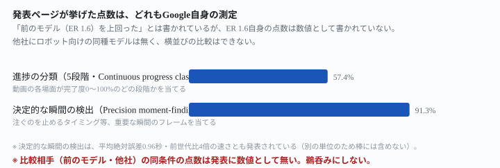
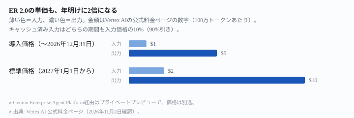
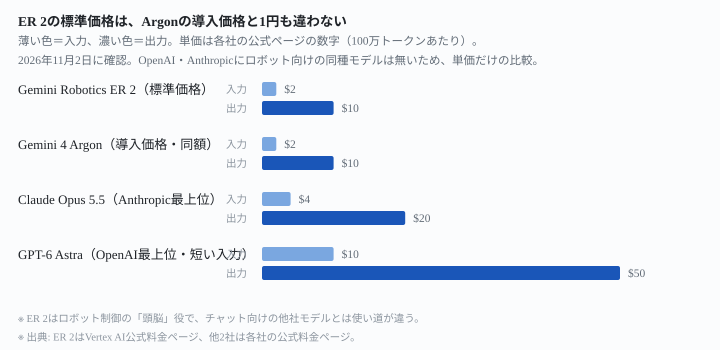

## 結論：立場ごとに、こうなります

Google は 2026年7月30日に **Gemini Robotics ER 2** を発表しました（出典: <https://blog.google/innovation-and-ai/models-and-research/google-deepmind/gemini-robotics-er-2/>）。ロボットの「高レベルの頭脳」として、人との対話・物理世界の理解・多段階タスクの計画を担う専用モデルです。実際の手足の動き（低レベルの制御）は別のモデルに渡します。立場で結果が分かれます。

| どんな立場か | 今日からできること | どうなるか |
|---|---|---|
| **物理AIエージェント（ロボット）を作っている開発者** | Gemini API・Google AI Studioでそのまま使える | **単価は2027年1月1日に2倍**になる（入力$1.00→$2.00、出力$5.00→$10.00） |
| **Gemini Enterprise Agent Platformの利用企業** | プライベートプレビューに申し込む | 一般提供の時期は発表に**書かれていない** |
| **自動化したい一般の会社員（このサイトの主な読者）** | 特にすることはない | ロボット本体を動かす仕組みの話で、<mark>チャットやオフィス作業の自動化には使えない</mark> |

一言でいうと、<mark>ロボットの「頭脳」役の専用モデルで、値段は年明けに2倍になる。チャット向けの他社モデルと比べる相手がいない</mark>。

先に断っておきます。**この記事は運営者がこのモデルを試した記録ではありません。**公式ページに書かれていることを読んで、立場ごとに整理したものです。

ここから下は、表の3行がなぜそうなるのかの説明です。

## なぜそうなるのか

### 「頭脳」と「手足」を分けた設計

発表ページは、Gemini Robotics ER 2 を「ロボットの高レベルの頭脳」と位置づけています（出典: 同上）。担う役割は3つです。

- 人と会話する
- 物理世界を理解する
- 多段階のタスクを計画する

実際の動作（モーター制御）は、任意の低レベルVLA（Vision-Language-Action）モデルに引き渡します。Google Searchなどのツールや、開発者が自分で定義した関数も呼び出せます。

前のモデル **Gemini Robotics ER 1.6** からの変更点として、公式は次の3つを挙げています（出典: 同上）。

- <mark>連続した映像フィードを見ることで、ロボットが自分の進捗を追跡し、問題があれば適応できるようになった</mark>
- 新機能として**マルチロボット協調**を追加。複数の種類のロボットが同じ空間で連携して作業できる
- **Gemini Live API**に統合され、低遅延の双方向ストリーミングに対応した

### 進捗の追跡と「決定的な瞬間」の検出

公式が挙げる数字は2つです（出典: 同上）。

- **進捗の分類（5段階）**：動画の各場面を、完了度5段階（0〜20%・20〜40%・40〜60%・60〜80%・80〜100%）に分類する課題。正解率**57.4%**
- **決定的な瞬間の検出**：コーヒーを注ぐのをいつ止めるか、といった重要な瞬間のフレームを当てる課題。正解率**91.3%**・平均絶対誤差**0.96秒**

公式はこの検出について、「はるかに大きなモデルのカテゴリに近い性能を、計算コストを抑えて実現した」と説明しています。速さも**前世代比4倍**と書かれています（出典: 同上）。

<figure class="figure">

<figcaption>前のモデル（ER 1.6）自身の点数は、数値としては書かれていません</figcaption>
</figure>

<mark class="warn">「前のモデルや競合モデルを上回った」とは書かれていますが、ER 1.6自身の点数は数値として書かれていません</mark>（出典: 同上）。比較のグラフ自体は発表ページに載っています。ただしこの記事では、文章にはっきり書かれた数字だけを使いました。グラフの目盛りから読み取った値は使っていません。

### 値段は2027年1月1日に2倍になる

Gemini Robotics ER 2自身の価格は、発表ページやモデルカードには書かれていません。**Vertex AI の公式料金ページ**に「Gemini ER 2.0」として載っています（出典: <https://cloud.google.com/vertex-ai/generative-ai/pricing>）。

| 期間 | 入力 | キャッシュ済み入力 | 出力 |
|---|---|---|---|
| 〜2026年12月31日（導入価格） | $1.00 | $0.10 | $5.00 |
| 2027年1月1日から（標準価格） | $2.00 | $0.20 | $10.00 |

出典: 同上（100万トークンあたりのドル）

<figure class="figure">

<figcaption>入力・出力・キャッシュのすべてが、年明けにきっちり2倍です</figcaption>
</figure>

<mark>キャッシュ済み入力は、どちらの期間も入力価格の10%（90%引き）で揃っています</mark>。これは $0.10÷$1.00 と $0.20÷$2.00 から、この記事が計算した比率です。**Gemini 4 Argon**・**Gemini 4 Carbon**でも、同じ型が使われています。「導入期間は半額、年明けに2倍」という型です。今回のER 2も、その型に乗っています。

## 他社の最上位モデルと比べると

### ロボット向けの同種モデルは、他社には無い

OpenAIの公式モデル一覧（出典: <https://developers.openai.com/api/docs/models>）を見ました。Anthropicの公式モデル一覧（出典: <https://platform.claude.com/docs/en/about-claude/models/overview>）も見ました。どちらにも「robot」や「robotics」を含むモデル名は1つもありません。<mark class="warn">ロボット制御の「頭脳」役という同じ土俵の製品が他社に無いため、性能やベンチマークの横並び比較はできません</mark>。できるのは、単価という数字だけの比較です。

| | Gemini Robotics ER 2（標準価格） | Claude Opus 5.5 | GPT-6 Astra（短い入力） |
|---|---|---|---|
| 入力（100万トークン） | $2.00 | $4.00 | $10.00 |
| 出力（100万トークン） | $10.00 | $20.00 | $50.00 |
| 一度に読める量 | 12.8万トークン | 100万トークン | 92.2万トークン |
| 一度に書ける量 | 6.4万トークン | 12.8万トークン | 12.8万トークン |

出典: ER 2は<https://cloud.google.com/vertex-ai/generative-ai/pricing>と<https://deepmind.google/models/model-cards/gemini-robotics-er-2>、Claudeは<https://platform.claude.com/docs/en/about-claude/pricing>と<https://platform.claude.com/docs/en/about-claude/models/overview>、GPTは<https://developers.openai.com/api/docs/pricing>と<https://developers.openai.com/api/docs/models/gpt-6-astra>（入力92.2万・出力12.8万トークンの内訳はこのモデル専用ページに記載）

<figure class="figure">

<figcaption>単価だけなら、ER 2のほうが安く見えます</figcaption>
</figure>

<mark>ER 2の標準価格（2027年以降・入力$2.00/出力$10.00）は、Gemini 4 Argonの導入価格と1円も違いません</mark>。両方ともGoogleの公式料金ページで確認しました。ただし<mark class="warn">使い道がまったく違う製品の単価を並べているだけで、「どちらが安いか」の答えにはなりません</mark>。ER 2は会話や文章作成のために作られたモデルではなく、ロボットに次の一手を指示するために作られたモデルです。

一度に読める量（コンテキストウィンドウ）も、ER 2だけ一回り小さいことが分かります。モデルカードには「Gemini Robotics ER 2 は Gemini 3.5 Flash をもとにしている」と明記されています（出典: <https://deepmind.google/models/model-cards/gemini-robotics-er-2>）。関係がありそうですが、公式がその理由を説明しているわけではないので、ここでは数字だけを書きます。

## どういう人に効くか

**関係がある人**

- 物理的なロボット（アーム・移動体・ヒューマノイド等）を自分で動かすソフトを作っている開発者。Gemini API・AI Studioから今日使えます。
- 複数のロボットを連携させたい企業。マルチロボット協調が新機能として入りました。
- Boston Dynamics の Spot のような既存ロボットのAPIを、音声などの自然言語で操作したい開発者。発表ページにデモのコードがGitHubで公開されています。

**関係が薄い人（このサイトの読者の大半）**

- チャットでの文章作成・要約・コーディングの自動化をしたい人。ER 2はそのための製品ではありません。
- 物理的なロボットを持っていない人。価格や性能を見比べても、使い道がありません。

## この記事で分からないこと

- 進捗分類（57.4%）・瞬間検出（91.3%）について、前のモデル（ER 1.6）自身が何点だったか。発表には数値として書かれていません。
- Gemini Enterprise Agent Platform経由の一般提供がいつ始まるか、その場合の価格。発表には書かれていません。
- Gemini Robotics ER 1.6自身のVertex AI料金。現在の料金ページには「Gemini ER 2.0」の行しかなく、確認できませんでした。

## 出典一覧

すべて各社の公式ページです。まとめ記事・ニュースサイト・個人ブログは1件も使っていません。

1. Gemini Robotics ER 2 の発表（Google・2026年7月30日）: <https://blog.google/innovation-and-ai/models-and-research/google-deepmind/gemini-robotics-er-2/>
   （Google DeepMind 側の <https://deepmind.google/blog/gemini-robotics-er-2-powering-robotics-with-video-understanding-task-orchestration-and-multi-robot-collaboration/> を開くと、このページへ転送されます）
2. Gemini Robotics ER 2 のモデルカード（Google DeepMind 公式）: <https://deepmind.google/models/model-cards/gemini-robotics-er-2>
3. Vertex AI の料金（Google Cloud 公式）: <https://cloud.google.com/vertex-ai/generative-ai/pricing>
4. 料金（Anthropic 公式ドキュメント）: <https://platform.claude.com/docs/en/about-claude/pricing>
5. モデル一覧と仕様（Anthropic 公式ドキュメント）: <https://platform.claude.com/docs/en/about-claude/models/overview>
6. API の料金（OpenAI 公式ドキュメント）: <https://developers.openai.com/api/docs/pricing>
7. モデル一覧（OpenAI 公式ドキュメント）: <https://developers.openai.com/api/docs/models>
8. GPT-6 Astra のモデルページ（OpenAI 公式ドキュメント）: <https://developers.openai.com/api/docs/models/gpt-6-astra>

料金と仕様は変わります。実際に支払う前に、必ず上記の公式ページで現在の値を確認してください。
